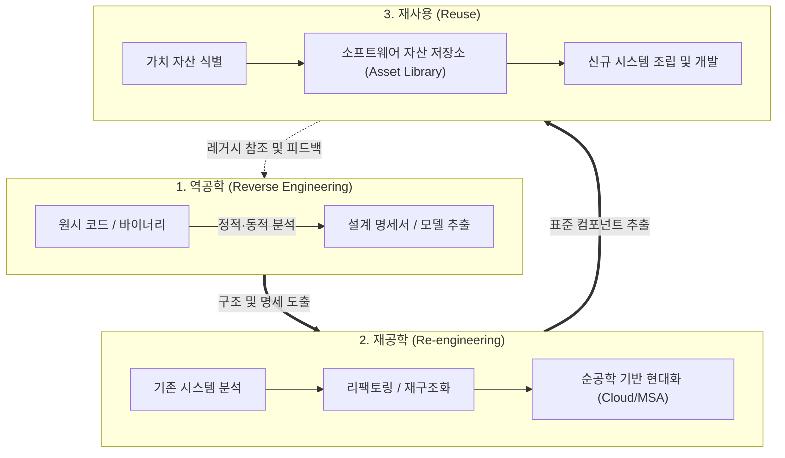

# 3R (Reverse Engineering, Re-engineering, Reuse)

---

## I. 레거시 현대화 및 소프트웨어 자산 가치 극대화, 3R의 개요

기존 소프트웨어 자산의 수명을 연장하고 유지보수성을 극대화하기 위해 시스템을 분석(역공학), 구조를 개선(재공학), 핵심 모듈을 재활용(재사용)하는 소프트웨어 유지보수 및 현대화 프레임워크이다.

| 구분 | 주요 내용 |
| --- | --- |
| **개념** | 역공학(Reverse Engineering), 재공학(Re-engineering), 재사용(Reuse)의 유기적 결합을 통해 레거시 소프트웨어를 효율적으로 개선·재활용하는 기술 체계 |
| **등장 배경** | 소프트웨어 노후화(Software Aging), 스파게티 코드 누적으로 인한 유지보수 비용(수명주기 전체의 70~80%) 급증 및 클라우드 네이티브 전환 요구 |
| **핵심 특징** | 설계 사양 복원, 무결성 보존 기반 아키텍처 재구조화, 표준 컴포넌트 자산화 및 개발 생산성 대폭 향상 |

---

## II. 3R의 프레임워크 및 핵심 기술 요소

### 가. 3R의 개념도 및 유기적 연계 메커니즘

레거시 구현체에서 역공학을 통해 설계 사양과 비즈니스 로직을 복원하고, 재공학을 통해 아키텍처를 개선하며, 추출된 표준 모듈을 자산 저장소에 축적하여 신규 시스템에 재사용하는 선순환 구조를 형성한다.

### 나. 3R의 핵심 구성 요소 및 세부 기술

| 분류 | 핵심 기술 (키워드) | 세부 설명 |
| --- | --- | --- |
| **역공학** | 정적 분석 (Static Analysis) | 소스 코드 실행 없이 파싱, AST(추상 구문 트리), 제어 흐름 그래프(CFG) 생성 및 구조 복원 |
| **역공학** | 동적 분석 (Dynamic Analysis) | 런타임 프로파일링, 메모리 덤프, API 트레이싱을 통해 시스템의 실행 행위와 동적 의존성 추출 |
| **역공학** | 모델 추출 (Model Extraction) | 데이터베이스 스키마 역공학(DDL 분석) 및 비즈니스 규칙 도출을 통한 ERD와 UML 다이어그램 복원 |
| **재공학** | 코드 리팩토링 (Refactoring) | 외부 동작의 변경 없이 코드 스멜을 제거하고 결합도를 낮추어 코드 품질 및 가독성 개선 |
| **재공학** | 아키텍처 재구조화 | 모놀리식 아키텍처를 [[DDD (Domain Driven Design)|DDD]] 기반 Bounded Context로 분할하여 MSA 환경으로 전환 |
| **재공학** | 데이터 재공학 (Data Migration) | 비정규화 데이터 정제, RDB에서 분산 NoSQL로의 데이터 이관 및 스키마 변환 수행 |
| **재사용** | 생성 중심 (Generation-based) | 도메인 모델 기반 코드 자동 생성, 패턴 및 템플릿(DSL, 로우코드/노코드)을 활용한 소프트웨어 구축 |
| **재사용** | 합성 중심 (Composition-based) | CBD(컴포넌트 기반 개발), 오픈소스 라이브러리 및 마이크로서비스 API 연계를 통한 모듈 조립 개발 |

---

## III. 전통적 3R vs AI 기반 현대적 3R 비교 및 발전 동향

### 가. 전통적 3R vs AI 기반 현대적 3R 비교

| 비교 항목 | 전통적 3R (Conventional) | AI 기반 현대적 3R (AI-Driven) |
| --- | --- | --- |
| **역공학 방식** | 정적 룰 파서 및 분석가의 수작업 분석 의존 | [[초거대 언어 모델|LLM]] 기반 레거시(COBOL 등) 다국어 코드 문맥 자동 해석 |
| **재공학 수준** | 단순 문법 변환 및 수작업 코드 리팩토링 | AI 코딩 에이전트를 통한 타깃 언어(Java, Go, Rust) 자동 변환 |
| **재사용 모델** | 정적 컴포넌트 라이브러리 및 프레임워크 종속 | 엔터프라이즈 코드 RAG 기반 문맥 적응형 코드 자동 합성 |
| **전환 타깃** | 클라이언트-서버, [[객체지향]](OOP) 환경 | [[클라우드 네이티브]](컨테이너, 서버리스), [[MSA (Micro Service Architecture)|MSA]] 분산 환경 |

### 나. 최신 기술 동향 및 발전 방향

* **[[SBOM]] 및 오픈소스 공급망 보안 결합**: 오픈소스 및 재사용 컴포넌트의 확산에 따라 SBOM 자동 생성과 라이선스·취약점 검증 파이프라인 결합이 표준화됨.
* **AI 환각(Hallucination) 검증을 위한 테스트 자동화**: 생성형 AI 기반 레거시 코드 변환 시 로직 왜곡을 방지하기 위해 [[리그레션 테스트|회귀 테스트]] 및 Back-to-Back 동등성 검증 자동화가 필수적으로 도입됨.

---

### 🔗 연관 토픽

- **소속 도메인**: [[00_소프트웨어공학_MOC|🏗️ 소프트웨어공학]]
- **세부 분류**: `4. 아키텍처 스타일 & 객체지향 설계 원리`
- **핵심 연관 토픽**:
  - [[MSA (Micro Service Architecture)]]
  - [[재사용]]
  - [[디자인 패턴]]
  - [[DDD (Domain Driven Design)]]
  - [[객체지향]]
