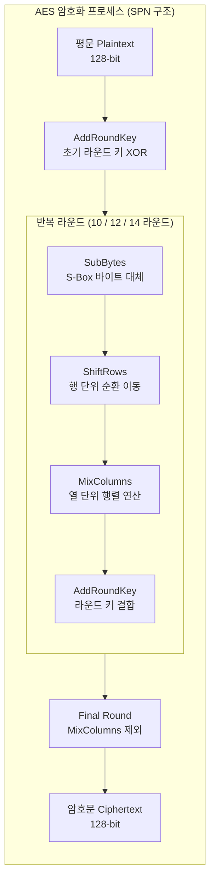

# AES (Advanced Encryption Standard)

---

## I. 현대 대칭키 블록 암호 표준, AES의 개요

### 가. AES의 정의
- 기존 DES의 보안 취약점을 해결하기 위해 미국 NIST가 선정한 Rijndael(라인달) 알고리즘 기반의 128비트 블록 대칭키 암호화 표준

### 나. AES의 등장배경 및 주요 특징
| 구분 | 내용 |
| --- | --- |
| 제정 배경 | 컴퓨팅 파워 향상으로 56비트 DES 키가 브루트 포스(전수조사)에 무력화됨에 따른 차세대 암호 표준 필요 |
| 암호 구조 | Feistel 구조를 탈피하고 치환-대체 망인 SPN(Substitution-Permutation Network) 구조 채택 |
| 블록 및 키 규격 | 128비트 고정 블록 크기, 보안 강도에 따라 128 / 192 / 256비트 가변 키 길이 지원 (10 / 12 / 14 라운드) |
| 구현 효율성 | S-Box 비선형 대체 및 행렬 곱 기반으로 소프트웨어 및 하드웨어(AES-NI 명령어) 고속 연산 최적화 |

---

## II. AES의 개념도 및 핵심 기술 요소

### 가. AES의 암호화 라운드 구조 및 동작 원리

* 평문을 4x4 바이트 행렬로 변환한 후, 대체(Substitution)와 치환(Permutation) 연산을 반복 수행하는 SPN 구조를 기반으로 매 라운드마다 확장된 키(Round Key)를 결합하여 혼란과 확산 극대화

### 나. AES의 핵심 구성 요소

| 구분 | 요소기술(키워드) | 세부 설명 |
| --- | --- | --- |
| 비선형 변환 | **SubBytes (바이트 대체)** | S-Box를 이용하여 각 바이트를 비선형적으로 치환하여 암호의 **혼란(Confusion)** 제공 |
| 위치 변환 | **ShiftRows (행 이동)** | 행렬의 각 행을 정해진 규칙에 따라 왼쪽으로 순환 시프트하여 **확산(Diffusion)** 제공 |
| 데이터 혼합 | **MixColumns (열 혼합)** | 열 단위로 갈루아 체(GF(2^8)) 상의 행렬 곱셈을 수행하여 바이트 간 종속성 강화 |
| 키 결합 | **AddRoundKey (라운드 키)** | 데이터 행렬과 해당 라운드 키 간의 비트단위 XOR 연산 수행 |
| 키 생성 | **Key Expansion (키 확장)** | 1개의 마스터 키로부터 일정 알고리즘(Rijndael Key Schedule)을 통해 각 라운드 키 생성 |
| 블록 크기 | **128-bit Fixed Block** | 입력 데이터를 항상 128비트(16바이트) 단위의 블록으로 분할하여 처리 |
| 키 길이 | **128 / 192 / 256-bit** | 보안 강도와 성능 요구사항에 따라 선택 가능한 가변 키 길이 지원 |
| 하드웨어 가속 | **AES-NI** | [[CPU]] 명령어 세트 수준에서 AES 연산을 하드웨어로 가속 처리하여 성능 극대화 |

---

## III. AES와 DES 비교 및 최신 동향

### 가. AES와 전세대 표준 DES 비교

| 비교 항목 | AES (Advanced Encryption Standard) | DES (Data Encryption Standard) |
| --- | --- | --- |
| **블록 크기** | 128 비트 | 64 비트 |
| **키 길이** | 128, 192, 256 비트 (가변) | 56 비트 (+ 8비트 패리티) |
| **암호 구조** | SPN (Substitution-Permutation Network) | Feistel 구조 |
| **보안성** | 현재 전 세계 표준으로 브루트 포스에 안전함 | 키가 짧아 전수조사 공격에 취약하여 폐기됨 |
| **라운드 수** | 키 길에 따라 10, 12, 14 라운드 | 16 라운드 |
| **구현 성능** | 하드웨어 및 소프트웨어 모두에서 고속 처리 가능 | 상대적으로 연산 속도가 느림 |

### 나. AES의 최신 동향 및 실무 활용 전략
- **하드웨어 가속 명령어(AES-NI) 보편화**: Intel, AMD, ARM(ARMv8 Crypto) 등 모던 CPU에 내장된 전용 명령어를 통해 대용량 네트워크 트래픽 및 디스크 암호화 시 오버헤드 최소화
- **양자 컴퓨터 시대(PQC)의 대칭키 안전성**: 양자 Grover 알고리즘 적용 시 키 길이가 절반으로 축소되나, AES-256은 여전히 128비트 유효 보안 강도를 유지하므로 포스트 퀀텀 시대에도 대칭키 표준으로 지속 활용
- **인증 암호화 모드(AEAD) 전환**: 단순 기밀성 제공 모드(CBC)의 패딩 오라클 취약점을 방지하기 위해 기밀성과 무결성을 동시 검증하는 AES-GCM(Galois/Counter Mode)이 TLS 1.3 표준으로 정착

---

### 🔗 연관 토픽

- **소속 도메인**: [[00_보안_MOC|🛡️ 보안]]
- **세부 분류**: `2. 현대 암호학 & 키 관리 · 전자서명`
- **핵심 연관 토픽**:
  - [[암호화|암호화 (Encryption)]]
  - [[DES]]
  - [[암호 알고리즘]]
  - [[RSA (Rivest Shamir Adleman)]]
  - [[FIPS (Federal Information Processing Standards)]]
