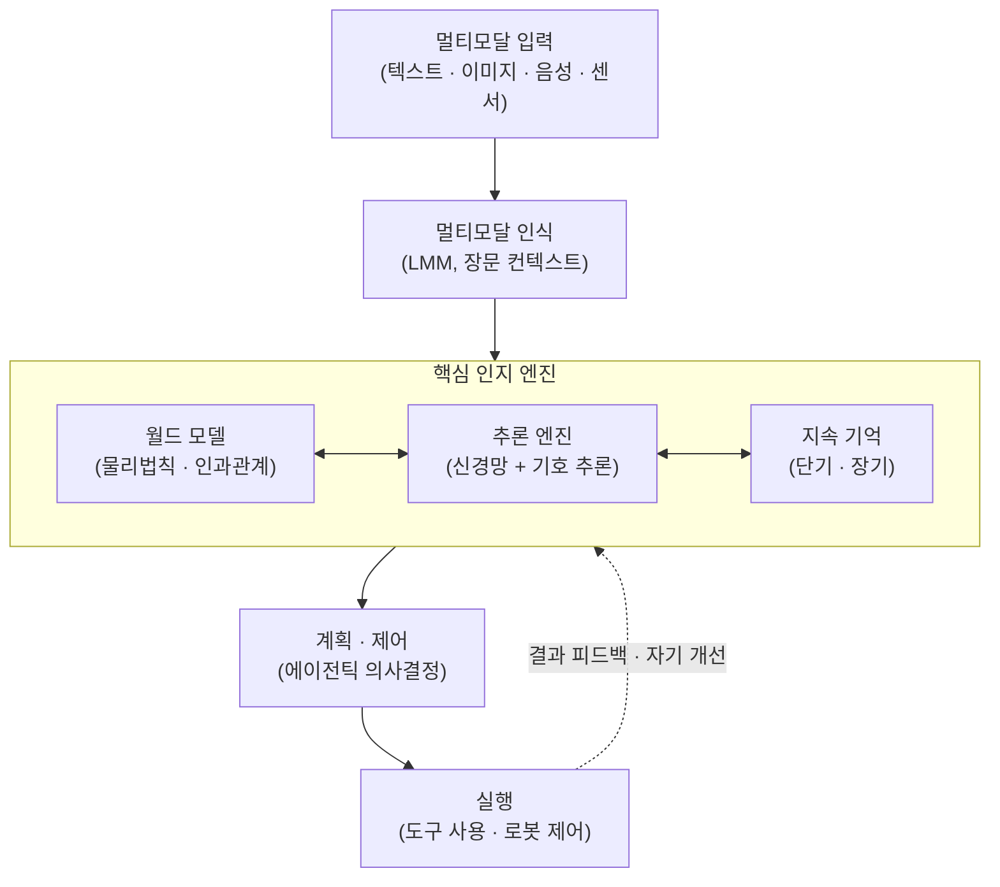

# AGI (Artificial General Intelligence, 범용 인공지능)

---

## I. 인간 수준의 범용 문제 해결 지능, AGI의 개요

### 가. AGI의 정의

- 특정 도메인에 국한된 좁은 [[인공지능]](ANI)을 넘어, **인간이 할 수 있는 모든 지적 작업을 스스로 학습·추론·해결**할 수 있는 범용 인공지능

### 나. 등장 배경 및 특징

| 구분 | 내용 |
| --- | --- |
| 등장 배경 | ANI의 유연성 한계, [[초거대 언어 모델\|LLM]]·멀티모달의 발전과 스케일링 법칙에 따른 능력 창발(Emergence), 환각 극복 요구 |
| 범용성 | 학습하지 않은 영역의 과제도 수행 (제로샷 일반화) |
| 자율성 | 목표를 하위 작업으로 분해·계획하고 도구를 사용해 실행 ([[에이전틱 AI]]) |
| 자가 학습 | 망각 없이 지속적으로 지식을 축적하고 스스로 개선 |
| 통합 추론 | 직관적 패턴 인식(System 1)과 논리적 추론(System 2)의 결합 |

---

## II. AGI 아키텍처 및 핵심 기술

### 가. AGI 인지 아키텍처

- 멀티모달 데이터를 인식하고, 월드 모델과 기억을 바탕으로 인과 추론한 뒤, 에이전트 방식으로 도구·물리 행동을 실행하며 피드백으로 지속 학습

### 나. 핵심 기술 요소

| 구분 | 기술 | 설명 |
| --- | --- | --- |
| 기반 모델 | 멀티모달 파운데이션 (LMM) | 텍스트·이미지·음성을 단일 모델에서 통합 이해·생성 ([[파운데이션 모델]]) |
| 이해 | 월드 모델 | 물리 세계의 법칙과 인과관계를 내부적으로 시뮬레이션 |
| 추론 | 신경-기호 AI (Neuro-Symbolic) | 통계적 패턴 인식과 [[심볼릭 추론\|기호 추론]]을 결합해 논리 오류·환각 감소 |
| | 추론 시간 확장 | 응답 전 내부적으로 사고 과정을 거치는 추론 모델 ([[테스트 타임 스케일링]]) |
| 기억 | 장문 컨텍스트 / 장기 메모리 | 수백만 토큰 수준의 정보를 유지해 고도의 문맥 이해 |
| 학습 | 지속 학습, RLAIF | 파국적 망각 없이 지식 누적, AI 피드백 기반 [[강화학습]] |
| 자율 | 에이전틱 워크플로 | 목표 분해·계획·도구 호출로 다단계 작업 자율 수행 |
| 하드웨어 | AI 가속기, [[뉴로모픽 칩]] | [[NPU]]·[[HBM]] 기반 대규모 연산, 저전력 뇌 모사 칩 |
| 안전 | AI 정렬 (Alignment), 가드레일 | 목표·행동을 인간 가치에 맞게 통제 |

---

## III. 발전 단계 비교 및 전망

### 가. ANI vs AGI vs ASI

| 비교 항목 | ANI (좁은 인공지능) | AGI (범용 인공지능) | ASI (초인공지능) |
| --- | --- | --- | --- |
| 범위 | 특정 도메인의 단일 작업 | 인간 수준의 범용 인지·문제 해결 | 인류 지성을 넘어서는 지능 |
| 추론 | 확률적 패턴 매칭 중심 | 인과·논리 추론, 제로샷 일반화 | 자기 진화 |
| 자율성 | 프롬프트 기반 수동 응답 | 목표 기반 자율 계획·실행 | - |
| 한계·과제 | 환각, 미지 상황에 취약 | 막대한 연산·전력, 안전·통제 | 통제 가능성 자체가 쟁점 |
| 사례 | 알파고, 챗봇, L3 자율주행 | 개발 진행 중 | 기술적 특이점 이후 |

### 나. 전망 및 대응

- **System 2 추론 모델 부상**: 사고 과정을 거치는 추론 모델이 등장하며 AGI 논의가 가속
- **에이전틱 DX**: 챗봇 도입을 넘어 전사 시스템과 연동된 에이전트 기반 업무 자동화로 전환 ([[디지털 전환|Digital Transformation]])
- **해결 과제**: 연산·전력 한계 극복(뉴로모픽·양자), AI 정렬과 [[AI 거버넌스]] 체계의 선제적 확립

---

### 🔗 연관 토픽

- **소속 도메인**: [[00_인공지능_MOC|🤖 인공지능]]
- **세부 분류**: `4. 거대언어모델 (LLM) & 생성형 AI`
- **핵심 연관 토픽**:
  - [[인공지능]]
  - [[에이전틱 AI|에이전틱 AI(Agentic AI)]]
  - [[초거대 언어 모델|초거대 언어 모델(Large Language Model)]]
  - [[심볼릭 추론]]
  - [[전용 인공지능]]
