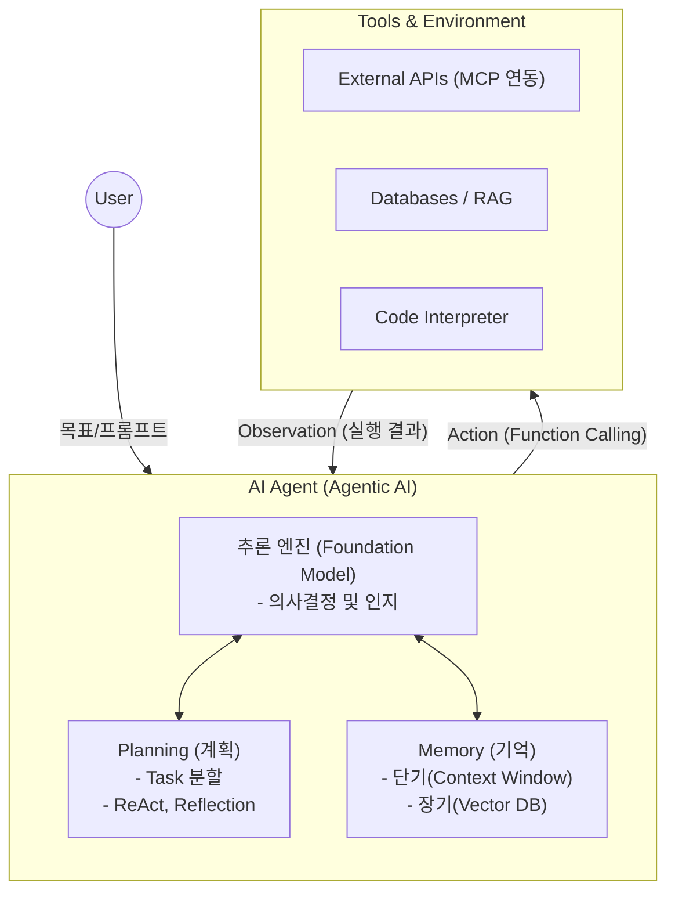

# AI Agent

---

## I. 자율적 목표 달성, AI Agent의 개요

### 가. 정의

- 거대언어모델([[초거대 언어 모델|LLM]])을 인지·추론 두뇌로 삼아, 주어진 목표를 달성하기 위해 스스로 계획을 수립하고 메모리와 외부 도구를 능동적으로 활용하여 자율 행동하는 지능형 시스템

### 나. 주요 특징

| 구분 | 주요 내용 |
| --- | --- |
| 자율 계획 (Planning) | ReAct(추론+행동), Reflection(자기성찰) 메커니즘을 통해 복잡한 작업을 세부 하위 단계로 자율 분해 및 실행 |
| 동적 도구 활용 (Tools) | Function Calling 및 [[MCP|MCP(Model Context Protocol)]] 표준 규약을 통해 API, 데이터베이스, 웹 도구 능동 호출 |
| 맥락 유지 (Memory) | 대화 컨텍스트 윈도우(단기 기억)와 벡터 DB 기반 지식 임베딩(장기 기억)을 결합하여 일관된 맥락 유지 |
| 다중 협업 (Multi-Agent) | 리서치, 코딩, 검증 등 전문화된 복수 에이전트 간의 역할 분담과 상호 통신을 통한 집단 지성 달성 |

---

## II. AI Agent의 아키텍처 및 핵심 기술 요소

### 가. AI Agent의 아키텍처 및 동작 원리

* 사용자 목표 달성을 위해 ReAct(Reasoning + Acting) 패턴 기반 추론, 행동, 관찰의 피드백 루프를 반복 수행함
* Memory로 작업 맥락을 유지하고, 함수 호출 및 MCP([[MCP|Model Context Protocol]])를 통해 외부 시스템(Tools)과 능동적 상호작용 구현

### 나. AI Agent의 핵심 기술 요소

| 구분 | 핵심 기술 요소 | 세부 설명 |
| --- | --- | --- |
| **인지/브레인** | Foundation Model | 상황을 인지하고 의사결정과 행동을 지시하는 에이전트의 두뇌(LLM/LMM) |
| **계획 (Planning)** | ReAct 기법 | 생각(Thought), 행동(Action), 관찰(Observation)을 교차 반복하여 목표 달성 |
| **계획 (Planning)** | Reflection (자기성찰) | 스스로 실행 결과를 평가하고 오류를 인지하여 교정하는 자가 복원 기법 |
| **기억 (Memory)** | Short/Long-term Memory | 작업 맥락(단기 기억) 및 과거 경험/지식 벡터 임베딩(장기 기억) 축적 |
| **도구 (Tool Use)** | Function Calling | 외부 도구/API 호출을 위해 LLM이 인자를 포함한 구조화된 데이터([[JSON]]) 출력 |
| **도구 (Tool Use)** | MCP | 에이전트와 다양한 데이터 소스, 도구를 느슨하게 결합하는 개방형 표준 규약 |
| **생태계** | Multi-Agent 협업 | 태스크별 전문 에이전트(리서처, 코더, 리뷰어 등) 간 역할 분담 및 조율(Orchestration) |
| **보안/통제** | HITL (Human-in-the-loop) | 고위험 의사결정 시 승인 게이트를 두어 자율성과 통제권의 균형을 유지하는 보안 체계 |

---

## III. AI Agent와 기존 챗봇 및 RPA 비교

### 가. AI Agent와 챗봇, 정적 워크플로우(RPA)의 비교

| 비교 항목 | 기존 챗봇 (Chatbot) | 정적 워크플로우 (RPA) | AI 에이전트 (AI Agent) |
| --- | --- | --- | --- |
| **의사결정 주체** | 사용자 입력에 수동적 반응 | 개발자가 정의한 고정 규칙/경로 | LLM 기반 상황 맞춤형 자율/동적 판단 |
| **목표 수행 범위** | 단순 질의응답, 제한적 검색 | 단일/반복적 UI 및 API 조작 | 복잡한 다단계 문제의 스스로 분할 및 해결 |
| **발전 방향** | RAG 기반 답변 고도화 | AI 융합(Hyper Automation) | 다중 에이전트 생태계 구축 및 보안 거버넌스 내재화 |

### 나. AI Agent의 최신 트렌드 및 향후 전망

- **다중 에이전트(Multi-Agent) 협업 프레임워크 표준화**: LangGraph, AutoGen, CrewAI 등을 활용하여 복수의 특화 에이전트가 상태 그래프(State Graph)를 기반으로 역할을 조율하는 엔터프라이즈 오케스트레이션 정착
- **개방형 연결 표준 MCP(Model Context Protocol) 도입**: 도구와 데이터 소스 간의 파편화된 인터페이스를 단일화하기 위해 앤트로픽 주도의 MCP 표준 규약을 채택하여 확장성 및 상호운용성 극대화
- **자율성과 통제의 균형을 위한 HITL 거버넌스 내재화**: 에이전트의 오작동 및 보안 침해(권한 남용)를 방지하기 위해 금융 이체, 코드 배포 등 고위험 작업에 인간 승인(Human-in-the-loop) 게이트웨이와 샌드박스 격리 의무화

---

### 🔗 연관 토픽

- **소속 도메인**: [[00_인공지능_MOC|🤖 인공지능]]
- **세부 분류**: `4. 거대언어모델 (LLM) & 생성형 AI`
- **핵심 연관 토픽**:
  - [[AX (AI Transformation)]]
  - [[인공지능]]
  - [[MCP|MCP (Model Context Protocol)]]
  - [[버티컬 AI|버티컬 AI(Vertical AI)]]
  - [[AGI|AGI (Artificial General Intelligence)]]
