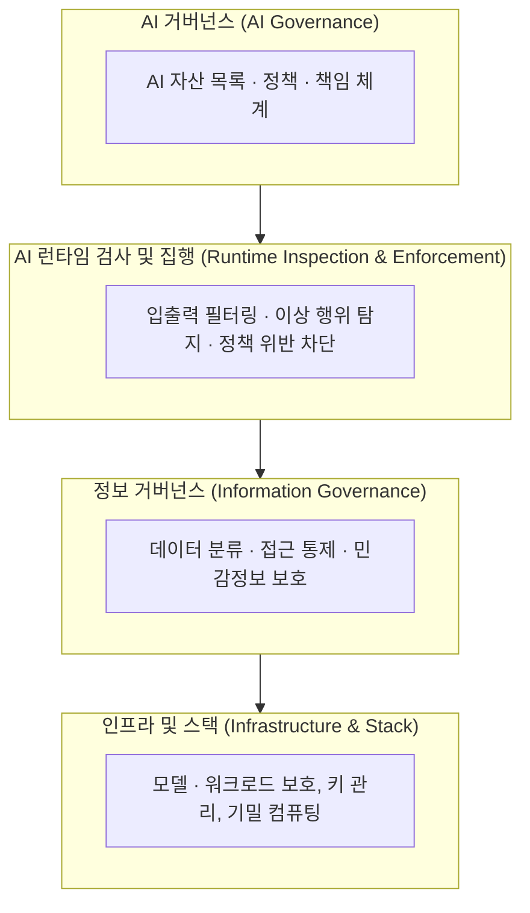

# AI TRiSM (AI Trust, Risk and Security Management)

---

## I. 신뢰할 수 있는 AI 운영 체계, AI TRiSM의 개요

### 가. 정의

- AI 모델 및 애플리케이션의 신뢰성(Trust), 위험(Risk), 보안(Security)을 전 생애주기에 걸쳐 지속적으로 관리하고 거버넌스와 기술적 통제를 통합 제공하기 위해 가트너가 제시한 종합 프레임워크

### 나. 주요 특징

| 구분 | 주요 내용 |
| --- | --- |
| 4대 핵심 축 | 설명 가능성(Explainability), 모델옵스(ModelOps), AI 앱 보안(Application Security), 프라이버시(Privacy) |
| 런타임 능동 통제 | 입출력 필터링, 프롬프트 인젝션 방어, 이상 행위 탐지 등 런타임 가드레일을 통한 상시 위험 차단 |
| 거버넌스-기술 융합 | 최상위 AI 윤리 정책 및 위험 등급 수립부터 데이터 분류, 암호화, 모델 모니터링 기술까지 계층적 연동 |
| 글로벌 규제 부합 | EU AI Act, 국내 [[AI 기본법]], ISO/IEC 42001([[인공지능 경영시스템]]) 적합성 평가의 핵심 이행 수단 |

---

## II. AI TRiSM의 구성 요소

### 가. AI TRiSM 개념도

### 나. 핵심 기능 요소 (전통적 4대 축)

| 요소 | 내용 | 관련 기술 |
| --- | --- | --- |
| 설명 가능성 / 모델 모니터링 | 모델의 판단 근거를 설명하고 성능·편향·드리프트를 지속 감시 | [[XAI]], [[LIME]], [[모델 드리프트 컨셉 드리프트 & 데이터 드리프트\|드리프트 탐지]] |
| ModelOps | 모델의 배포·버전·재학습 등 생애주기 관리 자동화 | [[MLOps]], [[LLMOps]] |
| AI 애플리케이션 보안 | 적대적 공격·프롬프트 공격·모델 탈취 방어 | [[적대적 공격]] 방어, [[AI 레드팀(Red team) 테스트\|AI 레드팀]] |
| 프라이버시 | 학습·추론 데이터의 개인정보 보호 | [[차분 프라이버시]], [[연합 학습]], [[동형 암호]] |

---

## III. 전통적 IT 보안과 AI TRiSM 비교 및 실무 시사점

### 가. 전통적 IT 보안 vs AI TRiSM 비교

| 비교 항목 | 전통적 IT 보안 (Traditional Security) | AI TRiSM (AI 신뢰·위험·보안 관리) |
| --- | --- | --- |
| **보안 대상** | 서버, 네트워크, DB, 웹 애플리케이션 | 데이터셋, 파운데이션 모델, 프롬프트, AI 에이전트 |
| **핵심 위협** | 악성코드, 네트워크 침투, 권한 탈취 | [[할루시네이션]], [[프롬프트 인젝션]], 모델 탈취, 데이터 오염 |
| **주요 통제 방식** | [[방화벽]], 접근 제어(IAM), 시그니처 백신 | 가드레일(Guardrails), XAI 설명성, RLAIF, 이상 드리프트 감시 |
| **품질/신뢰 척도** | 기밀성, 무결성, 가용성 (CIA Triad) | 공정성, 설명 가능성, 강건성, 프라이버시, 안전성 |
| **운영 체계** | SIEM / SOAR 기반 보안관제 | [[MLOps]] / [[LLMOps]] 기반 ModelOps 연계 지속적 거버넌스 |

### 나. 실무 시사점 및 추진 전략

- **전사 다학제 협업 거버넌스 필수**: AI TRiSM은 단일 보안 솔루션이 아니므로 개발, 데이터, 보안, 법무, 비즈니스 조직이 결합된 전사 위원회 체계로 운영 필수
- **ISO/IEC 42001 및 규제 인증 연계**: 국제 표준인 [[인공지능 경영시스템]](ISO 42001) 및 [[AI 신뢰성 인증]](CAT) 획득을 위한 실질적 위험 관리 도구로 AI TRiSM 프레임워크 적극 활용
- **지속적인 레드티밍 피드백 환류**: 모델 배포 전후에 걸쳐 전담 [[AI 레드팀(Red team) 테스트|AI 레드팀]]을 가동하고, 도출된 탈옥 및 취약점 패턴을 런타임 가드레일에 실시간 자동 반영하는 폐루프 구축

---

### 🔗 연관 토픽

- **소속 도메인**: [[00_인공지능_MOC|🤖 인공지능]]
- **세부 분류**: `4. 거대언어모델 (LLM) & 생성형 AI`
- **핵심 연관 토픽**:
  - [[AI 윤리]]
  - [[AI Ready Data]]
  - [[AX (AI Transformation)]]
  - [[AI 레드팀(Red team) 테스트]]
  - [[AI 거버넌스|AI 거버넌스 (AI Governance)]]
