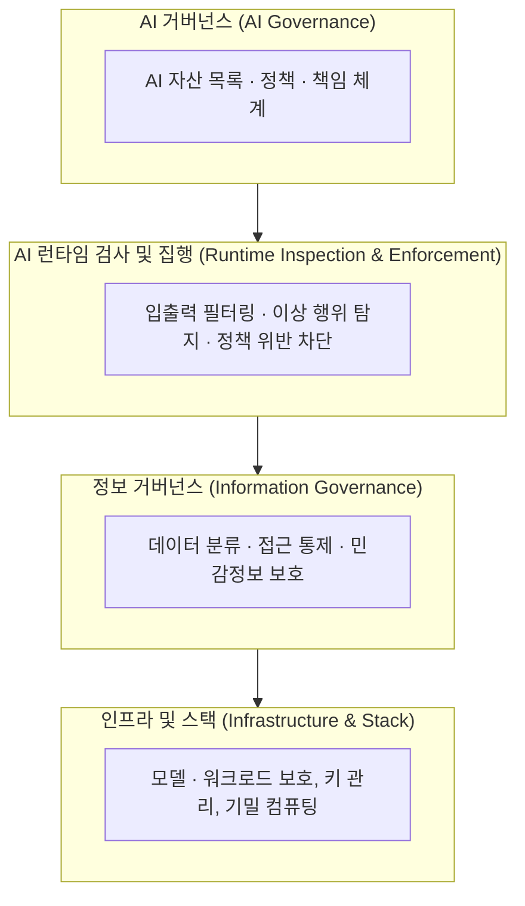

# AI TRiSM (AI Trust, Risk and Security Management)

---

## I. 신뢰할 수 있는 AI 운영 체계, AI TRiSM의 개요

### 가. AI TRiSM의 정의

- AI 모델과 애플리케이션의 **신뢰성(Trust), 위험(Risk), 보안(Security)** 을 생애주기 전반에서 관리하기 위해 Gartner가 제시한 거버넌스·기술 프레임워크
- 모델의 공정성·설명 가능성·견고성·프라이버시를 확보하고 규제 준수를 지원

### 나. 등장 배경

| 구분 | 내용 |
| --- | --- |
| 생성형 AI 확산 | [[할루시네이션]], [[프롬프트 인젝션]], 데이터 유출 등 새로운 위협 등장 |
| 규제 강화 | EU AI Act, [[AI 기본법]] 등 고영향 AI에 대한 투명성·위험관리 의무화 |
| 에이전트 AI | 자율적으로 행동하는 [[AI Agent]]의 권한·행위 통제 필요 |

---

## II. AI TRiSM의 구성 요소

### 가. AI TRiSM 개념도

### 나. 핵심 기능 요소 (전통적 4대 축)

| 요소 | 내용 | 관련 기술 |
| --- | --- | --- |
| 설명 가능성 / 모델 모니터링 | 모델의 판단 근거를 설명하고 성능·편향·드리프트를 지속 감시 | [[XAI]], [[LIME]], [[모델 드리프트 컨셉 드리프트 & 데이터 드리프트\|드리프트 탐지]] |
| ModelOps | 모델의 배포·버전·재학습 등 생애주기 관리 자동화 | [[MLOps]], [[LLMOps]] |
| AI 애플리케이션 보안 | 적대적 공격·프롬프트 공격·모델 탈취 방어 | [[적대적 공격]] 방어, [[AI 레드팀(Red team) 테스트\|AI 레드팀]] |
| 프라이버시 | 학습·추론 데이터의 개인정보 보호 | [[차분 프라이버시]], [[연합 학습]], [[동형 암호]] |

---

## III. AI TRiSM 도입 방안 및 시사점

### 가. 단계별 도입 방안

| 단계 | 주요 활동 |
| --- | --- |
| 1. 가시성 확보 | 조직 내 AI 모델·서비스·Shadow AI 목록화 |
| 2. 정책 수립 | 위험 등급 분류, 허용 용도, 책임자 지정 ([[AI 거버넌스]]) |
| 3. 기술 통제 | 런타임 가드레일, 데이터 보호, 모델 모니터링 적용 |
| 4. 지속 개선 | 레드팀 테스트·감사 결과를 정책과 모델에 환류 |

### 나. 시사점

- AI TRiSM은 단일 솔루션이 아니라 **거버넌스 + 기술 통제**를 결합한 운영 체계이므로 보안·법무·데이터 조직의 협업이 필수
- [[AI 신뢰성 인증]], ISO/IEC 42001([[인공지능 경영시스템]]) 등과 연계하면 규제 대응 근거를 체계적으로 확보 가능

---

### 🔗 연관 토픽

- **소속 도메인**: [[00_인공지능_MOC|🤖 인공지능]]
- **세부 분류**: `4. 거대언어모델 (LLM) & 생성형 AI`
- **핵심 연관 토픽**:
  - [[AI 윤리]]
  - [[AI Ready Data]]
  - [[AX (AI Transformation)]]
  - [[AI 레드팀(Red team) 테스트]]
  - [[AI 거버넌스|AI 거버넌스 (AI Governance)]]
