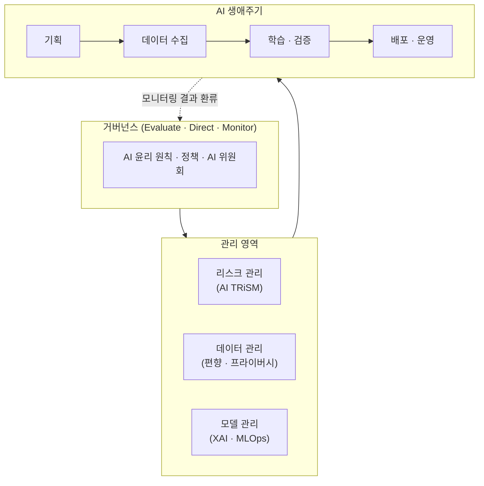

# AI 거버넌스 (AI Governance)

---

## I. 신뢰할 수 있는 AI를 위한 통제 체계, AI 거버넌스의 개요

### 가. AI 거버넌스의 정의

- AI의 **개발·배포·운영 전 과정**에서 편향·차별·보안 등 위험을 식별·통제하고, 조직 목표에 맞게 AI를 **평가(Evaluate)·지시(Direct)·모니터링(Monitor)** 하는 정책·프로세스·조직 체계
- 블랙박스 특성과 사회적 파급력 때문에 일반 IT 거버넌스와 별도로 윤리·법·기술 통제를 포함하는 [[프레임워크]]가 필요

### 나. 부각 배경

| 구분 | 내용 |
| --- | --- |
| 리스크 증대 | [[할루시네이션]], 알고리즘 [[편향]], [[딥페이크]] 등 AI 역기능 확산 |
| 규제 강화 | EU AI Act, [[AI 기본법]] 시행, ISO/IEC 42001 인증 수요 증가 |
| 책임 소재 | 자율주행 사고·AI 오판 시 책임 주체 정의 필요 |

---

## II. AI 거버넌스 프레임워크 및 구성요소

### 가. AI 거버넌스 개념도

- 최상위 전략·원칙이 관리 조직(리스크·데이터·모델)을 통해 AI 생애주기를 통제하는 Top-down 구조이며, [[EDM]] 흐름으로 순환

### 나. 핵심 원칙 (FATE)

| 원칙 | 내용 | 위반 시 위험 |
| --- | --- | --- |
| 공정성 (Fairness) | 성별·인종·연령 등에 따른 차별 없이 동작 | 편향 데이터로 채용·신용평가 차별 |
| 책무성 (Accountability) | AI 결과에 대한 책임 주체 명확화 | 사고 시 책임 소재 불분명 |
| 투명성 (Transparency) | 판단 과정과 근거를 설명 가능하게 공개 ([[XAI]]) | 피해자 이의 제기·구제 불가 |
| 윤리성 (Ethics) | 프라이버시·저작권 등 사회적 가치 준수 | 무단 크롤링, 딥페이크 악용, 감시 |

### 다. 핵심 구성요소

| 구분 | 구성요소 | 내용 |
| --- | --- | --- |
| 원칙 / 전략 | [[AI 윤리]] 원칙 | 인간 존엄성, 공정성, 투명성 등 조직의 가치 기준 |
| | ISO/IEC 42001 | AI 경영시스템([[인공지능 경영시스템\|AIMS]]) 국제 표준, [[PDCA(Plan-Do-Check-Act, Deming Cycle)\|PDCA]] 기반 지속 개선 |
| 리스크 관리 | [[AI TRiSM]] | AI의 신뢰·위험·보안 관리 프레임워크 |
| | XAI | 모델 판단 근거 설명으로 불투명성 해소 |
| 운영 / 기술 | [[MLOps]] / ModelOps | 모델 배포·모니터링·재학습 자동화 |
| | [[데이터 거버넌스]] | 학습 데이터 편향 제거, 개인정보 [[비식별화]] |

---

## III. 글로벌 프레임워크 및 구축 방안

### 가. 주요 글로벌 프레임워크 비교

| 구분 | NIST AI RMF (미국) | EU AI Act (유럽) |
| --- | --- | --- |
| 성격 | 자율 가이드라인 | 법적 구속력 있는 규제 |
| 핵심 구조 | Govern → Map → Measure → Manage 4대 기능 | 위험 기반 4단계 차등 규제 |
| 내용 | 거버넌스 체계 구축, 위험 식별·측정·대응 | 금지(소셜 스코어링 등), 고위험(채용·의료, 적합성 평가), 제한적 위험(챗봇·딥페이크, 고지 의무), 최소 위험 |

### 나. 구축 방안

- **전담 조직**: C-Level 주도 AI 위원회 또는 RAI(Responsible AI) 팀으로 책임 체계 확립
- **설계 내재화**: 기획 단계부터 가명처리·익명화 등 [[개인정보보호 중심 설계\|Privacy by Design]] 적용, AI 생성물에는 워터마크·UI 고지
- **지속 감사**: 추천 알고리즘의 편향 노출 여부를 사내 AI 감사(Audit)로 점검하고, 추천 근거를 사용자에게 제공
- **검증 도구**: [[AI 신뢰성 인증]](CAT), 드리프트 감지 등 자동화 도구로 실효성 확보

---

### 🔗 연관 토픽

- **소속 도메인**: [[00_인공지능_MOC|🤖 인공지능]]
- **세부 분류**: `2. 머신러닝 기초 & 핵심 알고리즘`
- **핵심 연관 토픽**:
  - [[AI 기본법]]
  - [[편향]]
  - [[MLOps]]
  - [[인공지능 감리|인공지능 감리 (AI Audit)]]
  - [[인공지능]]
