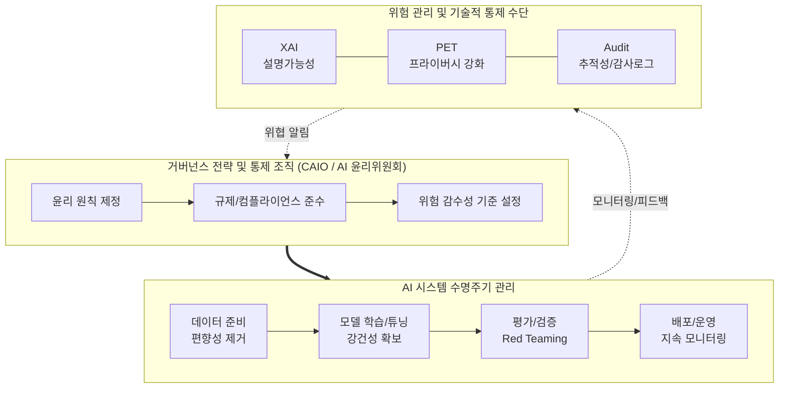

# AI 기본법 (인공지능 발전과 신뢰 기반 조성 등에 관한 기본법)

---

## I. 인공지능 산업 육성과 안전성 확보의 균형, AI 기본법의 개요

### 가. 정의

- 인공지능 기술의 건전한 발전과 산업 진흥을 촉진하는 동시에, 고영향 AI 등 잠재적 위험으로부터 국민의 기본권과 안전을 보호하기 위해 제정된 국가 차원의 인공지능 기본 법률

### 나. 주요 특징

| 구분 | 주요 내용 |
| --- | --- |
| 산업 진흥과 규제의 조화 | 원칙적 허용·사후 규제(우선허용·사후규제) 원칙을 통해 혁신을 장려하고 고위험 영역에 선별적 안전장치 마련 |
| 고영향 AI(High-Impact AI) | 보건·의료, 원자력, 에너지, 범죄수사, 채용 등 국민 생명·안전에 중대한 영향을 미치는 시스템을 별도 지정·관리 |
| 투명성 및 사전 고지 의무 | 생성형 AI 기반 결과물(텍스트, 이미지, 영상 등)에 대해 사용자가 식별할 수 있도록 워터마크 등 표시 의무화 |
| 추진 거버넌스 확립 | 국가인공지능위원회 설치, AI 안전연구소(AISI) 설립 등 범국가적 AI 정책 총괄 및 안전 검증 체계 구축 |

---

## II. AI 거버넌스 프레임워크 개념도 및 핵심 구성 요소

### 가. AI 거버넌스 프레임워크 개념도

* 전사적 윤리 정책 및 규제를 바탕으로 AI 수명주기 전반에 기술적 통제([[XAI]], PET 등)를 결합하여 위험을 지속 식별, 평가, 완화하는 폐쇄루프(Closed-Loop) 관리 구조임.

### 나. AI 거버넌스의 핵심 구성 요소

| 구분 | 요소기술(키워드) | 세부 설명 |
| --- | --- | --- |
| **조직/거버넌스** | CAIO (최고 AI 책임자) | 전사 [[AI 거버넌스]] 전략 수립, 도입 및 컴플라이언스 이행 총괄 임원 |
| **조직/거버넌스** | AI 윤리위원회 | AI 모델의 윤리적 쟁점 심의, 전사 가이드라인 제정 및 감독 의결 기구 |
| **프로세스** | 위험 기반 접근 (Risk-based) | 시스템 위해도(수용불가/고위험/제한적/최소)에 따른 차등적 통제 체계 |
| **프로세스** | 레드티밍 (Red Teaming) | 의도적 공격 프롬프트 등을 통해 AI 시스템의 취약점, 편향성 사전 검증 |
| **지원 기술** | XAI (설명가능한 AI) | AI 모델의 의사결정 과정을 시각화하여 사용자가 해석 가능하도록 제공 (SHAP 등) |
| **지원 기술** | PET (프라이버시 강화 기술) | 학습/추론 과정에서 개인정보 유출을 차단하는 기술 (동형암호, 차분프라이버시 등) |
| **표준/규제** | ISO/IEC 42001 | 조직이 AI 시스템을 책임감 있게 개발 및 사용할 수 있도록 돕는 글로벌 AI 경영시스템 표준 |
| **표준/규제** | EU AI Act (유럽 AI 법) | 고위험 AI에 대한 엄격한 의무 부과 및 위반 시 전 세계 매출의 최대 7% 과징금 부과 |

---

## III. EU AI Act와 AI 기본법 비교 및 향후 전망

### 가. EU AI Act vs 대한민국 AI 기본법 비교

| 비교 항목 | EU AI Act (유럽연합 인공지능법) | 대한민국 AI 기본법 (인공지능 발전과 신뢰기반 기본법) |
| --- | --- | --- |
| **입법 철학** | 기본권 보호 및 엄격한 위험 사전 규제 중심 | **혁신 선허용·사후규제** 원칙 기반 산업 진흥 및 안전 균형 |
| **규제 대상** | 4단계 위험 분류 (금지, 고위험, 투명성, 최소위험) | **고영향 인공지능(High-Impact AI)** 및 생성형 AI 표시 의무 |
| **위반 시 제재** | 글로벌 매출액의 최대 7% 또는 3,500만 유로 과징금 | 시정명령, 과태료 등 단계적 행정 제재 중심 |
| **전담 기구** | EU AI Office(AI 사무국), 유럽 AI 위원회 | **국가인공지능위원회**, AI 안전연구소(AISI) |
| **영향 및 효력** | EU 역내 서비스 제공 글로벌 기업 전면 적용 | 국내 사업자 및 국내 이용자 대상 AI 서비스 적용 |

### 나. AI 기본법의 최근 동향 및 향후 전망

- **Compliance by Design 체계 정착**: 인공지능 서비스 기획 및 개발 초기 단계부터 고영향 AI 위험 평가와 생성물 투명성 고지 기능을 내재화하는 프로세스 필수화
- **AI 안전연구소(AISI) 기반 기술 검증 강화**: 국가 차원의 AI 안전성 연구소를 통해 파운데이션 모델의 탈옥, 유해성, 오작동을 사전에 테스트하는 공인 레드티밍 체계 구축
- **국제 표준(ISO/IEC 42001) 및 글로벌 상호운용성 확보**: 국내 기업의 글로벌 수출 경쟁력 유지를 위해 국내 신뢰성 기준을 글로벌 AI 거버넌스 규격과 상호 인정하는 체계로 발전

---

### 🔗 연관 토픽

- **소속 도메인**: [[00_인공지능_MOC|🤖 인공지능]]
- **세부 분류**: `6. 설명가능한 AI (XAI) & AI 윤리 · 거버넌스`
- **핵심 연관 토픽**:
  - [[AI 거버넌스|AI 거버넌스 (AI Governance)]]
  - [[Sovereign AI (소버린 AI)]]
  - [[AI 신뢰성 인증]]
  - [[XAI]]
  - [[범용 인공지능 위험관리 프레임워크]]
