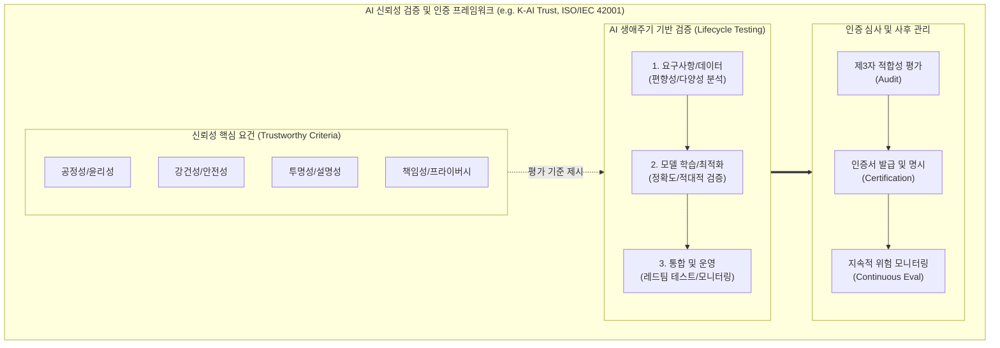

# AI 신뢰성 인증 (Trustworthy AI Certification)

---

## I. 안전하고 책임 있는 AI 생태계 조성을 위한, AI 신뢰성 인증의 개요

### 가. 정의

- AI 시스템이 기획, 개발, 운영 전 생애주기에서 투명성, 안전성, 공정성, 개인정보 보호 등의 품질 기준을 충족하여 잠재적 위험을 통제하고 있음을 공인된 제3자 인증기관이 객관적으로 검증하여 보증하는 제도

### 나. 주요 특징

| 구분 | 주요 내용 |
| --- | --- |
| 다차원 검증 요건 | 데이터 [[무결성]], [[알고리즘]] 강건성, 설명 가능성([[XAI]]), 차분 프라이버시 등 다각도 기술 지표 점검 |
| 위험 기반 평가 | 대상 AI 시스템의 사회적 파급력 및 위해도(고위험, 제한적 위험 등)에 따른 차등화된 평가 기준 적용 |
| 생애주기 전반 통제 | 데이터 수집부터 모델 학습, 배포, 런타임 모니터링까지 AI 라이프사이클 전 과정에 대한 거버넌스 확립 |
| 글로벌 규제 연계 | EU AI Act의 적합성 평가(CE 마크), 국내 [[AI 기본법]], ISO/IEC 42001 표준에 부합하는 객관적 증적 확보 |

---

## II. AI 신뢰성 인증 검증 체계 개념도 및 핵심 평가 요소

### 가. AI 신뢰성 인증 생애주기 검증 개념도

* AI [[신뢰성]] 핵심 요건을 바탕으로 데이터 구축부터 운영까지 단계별로 검증을 수행하며, 제3자 기관(TTA 등)의 적합성 평가를 통해 최종 인증을 부여함.

### 나. AI 신뢰성 인증의 핵심 기술 및 구성 요소

| 구분 | 요소기술(키워드) | 세부 설명 |
| --- | --- | --- |
| **핵심 요건** | 공정성 (Fairness) | 학습 데이터의 편향을 식별·제거하여 특정 성별, 인종 등에 대한 차별적 의사결정 방지 |
| **핵심 요건** | 강건성 (Robustness) | [[적대적 공격]](Adversarial Attack)이나 예상치 못한 노이즈 입력 환경에서도 정상적인 출력 유지 |
| **핵심 요건** | 투명성 (Transparency) | 의사결정 과정에 대한 추적성(Traceability) 확보 및 설명 가능한 AI([[XAI]]) 기술 적용 여부 점검 |
| **핵심 요건** | 프라이버시 보호 | [[비식별화]], 가명화, [[차분 프라이버시]](Differential Privacy) 등 개인정보 침해 방지 대책 검증 |
| **평가 기법** | 적대적 레드티밍 | 보안 전문가와 평가 AI([[초거대 언어 모델\|LLM]]-as-a-Judge)를 활용해 시스템의 윤리적 제약 우회(Jailbreak) 시도 및 방어력 측정 |
| **평가 기법** | 데이터 품질 검증 | 훈련/검증 데이터셋의 통계적 분포, 라벨링 오류율, 다양성 지표 산출을 통한 데이터 무결성 검사 |
| **인증 체계** | 제품/서비스 인증 | TTA(한국정보통신기술협회)의 K-AI Trust 등 개별 AI 솔루션 및 서비스의 품질과 신뢰성을 보증하는 민간/공공 인증 |
| **인증 체계** | 경영 시스템 인증 | ISO/IEC 42001 기반으로 조직 차원의 AI 리스크 관리, 윤리 위원회 운영 등 거버넌스 체계 전반 인증 |

---

## III. 제품 인증과 경영시스템 인증 비교 및 향후 전망

### 가. 제품·서비스 인증 vs 경영시스템 인증 비교

| 비교 항목 | AI 제품·서비스 인증 (e.g. K-AI Trust) | AI 경영시스템 인증 (ISO/IEC 42001) |
| --- | --- | --- |
| **인증 대상** | 개별 AI 모델, 솔루션, 알고리즘 자체 | 조직 전반의 **AI 거버넌스 및 리스크 관리 체계** |
| **평가 초점** | 모델 정확도, 강건성, 바이어스, XAI 설명성 | AI 윤리 정책, R&R, 내부 감사, 리스크 완화 프로세스 |
| **검증 방식** | 정량적 데이터셋 검증, 적대적 공격 테스트 | 문서 심사, 인터뷰, 조직 운영 프로세스 적합성 감사 |
| **유효 기간** | 모델 버전 변경 시 재검증 필요 (버전 종속적) | 3년 주기 (정기 사후관리 심사 매년 수행) |
| **주요 목적** | 특정 AI 제품의 안전성·신뢰성 보증 및 마케팅 | 전사 차원의 AI 컴플라이언스 및 지속 개선 역량 증명 |

### 나. AI 신뢰성 인증의 글로벌 동향 및 향후 전망

- **글로벌 고위험 AI 인증 의무화 확산**: EU AI Act의 전면 시행에 따라 의료, 교통, 금융, 채용 등 고위험군(High-Risk) AI 솔루션에 대한 제3자 적합성 평가 및 CE 마크 인증 획득이 글로벌 시장 진입의 필수 요건으로 정착
- **생성형 AI 특화 검증 체계 고도화**: 대규모 언어 모델(LLM)의 보급에 발맞추어 정답이 없는 생성형 콘텐츠의 환각(Hallucination), 저작권 침해, 딥페이크 워터마크 부착 여부를 측정하는 특화 인증 기준 신설 가속화
- **MLOps 연계 지속적 동적 인증(Continuous Certification)**: 모델의 잦은 재학습과 파인튜닝 환경에 대응하여, 일회성 정적 인증을 넘어 모델 드리프트(Drift)와 성능 저하를 실시간 모니터링하고 갱신하는 동적 인증 체계로 진화

---

### 🔗 연관 토픽

- **소속 도메인**: [[00_인공지능_MOC|🤖 인공지능]]
- **세부 분류**: `6. 설명가능한 AI (XAI) & AI 윤리 · 거버넌스`
- **핵심 연관 토픽**:
  - [[XAI]]
  - [[AI 기본법]]
  - [[인공지능]]
  - [[MLOps]]
  - [[AI 거버넌스|AI 거버넌스 (AI Governance)]]
