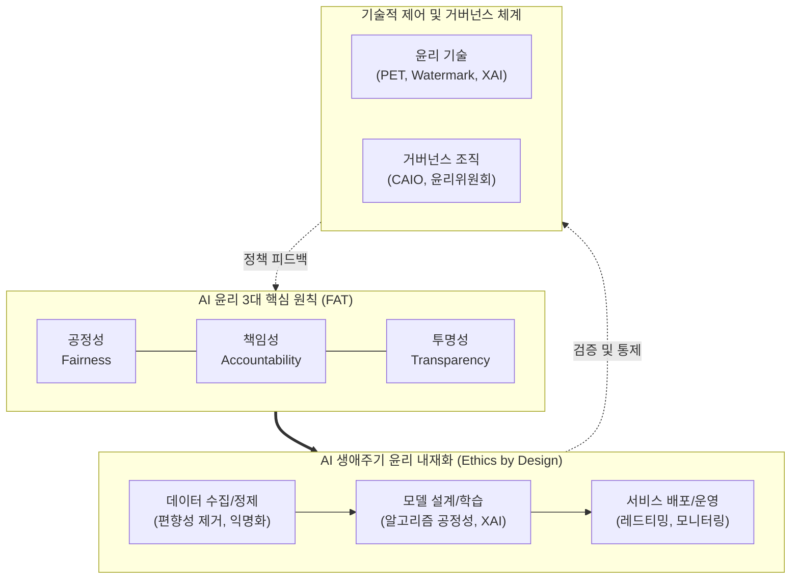

# AI 윤리 (AI Ethics)

---

## I. 인류의 보편적 가치 수호를 위한, AI 윤리의 개요

### 가. 정의

- 인공지능 기술의 기획, 개발, 배포, 운영 전 과정에서 발생할 수 있는 편향, 차별, 프라이버시 침해, 위해성 등의 도덕적·사회적 문제를 예방하고 인류의 안전과 기본권을 보장하기 위한 가치 규범 및 기술적 통제 체계

### 나. 주요 특징

| 구분 | 주요 내용 |
| --- | --- |
| FATE 4대 가치 | 공정성(Fairness), 책무성(Accountability), 투명성(Transparency), 윤리성(Ethics)의 다차원 가치 준수 |
| Ethics by Design | 사후 대처가 아닌 기획 및 데이터 수집, 모델 설계 초기 단계부터 윤리적 안전장치를 내재화하는 설계 원칙 |
| 기술과 규범의 융합 | 선언적 강령에 그치지 않고 설명 가능한 AI([[XAI]]), 차분 프라이버시, 안전 가드레일 등 구체적 공학 기술로 구현 |
| 경성 규범(Hard Law)화 | 아실로마 등 연성 규범(Soft Law)에서 EU AI Act, 국내 [[AI 기본법]] 등 위반 시 법적 제재를 가하는 강제 규제로 진화 |

---

## II. AI 윤리의 프레임워크 개념도 및 핵심 기술 요소

### 가. AI 윤리 프레임워크 및 실천 개념도

* AI 윤리는 공정성, 책임성, 투명성(FAT)의 핵심 가치를 기반으로 하여 데이터 구축부터 서비스 운영까지 전 생애주기에 걸쳐 기술적 수단과 거버넌스를 통해 내재화(Ethics by Design)됨.

### 나. AI 윤리의 핵심 구성 요소 및 기술

| 구분 | 요소기술(키워드) | 세부 설명 |
| --- | --- | --- |
| **핵심 가치** | 공정성 (Fairness) | 데이터 및 알고리즘의 [[편향]](Bias)을 제거하여 특정 인종, 성별, 연령에 대한 차별적 결과 방지 |
| **핵심 가치** | 투명성 (Transparency) | AI의 의사결정 과정을 사용자가 이해하고 검증할 수 있도록 블랙박스 구조 해석 가능성 제공 |
| **핵심 가치** | 책임성 (Accountability) | AI 시스템 오작동 또는 피해 발생 시 법적, 윤리적 귀책 사유 및 추적성(Traceability) 명확화 |
| **구현 기술** | XAI (설명가능한 AI) | [[LIME]], SHAP 등의 기술을 활용하여 [[딥러닝]] 모델의 결과 도출 근거를 인간이 이해할 수 있게 시각화 |
| **구현 기술** | PET (프라이버시 보호) | 동형암호, [[차분 프라이버시]](Differential Privacy), 연합학습을 통해 원본 데이터 노출 없이 AI 학습 |
| **검증 기술** | AI 레드티밍 (Red Teaming) | 의도적인 [[적대적 공격]]([[프롬프트 인젝션]], 탈옥 등)을 통해 모델의 유해성 및 윤리적 제약 우회 사전 점검 |
| **검증 기술** | 워터마킹 (Watermarking) | 생성형 AI가 만든 이미지, 텍스트 등에 식별 가능한 표식을 삽입하여 딥페이크 악용 및 저작권 침해 방지 |
| **거버넌스** | AI 윤리 위원회 및 CAIO | 기업 내 전사적 AI 윤리 가이드라인 제정 및 심의를 총괄하는 최고 AI 책임자 및 전담 기구 |

---

## III. 연성 규범과 경성 규범 비교 및 향후 전망

### 가. 연성 규범(Soft Law) vs 경성 규범(Hard Law) 비교

| 비교 항목 | 연성 규범 (Soft Law / 윤리 권고안) | 경성 규범 (Hard Law / 법적 규제) |
| --- | --- | --- |
| **대표 사례** | OECD AI 원칙, 아실로마 원칙, 과기정통부 AI 윤리기준 | EU AI Act, 대한민국 [[AI 기본법]], 미국 행정명령 |
| **법적 구속력** | 법적 제재 없음 (조직의 자율 준수 및 도덕적 책임) | 위반 시 천문학적 과징금 부과, 시정명령, 서비스 중단 |
| **이행 방식** | 자발적 가이드라인 제정 및 AI 윤리위원회 내부 심의 | 적합성 평가, 필수 사전 인증, 제3자 [[인공지능 감리\|AI 감리]] 의무화 |
| **규제 성격** | 추상적 원칙 제시 (방향성 중심) | 기술적 요구사항 및 명문화된 의무 사항 규정 (구체적 통제) |
| **기업 영향** | 기업 이미지 및 ESG 평가 반영 | 사업 승인 및 글로벌 시장 진출(수출)의 직접적 조건 |

### 나. AI 윤리의 최근 동향 및 향후 전망

- **선언적 준칙에서 강제적 법제화로 전면 전환**: 과거 자율 준수 위주의 가이드라인에서 벗어나 위반 시 거액의 과징금을 부과하는 EU AI Act 및 국내 [[AI 기본법]] 등 법적 컴플라이언스로 전환 본격화
- **AI TRiSM 기반 엔지니어링 내재화**: 가트너 AI TRiSM 프레임워크가 주요 [[MLOps]] 및 LLMOps 플랫폼에 통합되어 개발 단계부터 데이터 편향과 유해 프롬프트를 실시간 필터링하는 자동화 환경 안착
- **글로벌 경영 표준(ISO/IEC 42001) 인증 확산**: AI 윤리 및 신뢰성 확보 역량이 기업의 [[ESG 경영]] 핵심 지표로 부상함에 따라 공공 및 글로벌 B2B 공급망 진입을 위한 AI 경영시스템 인증 의무화 추세 확산

---

### 🔗 연관 토픽

- **소속 도메인**: [[00_인공지능_MOC|🤖 인공지능]]
- **세부 분류**: `4. 거대언어모델 (LLM) & 생성형 AI`
- **핵심 연관 토픽**:
  - [[AI TRiSM|AI TRiSM(AI Trust Risk and Security Management)]]
  - [[AI Ready Data]]
  - [[공공부문 초거대AI 도입, 활용 가이드라인 2.0(2025.04)]]
  - [[인공지능]]
  - [[편향]]
