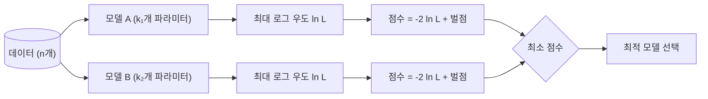

# AIC(Akaike Information Criterion) & BIC(Bayesian Information Criterion)

---

## I. 적합도와 복잡도를 함께 보는, AIC·BIC의 개요

### 가. 정의

- 모델의 **적합도(최대 로그 우도)에 파라미터 수에 따른 벌점을 더해** 후보 모델 중 최적 모델을 고르는 정보 기준

### 나. 필요성 및 특징

| 구분 | 내용 |
| --- | --- |
| 필요성 | 파라미터를 늘리면 학습 데이터 우도는 계속 증가해 과적합 위험 |
| 간결성 | 오컴의 면도날, 복잡한 모델에 벌점 |
| 상대 비교 | 값 자체는 의미 없고 같은 데이터의 후보끼리 비교해 **작은 값** 선택 |
| 전제 | 같은 데이터·같은 종속변수, 우도 기반 모델 |

---

## II. 선택 절차 및 구성요소

### 가. 모델 선택 절차

- 후보마다 $-2\ln L$(적합도)과 벌점(복잡도)을 더한 값을 비교해 가장 작은 모델 선택

### 나. 구성요소

| 구분 | 요소 | 설명 |
| --- | --- | --- |
| 적합도 | 최대 우도 $L$ | 추정 모수에서 데이터가 관측될 확률 |
| | $-2\ln L$ | 이탈도(Deviance) 형태, 작을수록 적합 |
| 복잡도 | 파라미터 수 $k$ | 추정할 모수 개수 |
| | 표본 크기 $n$ | BIC 벌점에 사용 |
| 이론 | AIC | 참 분포와 모델 간 KL 발산의 기대값 추정, 예측 성능 지향 |
| | BIC | 모델의 주변 우도(Evidence) 근사, 베이즈 팩터와 연결, 참 모델 선택에 일치성 |
| 보정 | AICc | 소표본 보정 $AIC + \frac{2k(k+1)}{n-k-1}$ |

---

## III. 비교 및 동향

### 가. AIC vs BIC

| 비교 항목 | AIC | BIC |
| --- | --- | --- |
| 수식 | $-2\ln L + 2k$ | $-2\ln L + k\ln n$ |
| 벌점 | 파라미터 수에만 비례 | 표본이 커질수록 증가 ($n \ge 8$이면 $\ln n > 2$로 AIC보다 강함) |
| 이론 | 정보 이론 (KL 발산) | 베이지안 (주변 우도 근사) |
| 선택 성향 | 상대적으로 복잡한 모델, 예측 지향 | 단순한 모델, 설명·참 모델 식별 지향 |
| 대표본 성질 | 일치성 없음 | 일치성 있음 (참 모델이 후보에 있을 때) |

### 나. 동향

- **시계열 차수 선택**: Auto-ARIMA 등이 AIC·BIC로 $(p, d, q)$ 차수를 자동 탐색 ([[시계열분석]])
- **변수 선택**: 회귀의 전진·후진·단계적 선택에서 변수 추가·제거 기준
- **교차검증 병행**: 딥러닝처럼 파라미터 수가 의미를 잃는 모델은 교차검증·검증 손실로 선택

---

### 🔗 연관 토픽

- **소속 도메인**: [[00_인공지능_MOC|🤖 인공지능]]
- **세부 분류**: `1. 수학 · 통계학 & 데이터 전처리`
- **핵심 연관 토픽**:
  - [[과적합 문제|과적합 (overfitting)문제]]
  - [[회귀분석|회귀분석(Regression Analysis)]]
  - [[추정 이론|추정 이론(Estimation Theory)]]
  - [[시계열분석]]
  - [[베이즈 추론]]
