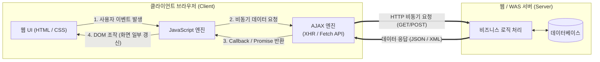

# AJAX (Asynchronous JavaScript and XML)

---

## I. 비동기 웹 통신의 표준, AJAX의 개요

전체 웹 페이지를 새로고침하지 않고, 브라우저 백그라운드에서 서버와 비동기적으로 데이터를 교환하여 웹 페이지의 일부만을 동적으로 갱신하는 웹 개발 기술이다.

| 구분 | 주요 내용 |
| --- | --- |
| **개념** | JavaScript와 비동기 통신 객체(XHR, Fetch API)를 활용하여 서버로부터 필요한 데이터만 수신하고 DOM을 조작해 화면을 부분 갱신하는 기법 |
| **등장 배경** | 기존 동기식 웹 요청(Full Reload)으로 인한 화면 깜빡임, 불필요한 전체 HTML 재전송에 따른 대역폭 낭비 및 사용자 경험(UX) 저하 해결 |
| **핵심 특징** | 논블로킹(Non-blocking) 비동기 통신, 순수 데이터([[JSON]], [[XML]]) 위주의 경량 트래픽, SPA(Single Page Application) 아키텍처의 기반 제공 |

---

## II. AJAX의 아키텍처 및 핵심 기술 요소

### 가. AJAX의 아키텍처 및 동작 원리

사용자 이벤트 발생 시 JavaScript가 AJAX 엔진을 통해 백그라운드 HTTP 요청을 전송하며, 서버 응답이 도착하면 Promise 또는 콜백 함수를 통해 브라우저 DOM을 동적으로 수정한다.

### 나. AJAX의 핵심 기술 및 구성 요소

| 분류 | 요소기술 (키워드) | 세부 설명 |
| --- | --- | --- |
| **통신 인터페이스** | XMLHttpRequest (XHR) | 초기 AJAX 표준 통신 객체로 이벤트 기반 상태 전이를 통해 비동기 HTTP 요청 처리 |
| **통신 인터페이스** | Fetch API | Promise 기반의 모던 웹 표준 통신 API로 가독성 향상 및 유연한 요청/응답 제어 지원 |
| **데이터 포맷** | [[JSON]] (JavaScript Object Notation) | XML 대비 가볍고 직관적인 키-값 구조로 현재 웹 통신에서 가장 널리 활용되는 사실상 표준 |
| **화면 조작** | DOM (Document Object Model) | 수신된 데이터를 바탕으로 브라우저 내 HTML 태그와 CSS 스타일을 동적으로 수정하는 트리 구조 |
| **비동기 제어** | Promise / async-await | 복잡한 중첩 콜백 지옥(Callback Hell)을 해소하고 동기식 코드 스타일로 비동기 흐름 제어 |
| **클라이언트 라이브러리** | Axios | 브라우저와 Node.js 환경 모두를 지원하며 요청 인터셉트, 자동 JSON 변환을 제공하는 HTTP 라이브러리 |
| **보안 메커니즘** | CORS (Cross-Origin Resource Sharing) | 서로 다른 출처(도메인, 포트) 간의 리소스 요청 시 보안 무결성을 보장하기 위한 브라우저 보안 규약 |

---

## III. 전통적 웹 통신과의 비교 및 최신 동향

### 가. 전통적 웹 통신(동기식) vs AJAX 기반 웹 통신(비동기식) 비교

| 비교 항목 | 전통적 웹 (Synchronous) | AJAX 기반 웹 (Asynchronous) |
| --- | --- | --- |
| **화면 갱신 방식** | 페이지 전체 새로고침 (Full Page Reload) | **필요한 영역만 동적 부분 갱신 (Partial Update)** |
| **사용자 반응성** | 서버 응답 완료 시까지 화면 정지 (블로킹) | **서버 처리 중에도 사용자 상호작용 유지 (논블로킹)** |
| **데이터 전송량** | UI 템플릿(HTML/CSS) 전체를 매번 재전송 | **순수 비즈니스 데이터(JSON)만 경량 전송** |
| **사용자 경험 (UX)** | 화면 깜빡임 발생 및 네트워크 지연 체감 | 데스크톱 앱과 같은 매끄러운 반응성 및 즉각적 피드백 |

### 나. 최신 기술 동향 및 발전 방향

* **SPA 및 모던 프론트엔드 프레임워크 표준화**: React, Vue, Next.js 등 모던 프론트엔드 생태계에서 초기 1회 번들 로딩 후 모든 데이터 연동을 비동기 API 통신(Fetch/Axios)으로 처리하는 구조가 정착됨.
* **실시간 양방향 웹 기술과의 융합**: 단순한 단방향 비동기 요청을 넘어, 지속적 데이터 스트리밍이 요구되는 서비스에서 WebSocket 및 SSE(Server-Sent Events)와 상호 보완적으로 결합되어 실시간 웹 환경을 구현함.

---

### 🔗 연관 토픽

- **소속 도메인**: [[00_소프트웨어공학_MOC|🏗️ 소프트웨어공학]]
- **세부 분류**: `6. 소프트웨어 테스팅 & 품질 보증 (QA/QC)`
- **핵심 연관 토픽**:
  - [[JSON]]
  - [[XML]]
  - [[Annotation]]
  - [[SBOM]]
  - [[퍼징 테스트]]
