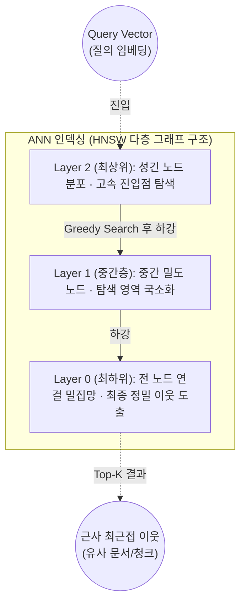

# ANN (Approximate Nearest Neighbor) 알고리즘

---

## I. 초고차원 벡터 검색 가속, ANN 알고리즘의 개요

### 가. 정의

- 고차원 임베딩 벡터 공간에서 **전수 탐색(KNN)의 계산 지연을 극복하기 위해, 일정 수준의 정확도(Recall)를 허용 오차 내에서 양보하고 검색 속도를 비약적으로 향상시킨 근사 최근접 이웃 탐색 알고리즘**

### 나. 특징 및 필요성

| 구분 | 내용 |
| --- | --- |
| 차원의 저주 극복 | 수백~수천 차원 벡터 전수 계산 시 발생하는 $O(N \cdot D)$ 선형 복잡도의 검색 병목 해소 |
| 속도-정확도 트레이드오프 | 재현율(Recall@K)과 질의 응답 시간(QPS) 간의 균형점을 애플리케이션 요구에 맞게 튜닝 가능 |
| 사전 인덱싱 | 그래프(HNSW), 트리(Annoy), 해싱(LSH), 양자화(PQ) 등의 기법으로 탐색 공간을 사전 축소 |
| 핵심 활용 분야 | 대규모 생성형 AI RAG(검색 증강 생성), 멀티모달 이미지/비디오 검색, 실시간 개인화 추천 엔진 |

---

## II. 개념도 및 핵심 구성요소

### 가. 개념도 (HNSW 다층 그래프 탐색)

- 질의 벡터는 최상위 성긴 계층부터 탐욕적(Greedy) 탐색으로 빠르게 범위를 좁히며 하위 계층으로 내려가 전체 데이터를 계산하지 않고 상위 K개 이웃을 $O(\log N)$에 반환

### 나. 핵심 기술 요소 및 인덱싱 기법

| 구분 | 요소 | 설명 |
| --- | --- | --- |
| 그래프 기반 | HNSW | 다층 스킵 리스트 구조의 작은 세상 네트워크(Small World) 구축. 가장 우수한 검색 속도 및 재현율 제공 (SOTA) |
| 트리 기반 | Annoy / KD-Tree | 고차원 공간을 무작위 초평면(Hyperplane)으로 분할하여 이진 탐색 트리 구축 |
| 해싱 기반 | LSH | 유사한 벡터일수록 동일한 해시 버킷에 충돌하도록 설계된 국소 민감 해시 함수 적용 |
| 군집/역색인 | IVF | 벡터 공간을 K-Means 등으로 보로노이 셀(Voronoi Cell) 군집으로 분할 후 근접 군집만 역색인 검색 |
| 양자화 압축 | PQ (Product Quantization) | 고차원 벡터를 여러 저차원 서브벡터로 쪼개어 코드북 인덱스로 압축, 메모리 사용량 최소화 |
| 거리 측정 | Cosine / L2 / IP | 벡터 간 유사도 판별을 위한 거리 척도 (코사인 유사도, 유클리디안 거리, 내적) |
| 성능 지표 | Recall@K / QPS | 실제 정답이 상위 K개 결과에 포함된 비율(Recall) 및 초당 쿼리 처리량(QPS) |

---

## III. 전수 탐색(KNN) 비교 및 동향

### 가. KNN vs ANN

| 비교 항목 | Exact NN (전수 탐색 / KNN) | Approximate NN (ANN) |
| --- | --- | --- |
| 탐색 방식 | 쿼리와 전체 데이터 간 전수 거리 계산 (Brute-Force) | 그래프·클러스터·해싱으로 탐색 공간 사전 필터링 |
| 시간 복잡도 | $O(N \cdot D)$ (데이터 수에 비례하여 선형 증가) | $O(\log N)$ 또는 $O(1)$ (초고속 인덱스 탐색) |
| 검색 정확도 | 100% 정답 보장 (Ground Truth) | 근사치 반환 (통상 90~99% 재현율 수준) |
| 인덱스 빌드 비용 | 인덱싱 불필요 (삽입 즉시 검색 가능) | 데이터 삽입 시 인덱스 구축 및 갱신 오버헤드 발생 |
| 메모리 소모 | 원본 벡터만 저장 | 인덱스 그래프 및 양자화 코드북용 추가 메모리 요구 |
| 주 활용 분야 | 소규모 데이터셋, 결함이 허용되지 않는 정밀 분석 | 대용량 Vector DB (Milvus, Pinecone), RAG, 추천 시스템 |

### 나. 동향

- **생성형 AI RAG(검색 증강 생성) 필수 엔진**: LLM 환각(Hallucination) 방지를 위해 사내 지식 문서를 임베딩하고 실시간 참조하는 벡터 데이터베이스의 코어 인덱스로 표준 정착
- **GPU 가속 ANN(NVIDIA RAFT / CAGRA)**: 수억 건 이상의 초거대 벡터 컬렉션에서 CPU 병목을 해소하기 위해 GPU 메모리 상에서 HNSW 및 그래프 탐색을 병렬 수행하는 하드웨어 가속 보편화
- **하이브리드 검색(Hybrid Search) 융합**: 키워드 기반 역색인(BM25)의 정밀도와 ANN 벡터 임베딩의 의미론적(Semantic) 맥락 검색을 RRF(Reciprocal Rank Fusion)로 결합하여 검색 품질 극대화

---

### 🔗 연관 토픽

- **소속 도메인**: [[00_데이터베이스_MOC|🗄️ 데이터베이스]]
- **세부 분류**: `6. SQL 표준 문법 & 쿼리 성능 튜닝`
- **핵심 연관 토픽**:
  - [[초거대 언어 모델]]
  - [[RAG (Retrieval Augmented Generation) 검색 증강 생성 AI|RAG]]
  - [[GPU]]
  - [[거리 공식]]
  - [[유사도|코사인 유사도]]
