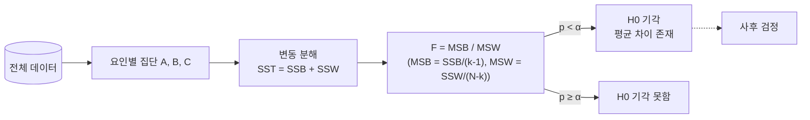

# ANOVA (Analysis of Variance)

---

## I. 세 집단 이상의 평균 비교, ANOVA의 개요

### 가. 정의

- 세 개 이상 집단의 평균 차이를 **집단 간 변동과 집단 내 변동의 비(F 통계량)로 검정**하는 [[가설 검정]] 기법

### 나. 필요성 및 특징

| 구분 | 내용 |
| --- | --- |
| 필요성 | [[t-검정 (t-test)\|t-검정]]을 여러 번 반복하면 제1종 오류 누적 (3집단 3회 비교 시 $1-0.95^3 \approx 14\%$) |
| 원리 | 평균의 차이를 분산 분해로 검정 |
| 가설 | $H_0: \mu_1 = \mu_2 = \dots = \mu_k$, $H_1$: 적어도 하나는 다름 |
| 사후 검정 | 유의하면 어느 집단이 다른지 Tukey HSD·Scheffé·Bonferroni로 확인 |

---

## II. 분석 구조 및 구성요소

### 가. 분석 흐름

- 전체 변동을 집단 간(처리 효과)과 집단 내(오차)로 나누고, 평균제곱의 비로 F 검정

### 나. 구성요소

| 구분 | 요소 | 설명 |
| --- | --- | --- |
| 변동 | 집단 간 제곱합 (SSB) | 집단 평균과 전체 평균의 차이, 처리 효과 |
| | 집단 내 제곱합 (SSW) | 개별 값과 집단 평균의 차이, 오차 |
| 통계량 | F | MSB / MSW, 클수록 집단 간 차이가 큼, 자유도 $(k-1, N-k)$ |
| 가정 | 정규성 | 각 집단 잔차가 정규분포 |
| | [[등분산성]] | 집단 분산 동일 (Levene 검정), 위배 시 Welch ANOVA |
| | 독립성 | 관측치 서로 독립 |
| 유형 | 일원·이원 ANOVA | 요인 1개 / 2개 (이원은 교호작용 검정 가능) |
| | 반복측정·MANOVA | 같은 대상 반복 측정 / 종속변수 여러 개 |
| 비모수 대안 | 크루스칼-월리스 | 정규성 위배 시 순위 기반 검정 |

---

## III. 비교 및 동향

### 가. ANOVA vs t-검정

| 비교 항목 | ANOVA | t-검정 |
| --- | --- | --- |
| 집단 수 | 3개 이상 (2개면 $F = t^2$로 동일) | 2개 |
| 분포 | F 분포 | t 분포 |
| 결과 | 차이 여부만, 사후 검정 필요 | 두 집단 차이 방향·크기 |
| 오류 통제 | 한 번의 검정으로 제1종 오류 유지 | 반복 시 오류 누적 |

### 나. 동향

- **A/B/n 테스트**: 세 개 이상 시안의 평균 지표(체류 시간 등)를 한 번에 비교
- **피처 선택**: 분류 문제에서 범주형 타깃별 연속형 특징의 평균 차이를 F 검정으로 평가해 필터링 (scikit-learn f_classif)
- **실험 설계(DoE)**: 공정·하이퍼파라미터 실험에서 요인 효과와 교호작용 분석

---

### 🔗 연관 토픽

- **소속 도메인**: [[00_인공지능_MOC|🤖 인공지능]]
- **세부 분류**: `1. 수학 · 통계학 & 데이터 전처리`
- **핵심 연관 토픽**:
  - [[t-검정 (t-test)]]
  - [[가설 검정]]
  - [[등분산성|등분산성 (Homoscedasticity)]]
  - [[관계검정|관계검정 (Relationship Test)]]
  - [[유의확률|유의확률 (p-value)]]
