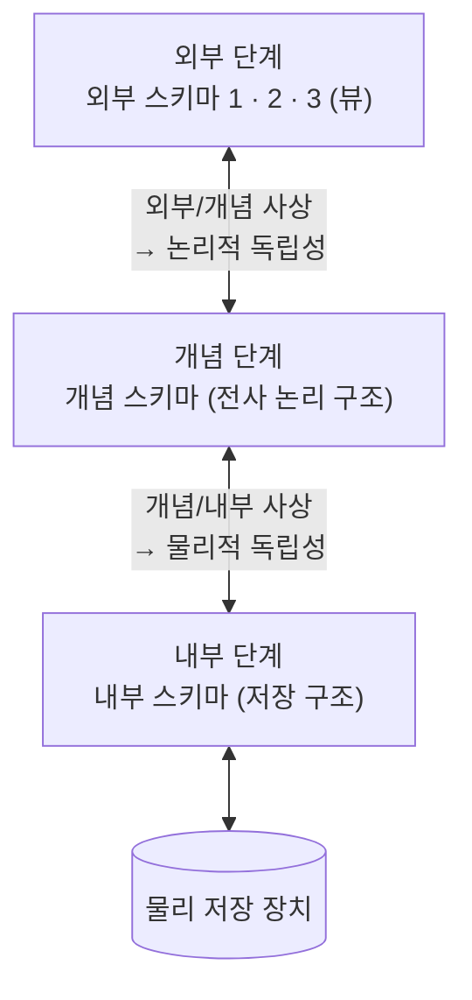

# ANSI/SPARC 모델 및 데이터 독립성

---

## I. 변경의 파급 차단, ANSI/SPARC 3단계 구조의 개요

### 가. 정의

- 데이터베이스를 **외부(사용자)·개념(조직)·내부(저장) 3단계 스키마로 분리하고 단계 간 사상으로 데이터 독립성을 확보하는 표준 구조** (ANSI/X3/SPARC, 1975)

### 나. 특징

| 구분 | 내용 |
| --- | --- |
| 관점 분리 | 사용자 관점, 조직 전체 관점, 저장 장치 관점을 분리 |
| 데이터 독립성 | 하위 단계 변경이 상위 단계에 영향을 주지 않음 |
| 다중 뷰 | 하나의 DB 위에 사용자별 외부 스키마 제공 |
| 매핑 관리 | [[DBMS]]가 사상 정보를 [[시스템 카탈로그]]에 저장해 자동 변환 |

---

## II. 3단계 구조 및 구성요소

### 가. 3단계 구조

- 사상 계층이 변경을 흡수해, 저장 구조나 논리 구조가 바뀌어도 응용 프로그램 수정을 줄임

### 나. 구성요소

| 구분 | 요소 | 설명 |
| --- | --- | --- |
| 스키마 | 외부 스키마 | 사용자·응용별 논리적 부분 구조 (서브스키마, 뷰) |
| | 개념 스키마 | 조직 전체의 통합 논리 구조, 관계·[[무결성]] 제약·보안 정의 (DBA 관리) |
| | 내부 스키마 | 레코드 형식, 저장 경로, 인덱스 등 물리 구조 |
| 사상 | 외부/개념 사상 | 외부 스키마와 개념 스키마의 대응 → 논리적 독립성 |
| | 개념/내부 사상 | 개념 스키마와 내부 스키마의 대응 → 물리적 독립성 |
| 독립성 | 논리적 독립성 | 개념 스키마 변경(속성 추가, 테이블 분리)이 외부 스키마·응용에 무영향 |
| | 물리적 독립성 | 내부 스키마 변경(인덱스 추가, 저장 장치 교체)이 개념 스키마에 무영향 |

---

## III. 비교 및 동향

### 가. 논리적 vs 물리적 데이터 독립성

| 비교 항목 | 논리적 독립성 | 물리적 독립성 |
| --- | --- | --- |
| 관련 사상 | 외부/개념 | 개념/내부 |
| 보호 대상 | 응용 프로그램 | 개념 스키마 |
| 변경 예 | 테이블 통합·분리, 속성 추가 | 인덱스 추가, [[파티셔닝]], 저장 장치 교체 |
| 구현 수단 | 뷰(View) | DBMS 저장 엔진 |
| 달성 난이도 | 어려움 (업무 구조와 밀접) | 상대적으로 쉬움 |

### 나. 동향

- **스토리지–컴퓨팅 분리**: Snowflake·BigQuery 등 [[클라우드 네이티브]] DW가 물리 독립성을 아키텍처 수준으로 확장
- **데이터 가상화·시맨틱 레이어**: 이기종 소스 위에 하나의 논리 모델을 제공해 외부/개념 사상 원리를 확장

---

### 🔗 연관 토픽

- **소속 도메인**: [[00_데이터베이스_MOC|🗄️ 데이터베이스]]
- **세부 분류**: `1. 데이터 모델링 & 관계형 DB 설계`
- **핵심 연관 토픽**:
  - [[스키마]]
  - [[DBMS]]
  - [[데이터베이스]]
  - [[시스템 카탈로그|시스템 카탈로그 (System Catalog)]]
  - [[자료 사전]]
