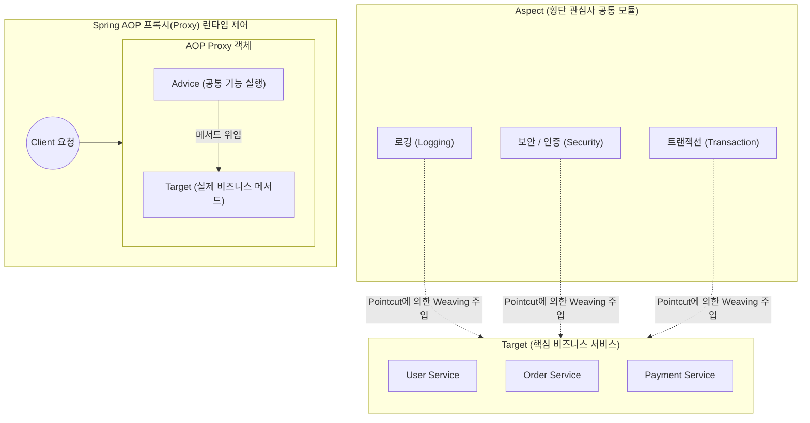

# AOP (Aspect Oriented Programming)

---

## I. 핵심 비즈니스 로직과 횡단 관심사의 분리, AOP의 개요

애플리케이션의 핵심 비즈니스 로직과 시스템 전반에 걸쳐 공통으로 반복되는 부가 기능(로깅, 보안, 트랜잭션 등)을 분리하여 모듈화하는 관점 지향 프로그래밍 패러다임이다.

| 구분 | 주요 내용 |
| --- | --- |
| **개념** | 핵심 관심사(Core Concern)와 횡단 관심사(Cross-cutting Concern)를 분리하고, Aspect라는 모듈 단위로 공통 로직을 캡슐화하여 위빙(Weaving)하는 기법 |
| **등장 배경** | 객체 지향 프로그래밍(OOP)에서 모듈 간 공통 코드가 중복·분산되는 코드 얽힘(Code Tangling) 및 코드 흩어짐(Code Scattering) 한계 극복 |
| **핵심 특징** | 관심사의 분리(SoC), 핵심 비즈니스 코드의 순수성 보장, 높은 응집도 및 결합도 감소, 선언적 부가 기능 제어 |

---

## II. AOP의 아키텍처 및 핵심 기술 요소

### 가. AOP의 아키텍처 및 프록시 동작 원리

핵심 비즈니스 모듈과 독립적으로 정의된 Aspect가 런타임에 프록시(Proxy) 객체를 생성하여, 클라이언트 요청 시 공통 부가 기능(Advice)을 사전·사후에 실행하고 실제 타겟 메서드로 호출을 위임한다.

### 나. AOP의 핵심 기술 및 구성 요소

| 분류 | 요소기술 (키워드) | 세부 설명 |
| --- | --- | --- |
| **관심사 모듈화** | Aspect (관점) | 부가 기능(Advice)과 적용 위치(Pointcut)를 하나로 묶어 독립적으로 캡슐화한 핵심 단위 |
| **적용 대상** | Target (타겟) | 핵심 비즈니스 로직을 수행하며, Aspect의 부가 기능이 적용되는 실제 객체 |
| **부가 기능** | Advice (조언) | 타겟에 주입할 실질적인 공통 기능 구현체 (실행 시점에 따라 Before, After, Around 등 지원) |
| **적용 후보군** | Joinpoint (결합점) | Advice가 삽입될 수 있는 프로그램 실행 중의 모든 논리적 위치 (메서드 호출, 예외 발생 시점 등) |
| **적용 지점** | Pointcut (교차점) | 무수히 많은 Joinpoint 중 실제로 특정 Advice를 적용할 지점을 선별하는 표현식 및 규칙 |
| **주입 과정** | Weaving (위빙) | Pointcut에 의해 매핑된 Joinpoint에 Advice를 삽입하는 과정 (컴파일 시점, 클래스 로딩 시점, 런타임 시점) |
| **동작 대리자** | Proxy (프록시) | 타겟 객체를 감싸 클라이언트 호출을 가로채고, Advice 실행 후 타겟을 대리 실행하는 객체 |
| **프록시 구현** | JDK Dynamic Proxy / CGLIB | Java 인터페이스 기반 동적 프록시(JDK) 또는 바이트코드 조작 기반 서브클래싱 프록시(CGLIB) 활용 |

---

## III. OOP와 AOP 비교 및 최신 동향

### 가. OOP vs AOP 비교

| 비교 항목 | OOP (객체 지향 프로그래밍) | AOP (관점 지향 프로그래밍) |
| --- | --- | --- |
| **주요 목적** | 비즈니스 엔티티의 상태와 행위를 객체로 캡슐화 | 객체 간 분산된 공통 관심사의 중복 제거 및 모듈화 |
| **관심사 방향** | **핵심 관심사 (Core Concern)** / 수직적(Vertical) | **횡단 관심사 (Cross-cutting Concern)** / 수평적(Horizontal) |
| **모듈화 단위** | 클래스 (Class) | 관점 (Aspect) |
| **상호 관계** | 시스템의 뼈대와 비즈니스 도메인 로직 구성 | OOP의 구조적 한계를 보완하는 상호 보완적 패러다임 |

### 나. 최신 기술 동향 및 발전 방향

* **마이크로서비스 분산 추적(Distributed Tracing) 연계**: [[MSA (Micro Service Architecture)|MSA]] 환경에서 비즈니스 코드 수정 없이 요청 흐름 추적 ID(Trace ID, Span ID)를 발급하고 OpenTelemetry/Zipkin으로 전송하는 관측성(Observability) 엔진으로 활용됨.
* **선언적 인프라 자동화 고도화**: Spring Boot 환경의 `@Transactional`, `@Retryable`, `@CircuitBreaker` 등 선언적 어노테이션 기반 인프라 로직 주입의 핵심 백엔드 메커니즘으로 안착됨.

---

### 🔗 연관 토픽

- **소속 도메인**: [[00_소프트웨어공학_MOC|🏗️ 소프트웨어공학]]
- **세부 분류**: `4. 아키텍처 스타일 & 객체지향 설계 원리`
- **핵심 연관 토픽**:
  - [[Annotation]]
  - [[모듈화]]
  - [[결합도]]
  - [[응집도]]
  - [[MSA (Micro Service Architecture)]]
