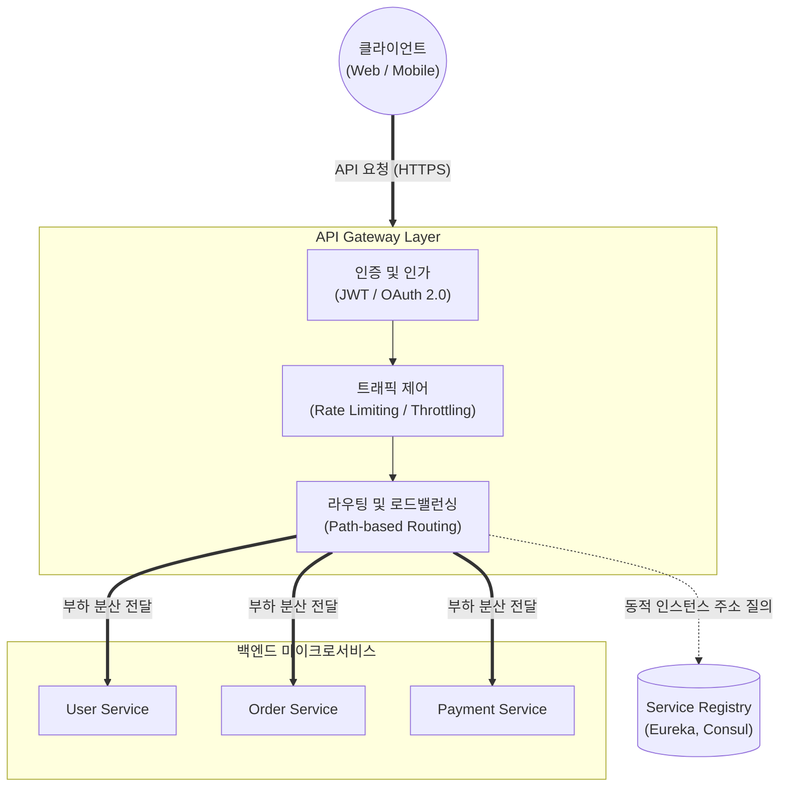

# API Gateway

---

## I. MSA 환경의 단일 진입점, API Gateway의 개요

마이크로서비스 아키텍처(MSA) 환경에서 클라이언트의 모든 요청을 받아 적절한 백엔드 서비스로 라우팅하고, 인증, 인가, 로깅, 트래픽 제어 등 공통 횡단 관심사를 일괄 처리하는 단일 진입점(Single Entry Point) 미들웨어이다.

| 구분 | 주요 내용 |
| --- | --- |
| **개념** | 외부 클라이언트와 내부 분산 마이크로서비스 간의 통신을 중재하며 보안, 라우팅, 로드밸런싱 및 API 조립을 수행하는 관문 인프라 |
| **등장 배경** | MSA 도입에 따른 서비스 파편화, 클라이언트-서비스 직접 통신 시의 강한 결합도와 다중 네트워크 RTT 오버헤드 해소 필요 |
| **핵심 특징** | 단일 엔드포인트 제공, 횡단 관심사 중앙 오프로딩(Off-loading), 프로토콜 변환(HTTP/REST ➔ gRPC) 및 응답 집계(Composition) |

---

## II. API Gateway의 아키텍처 및 핵심 구성요소

### 가. API Gateway의 아키텍처 및 요청 흐름

외부 요청은 API Gateway에서 중앙 집중식으로 보안 검증과 트래픽 제어를 거친 후, Service Registry를 통해 동적으로 확인된 백엔드 인스턴스로 분산 전달된다.

### 나. API Gateway의 핵심 기술 요소

| 분류 | 요소기술 (키워드) | 세부 설명 |
| --- | --- | --- |
| **요청 라우팅** | 동적 라우팅 (Dynamic Routing) | 요청의 URL 경로, HTTP 헤더, 메서드를 기준으로 적절한 백엔드 서비스 엔드포인트로 패킷 포워딩 |
| **응답 가공** | API 컴포지션 (Aggregation) | 여러 마이크로서비스를 병렬 호출하여 수집한 개별 응답 데이터를 하나로 통합·가공 후 반환 |
| **보안/인증** | 인증 및 인가 (Auth Off-loading) | JWT 유효성 검증, OAuth 2.0 토큰 파싱을 Gateway에서 일괄 수행하여 백엔드 서비스의 보안 부담 경감 |
| **보안/인증** | SSL/TLS 터미네이션 | 클라이언트와의 HTTPS 암복호화 처리를 Gateway에서 전담하여 내부 네트워크 트래픽 최적화 |
| **트래픽 통제** | 속도 제한 (Rate Limiting) | 클라이언트 IP나 API 키별로 호출 빈도를 제한하여 백엔드 과부하 및 대규모 트래픽 공격 방어 |
| **부하 분산** | 로드밸런싱 (Load Balancing) | 동일 마이크로서비스의 복수 인스턴스 간 트래픽을 가중치 라운드로빈 등으로 공정하게 분배 |
| **프로토콜 변환** | 프로토콜 변환 (Translation) | 외부 클라이언트의 HTTP/JSON 요청을 내부 고성능 통신 규격인 gRPC나 메시지 큐(Kafka)로 변환 |
| **관측성 확보** | 중앙 집중식 로깅/추적 | 인입되는 모든 API 요청에 분산 추적용 상관 ID(Trace ID)를 주입하고 메트릭을 수집하여 가시성 제공 |

---

## III. API Gateway vs Service Mesh 비교 및 최신 동향

### 가. API Gateway vs Service Mesh 비교

| 비교 항목 | API Gateway | Service Mesh |
| --- | --- | --- |
| **통신 방향** | **North-South 트래픽** (외부 클라이언트 $\leftrightarrow$ 내부 서비스) | **East-West 트래픽** (내부 마이크로서비스 $\leftrightarrow$ 마이크로서비스) |
| **배치 형태** | 클러스터 외곽의 **중앙 집중형 프록시 계층** | 각 서비스 파드(Pod)에 밀착된 **사이드카(Sidecar) 프록시** |
| **주요 역할** | 단일 진입점, API 노출, 보안 인증, 과금 및 라우팅 | 서비스 간 상호 TLS(mTLS), 트래픽 분할, 서킷 브레이커, 관측성 |
| **처리 계층** | 애플리케이션 계층(L7) 비즈니스 로직 중심 | 네트워크 인프라 계층(L4~L7) 통신 제어 중심 |
| **대표 솔루션** | Spring Cloud Gateway, Kong, Envoy Gateway, AWS API GW | Istio, Linkerd, Consul Service Mesh |

### 나. 최신 기술 동향 및 발전 방향

* **BFF(Backend for Frontend) 패턴으로의 진화**: 단일 Gateway의 과부하와 복잡도 증가(SPOF 위험)를 방지하기 위해 웹, 모바일, 서드파티 등 클라이언트 채널별로 전용 Gateway를 분리 운영하는 아키텍처가 확산됨.
* **WAAP(웹 애플리케이션 및 API 보안) 통합**: 지능형 API 남용(Abuse) 및 봇 트래픽을 실시간 탐지하기 위해 WAF, DDoS 방어, API 보호 기능이 Gateway 레벨에 일체화되는 추세임.

---

### 🔗 연관 토픽

- **소속 도메인**: [[00_소프트웨어공학_MOC|🏗️ 소프트웨어공학]]
- **세부 분류**: `4. 아키텍처 스타일 & 객체지향 설계 원리`
- **핵심 연관 토픽**:
  - [[MSA (Micro Service Architecture)]]
  - [[서비스 매쉬]]
  - [[결합도]]
  - [[모듈화]]
  - [[인스턴스]]
