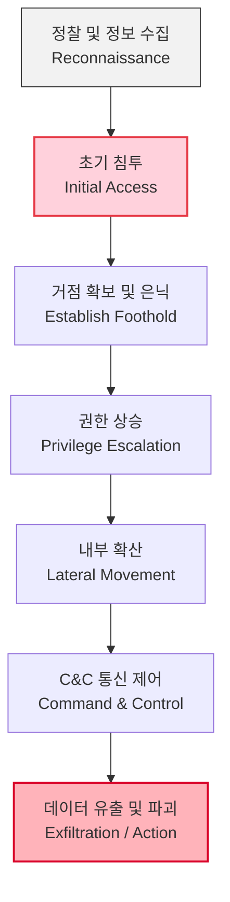

# APT(Advanced Persistent Threat) 공격

---

## I. 표적형 지능형 지속 위협, APT 공격의 개요

### 가. APT 공격의 정의
- 특정 조직이나 인프라를 표적으로 삼아 장기간 은밀하게 잠복하며, 다양한 지능형 기법을 결합하여 기밀을 유출하거나 핵심 시스템을 파괴하는 사이버 위협

### 나. APT 공격의 등장배경 및 주요 특징
| 구분 | 내용 |
| --- | --- |
| 등장 배경 | 국가 배후 해킹 그룹의 전략적 기밀 탈취 증가, RaaS(Ransomware-as-a-Service) 확산, 시그니처 보안 체계 무력화 |
| 타겟 지향성(Targeted) | 불특정 다수가 아닌 명확한 대상(정부, 방산, 핵심 기업)을 사전에 면밀히 정찰 후 맞춤형 공격 수행 |
| 지속 잠복성(Persistent) | 초기 침투 성공 후 내부망에 거점(Foothold)을 구축하고 수개월~수년간 은밀하게 권한 상승 및 횡적 이동 |
| 지능적 기법(Advanced) | 제로데이(Zero-day) 취약점, 맞춤형 스피어 피싱, 정상 프로세스 위장(Living-off-the-Land), C2 은닉 통신 결합 |

---

## II. APT 공격의 사이버 킬 체인(Cyber Kill Chain) 및 핵심 기술 요소

### 가. APT 공격의 개념도 및 동작 원리

* 스피어 피싱 등을 통해 내부망에 **초기 침투**한 후, 백도어를 설치해 **거점을 확보**하고, 관리자 **권한을 상승**시켜 네트워크 전반으로 **확산**하며 최종적으로 기밀을 유출하는 [[사이버 킬 체인]](Cyber Kill Chain) 구조를 가짐.

### 나. APT 공격의 핵심 기법 및 구성 요소

| 분류 | 요소기술(키워드) | 세부 설명 |
| --- | --- | --- |
| **초기 침투** | **Spear Phishing** | 특정 대상을 정교하게 겨냥하여 악성 첨부파일이나 링크를 포함한 이메일 발송 |
| **초기 침투** | **Water Holing** | 표적 집단이 자주 방문하는 정상 웹사이트를 미리 감염시켜 악성코드 유포 |
| **초기 침투** | **Zero-Day [[Exploit]]** | 소프트웨어 벤더가 인지하거나 패치하기 전의 취약점을 악용하여 시스템 침투 |
| **거점 확보** | **Rootkit / Backdoor** | 시스템 깊숙이 은닉하여 탐지를 회피하고, 공격자가 언제든 재접속할 수 있는 통로 유지 |
| **내부 확산** | **Privilege Escalation** | 시스템 취약점을 악용하여 일반 사용자 계정에서 관리자(System/Root) 권한 획득 |
| **내부 확산** | **Lateral Movement** | 초기 감염된 단말을 교두보로 삼아 내부 네트워크의 다른 주요 서버나 단말기로 수평 이동 |
| **통신/제어** | **C&C 통신** | 공격자의 외부 명령제어(Command & Control) 서버와 [[암호화]] 통신을 연결하여 원격 제어 |
| **목적 달성** | **Exfiltration** | 탈취한 민감 데이터를 압축/암호화하여 분할 전송하거나 정상 트래픽으로 위장하여 유출 |

---

## III. 일반 사이버 공격과의 비교 및 APT 방어 동향

### 가. 일반 해킹과 APT 공격의 비교 및 최신 대응 전략

| 비교 항목 | 일반 사이버 공격 | APT 공격 |
| --- | --- | --- |
| **공격 대상** | 불특정 다수 (무차별적) | 특정 타겟 (정부, 기관, 핵심 기업 등) |
| **공격 목적** | 단기적 금전 획득, 단순 시스템 파괴 | 장기적인 기밀 유출, 국가 안보 위협, [[랜섬웨어]] 결합 |
| **지속성** | 일회성, 단기적 (단일 시점) | 수개월 ~ 수년 간 장기 잠복 (Persistent) |
| **공격 기법** | 알려진 취약점, 단순 스팸, 무작위 대입 | 제로데이(Zero-Day), 스피어 피싱, 크리덴셜 스터핑 |
| **탐지 난이도** | 상대적으로 탐지 용이 (시그니처 패턴 기반) | 탐지 매우 어려움 (행위 기반 이상 징후 분석 필요) |

### 나. 최신 APT 공격 동향 및 차세대 방어 전략
- **MITRE ATT&CK 기반 위협 헌팅**: 공격자의 전술·기법·절차(TTPs)를 매트릭스로 프로파일링하고 SIEM/SOAR를 연계하여 침해사고 조사 및 대응 워크플로우 자동화
- **제로 트러스트(Zero Trust) 아키텍처 구현**: "결코 신뢰하지 않고 항상 검증한다"는 원칙 하에 내부망에서도 마이크로 세그멘테이션과 지속적 신원 인증을 적용하여 횡적 이동(Lateral Movement) 차단
- **EDR/XDR 기반 다계층 이상 행위 탐지**: 파일 시그니처 검사를 탈피하여 엔드포인트 프로세스 트리, 네트워크 비정상 비코닝, 클라우드 권한 남용을 통합 상관분석하여 거점 확보 즉시 격리

---

### 🔗 연관 토픽

- **소속 도메인**: [[00_보안_MOC|🛡️ 보안]]
- **세부 분류**: `3. 네트워크 & 엔드포인트 · 인프라 보안`
- **핵심 연관 토픽**:
  - [[EDR(Endpoint Detection and Response)]]
  - [[SIEM]]
  - [[위협 헌팅|위협 헌팅(Threat Hunting)]]
  - [[SOAR (Security Orchestration, Automation and Response)]]
  - [[방화벽]]
