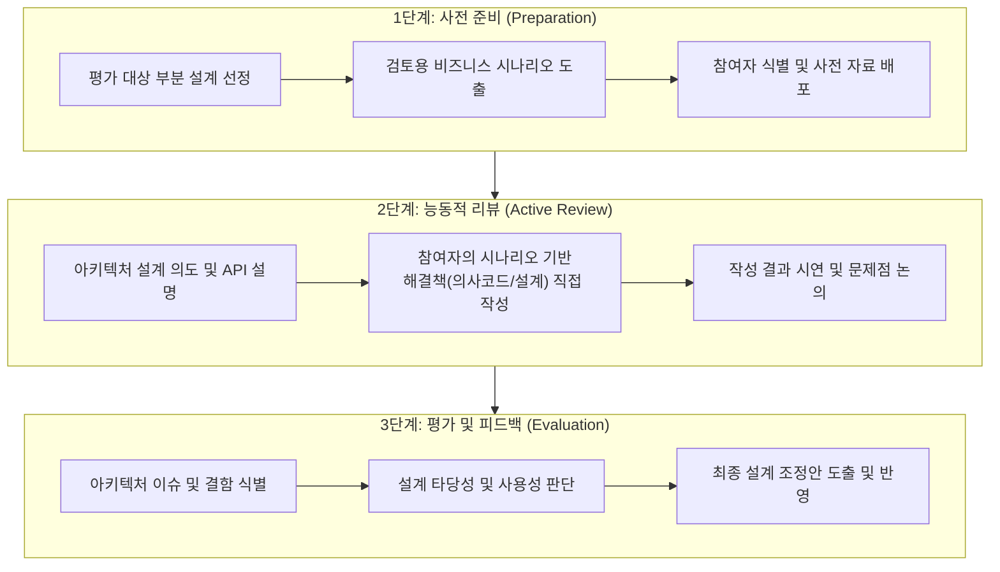

# ARID (Active Reviews for Intermediate Designs)

---

## I. 초기/부분 설계 타당성 검증 평가, ARID의 개요

소프트웨어 아키텍처 전체가 완성되기 전, 초기 단계의 특정 부분(중간 설계, 컴포넌트, API 등)에 대해 설계의 타당성과 사용성(Usability)을 조기에 검증하는 시나리오 기반 아키텍처 평가 방법론이다.

| 구분 | 주요 내용 |
| --- | --- |
| **개념** | ATAM의 시나리오 기반 평가 기법과 ADR(Active Design Review)의 능동적 참여 방식을 결합하여 부분 설계를 검증하는 평가 기법 |
| **등장 배경** | 아키텍처 전체 완료 후 결함이 발견될 경우 발생하는 막대한 재작업(Rework) 비용 방지 및 서브시스템 간 조기 인터페이스 정합성 확보 필요 |
| **핵심 특징** | 중간 설계(Intermediate Design) 집중 평가, 평가 대상 컴포넌트를 실제 사용할 실무 개발자의 능동적 참여(의사코드 작성), 빠른 피드백 반영 |

---

## II. ARID의 아키텍처 및 핵심 기술 요소

### 가. ARID의 평가 절차 및 동작 원리

초기 단계에서 설계자가 시나리오를 제시하면 실무 개발자가 능동적(Active)으로 해당 설계를 활용하여 직접 코드를 작성해봄으로써 설계의 사용성과 결함을 조기에 검증한다.

### 나. ARID의 핵심 기술 및 구성 요소

| 분류 | 요소기술 (키워드) | 세부 설명 |
| --- | --- | --- |
| **기반 방법론** | [[ATAM]] (품질 속성 분석) | 비즈니스 목표와 품질 속성 요구사항을 구체화하기 위한 시나리오 기반 분석 기법 차용 |
| **기반 방법론** | ADR (Active Design Review) | 수동적 문서 열람을 벗어나 리뷰어가 설계를 직접 활용해 보는 능동적 검토 기법 적용 |
| **평가 대상** | 중간 설계 (Intermediate Design) | 시스템 전체가 아닌 서브시스템, 공통 라이브러리, API 등 개발 진행 중인 부분 설계 |
| **핵심 활동** | 능동적 검토 (Active Review) | 제공된 설계 명세를 바탕으로 주어진 시나리오를 해결하는 의사코드(Pseudo Code) 직접 구현 |
| **검증 도구** | 시나리오 테스트 (Scenario Test) | 향후 시스템이 직면할 구체적 상황을 시나리오로 부여하여 설계의 수용 가능성 평가 |
| **핵심 참여자** | 리뷰어 (Reviewer) | 해당 컴포넌트나 API를 직접 호출하여 소프트웨어를 개발하게 될 실무 엔지니어 및 개발자 |
| **평가 기준** | 설계 타당성 및 사용성 | 제공된 설계가 목적에 부합하는지, 개발자가 오해 없이 쉽게 코딩할 수 있는지 평가 |
| **도출 산출물** | 설계 개선안 (Refined Design) | 리뷰 과정에서 식별된 API 인터페이스 결함, 제약 사항, 모호성을 개선한 수정 설계서 |

---

## III. 시나리오 기반 아키텍처 평가 방법론 비교 및 최신 동향

### 가. 시나리오 기반 아키텍처 평가 방법론 비교 (ARID, ATAM, SAAM, CBAM)

| 비교 항목 | ARID | ATAM | [[SAAM]] | [[CBAM]] |
| --- | --- | --- | --- | --- |
| **평가 대상** | **중간 단계 부분 설계** (컴포넌트, API) | 아키텍처 전체 (구체화 완료 단계) | 아키텍처 전체 (초기 아키텍처) | 복수의 아키텍처 대안 |
| **평가 목적** | **설계 타당성 및 사용성 조기 검증** | 품질 속성 간 Trade-off 및 위험 분석 | 변경 용이성 및 기능성 평가 | 아키텍처 변경의 경제적 ROI 분석 |
| **핵심 기법** | **ATAM + ADR** (의사코드 직접 작성) | 유틸리티 트리, 품질 시나리오 분석 | 시나리오 기반 아키텍처 평가 | 효용 곡선, 비용-편익 재무 모델 |
| **수행 시점** | **설계 초기 ~ 중간 단계** | 설계 완료 전후 | 설계 초기 단계 | ATAM 평가 완료 직후 |
| **주요 장점** | 조기 결함 발견, 개발자 관점 사용성 검증 | 품질 속성 간 상충관계 명확화 | 프로세스의 단순성 및 신속성 | 경영진의 투자 의사결정 근거 제공 |

### 나. 최신 기술 동향 및 발전 방향

* **애자일 및 MSA 환경에서의 적용 확대**: 단일 대규모 아키텍처 평가 대신 스프린트 단위로 마이크로서비스 간의 REST/gRPC API 명세를 조기에 검증하는 경량화된 ARID 기법이 널리 활용됨.
* **API 우선 설계(API-First Design) 연계**: OpenAPI Specification(Swagger) 명세 작성 후 백엔드 실제 구현 전 클라이언트 개발팀과 함께 Mock 서버 기반의 능동적 리뷰를 수행하는 방식으로 고도화됨.

---

### 🔗 연관 토픽

- **소속 도메인**: [[00_소프트웨어공학_MOC|🏗️ 소프트웨어공학]]
- **세부 분류**: `4. 아키텍처 스타일 & 객체지향 설계 원리`
- **핵심 연관 토픽**:
  - [[ATAM]]
  - [[CBAM]]
  - [[SAAM]]
  - [[SW Architecture 평가]]
  - [[MSA (Micro Service Architecture)]]
