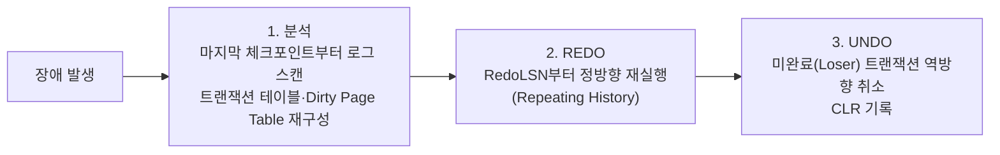

# ARIES (Algorithms for Recovery and Isolation Exploiting Semantics)

---

## I. 로그 기반 회복의 표준, ARIES의 개요

### 가. 정의

- WAL 원칙 아래 **분석(Analysis)·REDO·UNDO 3단계로 장애 직전 상태를 재현한 뒤 미완료 트랜잭션을 취소하는 회복 알고리즘** (C. Mohan 외, IBM, 1992)

### 나. 특징

| 구분 | 내용 |
| --- | --- |
| WAL | 데이터 페이지보다 로그를 먼저 안정 저장소에 기록 |
| Repeating History | REDO 단계에서 커밋 여부와 관계없이 장애 직전 상태를 그대로 재현 |
| CLR 기록 | UNDO 중에도 보상 로그를 남겨 회복 중 재장애에도 중복 취소 방지 |
| 정책 | Steal·No-Force 버퍼 정책 지원, 레코드 단위 잠금과 호환 |

---

## II. 회복 절차 및 구성요소

### 가. 3단계 회복

- 분석 단계에서 REDO 시작점과 취소 대상 트랜잭션을 정하고, REDO로 장애 직전 상태를 만든 뒤 UNDO로 원자성을 회복

### 나. 구성요소

| 구분 | 요소 | 설명 |
| --- | --- | --- |
| 원칙 | WAL | 로그 우선 기록, 커밋 시 로그 강제 기록 |
| | Repeating History | 장애 직전 상태 재현 후 UNDO |
| 자료구조 | LSN | 로그 레코드의 단조 증가 번호, 페이지에 PageLSN 기록 |
| | 트랜잭션 테이블 (TT) | 활성 트랜잭션 상태와 LastLSN |
| | Dirty Page Table (DPT) | 디스크에 반영되지 않은 페이지와 RecLSN |
| 로그 | CLR | UNDO 수행 내역 기록, UndoNextLSN으로 다음 취소 지점 지정 |
| | Physiological Logging | 페이지는 물리적, 페이지 내부는 논리적으로 기록 |
| 최적화 | Fuzzy Checkpoint | 더티 페이지를 강제 기록하지 않고 TT·DPT만 기록해 운영 중단 최소화 |

---

## III. 비교 및 동향

### 가. 회복 기법 비교

| 비교 항목 | ARIES | 지연 갱신 | [[그림자페이지 기법\|그림자 페이징]] |
| --- | --- | --- | --- |
| 갱신 방식 | 즉시 갱신 (Steal 허용) | 커밋 후 반영 | 비제자리 갱신 |
| 회복 연산 | 분석·REDO·UNDO | REDO만 | 포인터 교체 |
| 버퍼 정책 | Steal·No-Force | No-Steal | — |
| 동시성 | 레코드 단위 잠금 지원 | 버퍼 크기 제약 | 다중 트랜잭션 지원 어려움 |
| 적용 | DB2, SQL Server 등 상용 RDBMS | 소규모 시스템 | 파일 시스템 CoW |

### 나. 동향

- **클라우드 DB**: Aurora는 REDO 로그 적용을 분산 스토리지 계층에 맡겨 복구 시간 단축 ([[클라우드 네이티브]])
- **복구 시간 단축**: SQL Server Accelerated Database Recovery(ADR)는 버전 저장소로 UNDO 시간을 일정하게 유지
- **비휘발성 메모리**: NVM 환경에 맞춘 경량 로깅·즉시 복구 연구

---

### 🔗 연관 토픽

- **소속 도메인**: [[00_데이터베이스_MOC|🗄️ 데이터베이스]]
- **세부 분류**: `2. 트랜잭션 & 동시성 제어 (Concurrency)`
- **핵심 연관 토픽**:
  - [[DB 회복기법]]
  - [[그림자페이지 기법|그림자페이지(Shadow Paging) 기법]]
  - [[트랜잭션]]
  - [[DBMS]]
  - [[DRP(RTO, RPO 등)]]
