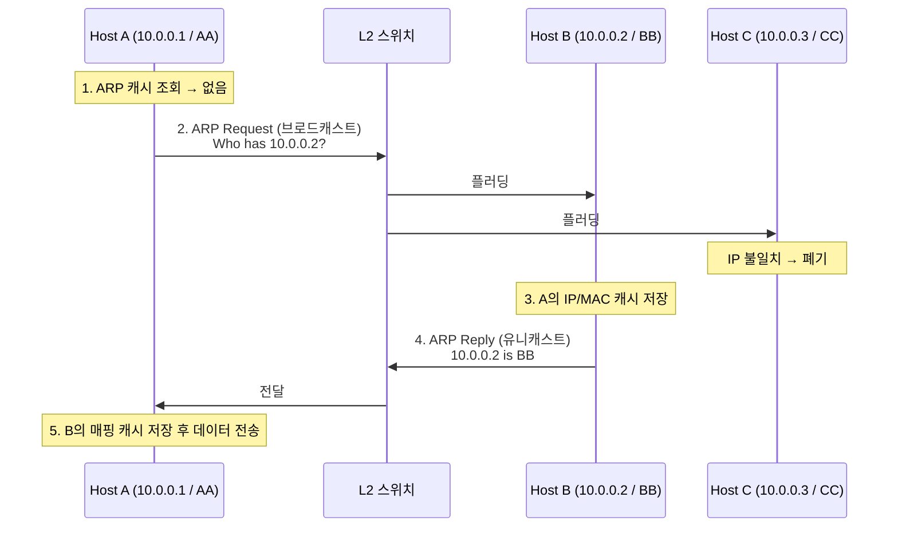

# ARP (Address Resolution Protocol)

---

## I. IP 주소로 MAC 주소를 찾는, ARP의 개요

### 가. 정의

- 같은 LAN에서 **목적지(또는 다음 홉)의 IP 주소로 프레임 전송에 필요한 MAC 주소를 알아내는** 주소 변환 [[프로토콜]] (RFC 826). L2와 L3 사이에서 동작

### 나. 특징

| 구분 | 내용 |
| --- | --- |
| 필요성 | IP는 논리 주소, 실제 프레임 전달에는 MAC 주소 필요 |
| 질의·응답 | 요청은 브로드캐스트, 응답은 유니캐스트 |
| 캐시 | ARP 테이블에 IP↔MAC 매핑을 일정 시간 저장해 질의 감소 |
| 다른 서브넷 | 목적지가 외부면 기본 [[게이트웨이]]의 MAC을 질의 |
| 보안 취약 | 인증이 없고 요청하지 않은 응답도 캐시에 반영 → 스푸핑 가능 |

---

## II. 동작 구조 및 구성요소

### 가. ARP 동작 절차

- 요청은 같은 브로드캐스트 도메인 전체에 전달되고, 해당 IP를 가진 호스트만 자신의 MAC으로 응답

### 나. 구성요소

| 구분 | 요소 | 설명 |
| --- | --- | --- |
| 메시지 | ARP Request | 목적지 MAC FF:FF:FF:FF:FF:FF 브로드캐스트 질의 |
| | ARP Reply | 대상 호스트의 유니캐스트 응답 |
| 저장 | ARP 캐시 | 동적 항목은 타이머 만료 시 삭제, 정적 항목 수동 설정 |
| 변형 | Proxy ARP | [[라우터]]가 다른 서브넷 호스트를 대신해 자신의 MAC으로 응답 |
| | Gratuitous ARP | 자기 IP를 질의·공지해 IP 충돌 감지, 이중화 전환 시 캐시 갱신 |
| 역변환 | [[RARP]] | MAC으로 자기 IP를 요청 (현재는 [[DHCP]]로 대체) |
| 위협 | ARP 스푸핑 | 위조 응답으로 캐시를 변조해 중간자 공격(MITM) |
| 대응 | DAI (Dynamic ARP Inspection) | 스위치가 DHCP 스누핑 바인딩과 대조해 위조 ARP 차단 |
| | 정적 ARP · 포트 보안 | 중요 서버·게이트웨이 매핑 고정, 포트별 MAC 제한 |

---

## III. 비교 및 동향

### 가. ARP (IPv4) vs NDP (IPv6)

| 비교 항목 | ARP | NDP |
| --- | --- | --- |
| 적용 | [[IPv4]] | [[IPv6]] |
| 메시지 기반 | 독자 프레임 (EtherType 0x0806) | ICMPv6 |
| 전송 방식 | 브로드캐스트 | Solicited-Node 멀티캐스트 |
| 수신 부하 | 브로드캐스트 도메인 전체 처리 | 해당 멀티캐스트 그룹만 처리 |
| 메시지 | Request / Reply | NS / NA (+ RS·RA·Redirect) |
| 부가 기능 | 주소 변환만 | 라우터 탐색, SLAAC, 중복 주소 검출(DAD) |
| 보안 | 기본 없음 | SEND(RFC 3971), RA Guard |

### 나. 동향

- **ARP Suppression**: EVPN-VXLAN·[[SDN(Software Defined Network)|SDN]] 환경에서 VTEP·가상 [[스위치]]가 학습한 정보로 ARP에 대신 응답해 BUM 트래픽 감소
- **IPv6 전환**: 듀얼 스택 망에서 NDP 보안(RA Guard, ND Inspection) 적용 확대

---

### 🔗 연관 토픽

- **소속 도메인**: [[00_네트워크_MOC|🌐 네트워크]]
- **세부 분류**: `1. OSI 7계층 & 데이터링크 계층 (L1/L2)`
- **핵심 연관 토픽**:
  - [[RARP]]
  - [[DHCP|DHCP(Dynamic Host Configuration Protocol)]]
  - [[네트워크 계층|네트워크 계층 (Network Layer)]]
  - [[데이터 링크 계층]]
  - [[IPv6]]
