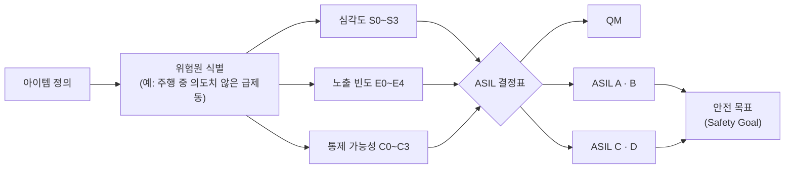

# ASIL (Automotive Safety Integrity Level)

---

## I. 자동차 기능안전 등급, ASIL의 개요

### 가. 정의

- [[ISO 26262]]에서 차량 E/E 시스템의 위험원별로 **심각도(S)·노출 빈도(E)·통제 가능성(C)을 평가해 부여하는 안전 요구 수준**으로, QM과 ASIL A~D(D가 가장 엄격)로 구분

### 나. 특징

| 구분 | 내용 |
| --- | --- |
| 등장 배경 | ADAS·[[Smart Car(자율주행)\|자율주행]]으로 차량 SW·전장 복잡도 증가, 오작동이 인명 피해로 직결 |
| 위험 기반 | 시스템 자체가 아니라 위험원(Hazardous Event)별로 등급 부여 |
| 차등 요구 | 등급이 높을수록 설계·검증·하드웨어 지표 요구 강화 |
| 기원 | [[IEC 61508]]의 SIL을 자동차 특성에 맞게 변형 |

---

## II. 산정 절차 및 구성요소

### 가. HARA 절차

- 위험원별 S·E·C 조합으로 ASIL을 정하고, 위험을 회피·완화하는 안전 목표에 해당 ASIL을 부여하여 하위 요구사항으로 전파

### 나. 구성요소

| 구분 | 요소 | 설명 |
| --- | --- | --- |
| 평가 지표 | 심각도 (S) | 사고 시 상해 정도, S0(상해 없음) ~ S3(생명 위협·치명상) |
| | 노출 빈도 (E) | 해당 운전 상황에 놓일 확률, E0(거의 없음) ~ E4(높음) |
| | 통제 가능성 (C) | 운전자 등이 사고를 회피할 수 있는 정도, C0(일반적으로 통제 가능) ~ C3(통제 곤란) |
| 등급 | QM | 일반 품질관리(IATF 16949 등)로 충분, ISO 26262 추가 요구 없음 |
| | ASIL A ~ D | S3·E4·C3 조합만 ASIL D, 조합 수준이 한 단계 낮아질 때마다 등급 하락 |
| 활동 | HARA | 위험원 분석 및 위험 평가 |
| | 안전 목표 (Safety Goal) | 위험원별 최상위 안전 요구사항, ASIL 부여 |
| 기법 | ASIL 분해 (Decomposition) | 독립된 중복 요소로 요구사항 분배 (예: D → C(D) + A(D), B(D) + B(D)) |
| 하드웨어 지표 | SPFM / LFM / PMHF | 단일점 고장·잠재 고장 지표, 확률적 하드웨어 고장률 목표 (ASIL D: SPFM ≥ 99%) |

---

## III. 비교 및 동향

### 가. ISO 26262 vs ISO 21448 vs ISO/SAE 21434

| 비교 항목 | ISO 26262 (기능안전) | ISO 21448 (SOTIF) | ISO/SAE 21434 (사이버보안) |
| --- | --- | --- | --- |
| 목적 | E/E 시스템 고장으로 인한 위험 방지 | 고장 없이도 기능 한계·오용으로 인한 위험 방지 | 사이버 공격으로 인한 위험 방지 |
| 원인 | HW 랜덤 고장, SW·설계 결함 | 센서 인지 한계, 알고리즘 판단 오류 | 악의적 공격, 통신·OTA 취약점 |
| 등급 · 지표 | ASIL | 알려진/미지의 위험 시나리오 축소 | CAL (Cybersecurity Assurance Level) |
| 분석 기법 | HARA, FMEA, FTA | 시나리오 기반 분석, [[STPA]] | TARA |
| 대상 | 제동·조향 등 E/E 시스템 | ADAS·자율주행 인지·판단 기능 | 커넥티드 카, OTA |

### 나. 동향

- **통합 엔지니어링**: 기능안전·SOTIF·사이버보안([[차량 사이버 보안 국제 표준(ISO 21434)|ISO 21434]])을 개발 초기부터 함께 적용하는 Safety & Security Co-engineering
- **AI 안전**: 자동차 AI 시스템 안전 지침 ISO/PAS 8800(2024) 발행, 학습 기반 기능의 안전 논증 요구
- **규제 연계**: UNECE R155(사이버보안)·R156(SW 업데이트) 인증 의무화로 표준 준수가 형식승인 요건화

---

### 🔗 연관 토픽

- **소속 도메인**: [[00_디지털서비스_MOC|🚀 디지털서비스]]
- **세부 분류**: `3. 사물인터넷 (IoT) & 스마트 플랫폼 · 메타버스`
- **핵심 연관 토픽**:
  - [[ISO 26262]]
  - [[IEC 61508]]
  - [[차량 사이버 보안 국제 표준(ISO 21434)]]
  - [[STPA|STPA (System-Theoretic Process Analysis)]]
  - [[Smart Car(자율주행)]]
