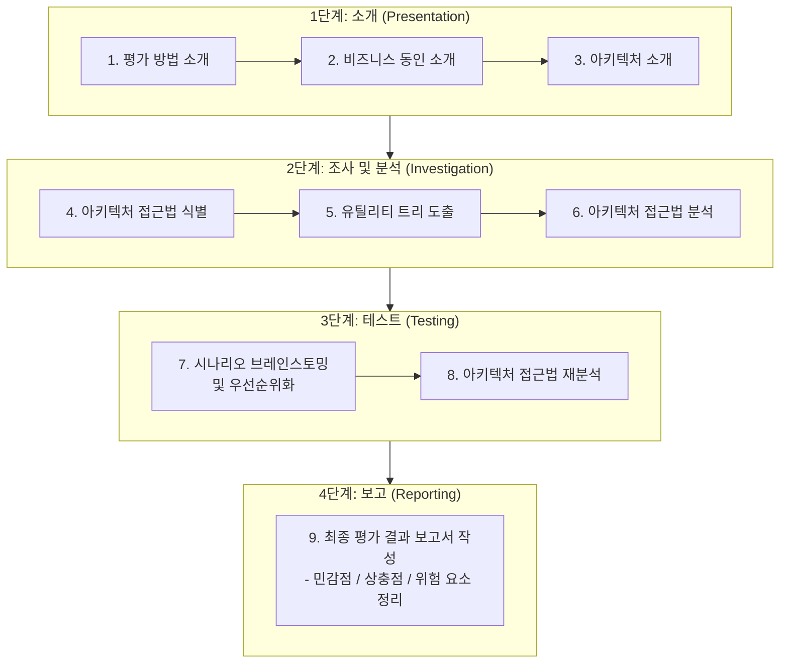

# ATAM (Architecture Tradeoff Analysis Method)

---

## I. 품질 속성 간 상충관계 분석, ATAM의 개요

소프트웨어 아키텍처가 성능, 가용성, 보안성 등 다양한 비기능적 품질 요구사항을 얼마나 만족하는지 평가하고, 아키텍처 결정에 따른 품질 속성 간의 상충관계(Trade-off)와 잠재적 위험 요소를 체계적으로 식별하는 시나리오 기반 아키텍처 평가 방법론이다.

| 구분 | 주요 내용 |
| --- | --- |
| **개념** | 시스템 이해관계자 전원이 참여하여 유틸리티 트리와 시나리오를 정의하고, 아키텍처 결정이 품질 목표 달성에 미치는 영향을 분석하는 평가 프레임워크 |
| **등장 배경** | 단일 속성 위주([[SAAM]]) 평가의 한계 극복, 시스템 복잡도 증가에 따라 발생하는 품질 간 충돌(예: 보안 강화로 인한 성능 저하) 문제의 조기 해결 필요 |
| **핵심 특징** | 유틸리티 트리(Utility Tree)를 통한 품질 속성 구체화, 민감점(Sensitivity)과 상충점(Trade-off) 도출, 조기 위험(Risk) 식별을 통한 재작업 방지 |

---

## II. ATAM의 프로세스 및 핵심 기술 요소

### 가. ATAM의 평가 절차(4단계 9활동) 및 프로세스

이해관계자들이 모여 비즈니스 목표와 아키텍처를 공유하고, 유틸리티 트리와 시나리오를 바탕으로 아키텍처 접근법을 분석하여 최종적으로 민감점, 상충점, 위험 요소를 도출한다.

### 나. ATAM의 핵심 산출물 및 기술 요소

| 분류 | 요소기술 (키워드) | 세부 설명 |
| --- | --- | --- |
| **품질 구체화** | [[유틸리티 트리]] (Utility Tree) | 시스템 비즈니스 목표를 최상위 품질 속성, 세부 속성, 구체적 품질 시나리오로 체계화한 트리 |
| **평가 기준** | 시나리오 (Scenario) | 자극(Stimulus)과 반응(Response)으로 정의된 시스템 상황 (사용 사례, 성장, 탐색 시나리오) |
| **분석 요소** | 민감점 (Sensitivity Point) | 특정 하나의 품질 속성에 지대한 영향을 미치는 아키텍처 결정 사항 (예: 특정 암호화 알고리즘 채택) |
| **분석 요소** | 상충점 (Trade-off Point) | 둘 이상의 품질 속성에 영향을 미치며 하나를 개선하면 다른 하나가 저하되는 결정 (예: 보안 향상 vs 성능 저하) |
| **리스크 판별** | 위험 요소 (Risk) | 의도된 품질 속성을 만족하지 못해 향후 시스템 장애나 문제로 이어질 수 있는 아키텍처 결정 |
| **리스크 판별** | 비위험 요소 (Non-Risk) | 품질 목표를 충분히 충족하며 안전성이 검증된 바람직한 아키텍처 설계 결정 |
| **평가 대상** | 아키텍처 접근법 (Approach) | 품질 요구사항을 달성하기 위해 아키텍트가 채택한 설계 패턴, 스타일, 전술(Tactics) |
| **참여 주체** | 이해관계자 (Stakeholders) | 아키텍트, 프로젝트 관리자, 개발자, 고객, 운영자 등 시스템 생명주기 관련 전원 참여 |

---

## III. 클라우드/MSA 환경에서의 ATAM 활용 및 발전 동향

### 가. 마이크로서비스(MSA) 설계 시 ATAM 기반 주요 Trade-off 분석

| 구분 | MSA 설계 시 주요 상충관계 (Trade-off) | ATAM 기반 아키텍처 의사결정 방안 |
| --- | --- | --- |
| **데이터 정합성** | **ACID 강결합 vs 성능 및 고가용성** | Saga 패턴 및 Event Sourcing 도입에 따른 복잡도(Risk)와 트랜잭션 성능(Sensitivity) 비교 분석 |
| **서비스 분할** | **도메인 독립성 vs 네트워크 지연** | 마이크로서비스 분할 입도(Granularity) 설정 시 서비스 간 통신 오버헤드 시나리오 기반 적정선 도출 |
| **보안 및 인증** | **Zero-Trust 보안 vs 종단 응답 지연** | API Gateway 및 Service Mesh mTLS 적용에 따른 보안성 향상과 암복호화 레이턴시 상충관계 평가 |

### 나. 최신 기술 동향 및 발전 방향

* **[[CBAM]] 연계를 통한 경제적 ROI 검증**: ATAM을 통해 도출된 아키텍처 대안들에 비용-편익 분석 모델(CBAM)을 결합하여, 기술적 타당성과 함께 경영진의 투자 대비 수익률(ROI) 의사결정 지원.
* **지속적 아키텍처 평가(Continuous Architecture Evaluation)**: 한 번의 이벤트성 평가에 그치지 않고, CI/CD 파이프라인 내에서 성능·보안 적합도 함수(Fitness Functions)를 자동화하여 아키텍처 드리프트를 지속 검증하는 방식으로 발전함.

---

### 🔗 연관 토픽

- **소속 도메인**: [[00_소프트웨어공학_MOC|🏗️ 소프트웨어공학]]
- **세부 분류**: `3. 요구사항 공학 & UML 객체지향 분석/설계`
- **핵심 연관 토픽**:
  - [[CBAM]]
  - [[ARID]]
  - [[SAAM]]
  - [[유틸리티 트리]]
  - [[SW Architecture 평가]]
