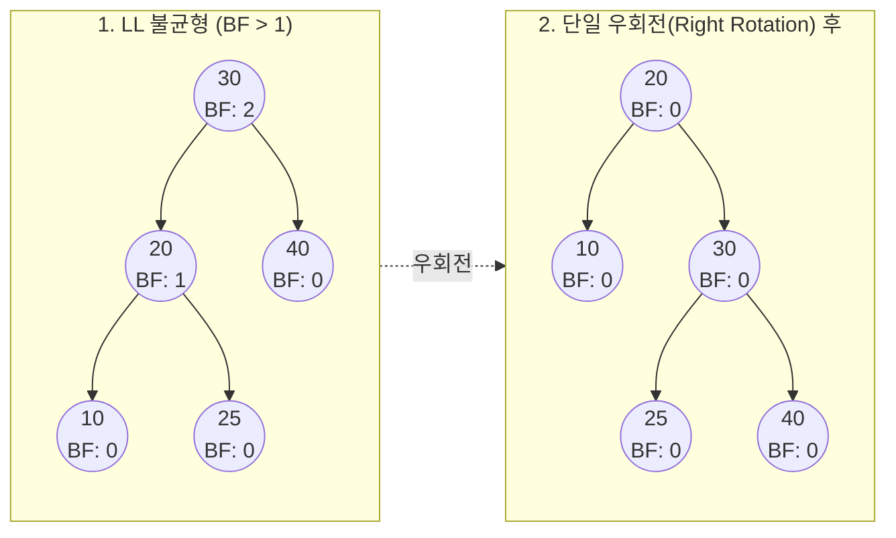

# AVL 트리

---

## I. 높이 균형을 통한 탐색 성능 보장, AVL 트리의 개요

### 가. 정의

- 이진 탐색 트리의 편향(Skewed) 문제를 해결하기 위해 **모든 노드의 좌우 서브트리 높이 차이(균형 인수)를 1 이하로 유지하는 자가 균형 이진 탐색 트리(Self-Balancing BST)**

### 나. 특징 및 필요성

| 구분 | 내용 |
| --- | --- |
| 편향 방지 | 정렬된 데이터 연속 삽입 시 선형 탐색($O(N)$)으로 퇴화하는 편향 트리 방지 |
| 엄격한 균형 | 모든 노드의 균형 인수(Balance Factor)가 $\{-1, 0, 1\}$을 유지하도록 강제 |
| 회전 연산 | 데이터 삽입·삭제 시 불균형 발생 노드를 기준으로 4가지 회전(LL, RR, LR, RL) 수행 |
| 시간 복잡도 | 최악의 경우에도 탐색, 삽입, 삭제 연산의 $O(\log N)$ 수행 시간 보장 |

---

## II. 개념도 및 핵심 구성요소

### 가. 개념도 (회전 연산)

- 노드 삽입 후 균형 인수가 $\pm 1$을 벗어나면 회전 연산(Single/Double Rotation)을 수행하여 즉시 트리의 높이 균형을 복원

### 나. 핵심 구성요소 및 회전 기법

| 구분 | 요소 | 설명 |
| --- | --- | --- |
| 균형 지표 | Balance Factor (BF) | 왼쪽 서브트리 높이에서 오른쪽 서브트리 높이를 뺀 값 ($BF = H_L - H_R$) |
| | 균형 조건 | 트리 내 모든 노드가 $-1 \le BF \le 1$ 조건을 만족 |
| 단일 회전 | LL 회전 (Right) | 왼쪽 자식의 왼쪽에 삽입되어 불균형 발생 시, 부모 노드를 기준으로 우회전 수행 |
| | RR 회전 (Left) | 오른쪽 자식의 오른쪽에 삽입되어 불균형 발생 시, 부모 노드를 기준으로 좌회전 수행 |
| 이중 회전 | LR 회전 (Left-Right) | 왼쪽 자식의 오른쪽에 삽입된 경우, 자식 기준 좌회전 후 부모 기준 우회전 수행 |
| | RL 회전 (Right-Left) | 오른쪽 자식의 왼쪽에 삽입된 경우, 자식 기준 우회전 후 부모 기준 좌회전 수행 |
| 성능 | $O(\log N)$ | 트리 높이가 항상 $\log_2 N$에 비례하도록 유지되어 안정적인 검색 속도 제공 |

---

## III. 자가 균형 트리 비교 및 동향

### 가. AVL 트리 vs Red-Black 트리

| 비교 항목 | AVL 트리 | Red-Black 트리 |
| --- | --- | --- |
| 균형 조건 | 엄격함 (좌우 높이 차이 최대 1) | 상대적 완화 (루트-리프 간 Black 노드 수 동일) |
| 트리 높이 | 더 낮음 ($\approx 1.44 \log_2 N$) | 상대적으로 높음 ($\le 2 \log_2(N+1)$) |
| 탐색 속도 | 매우 빠름 (높이가 낮아 검색 유리) | AVL 대비 소폭 느림 |
| 삽입·삭제 속도 | 상대적 느림 (잦은 회전 및 재균형 오버헤드) | 빠름 (최대 2~3회 회전으로 불균형 해소) |
| 메모리 소모 | 노드당 정수형 BF 또는 높이 필드 필요 | 노드당 1비트 색상 정보(Red/Black)만 요구 |
| 주 활용 분야 | 검색 빈도가 삽입·삭제보다 많은 읽기 집중 환경 | 삽입·삭제가 빈번한 범용 라이브러리 (`std::map`, `TreeMap`, CFS 스케줄러) |

### 나. 동향

- **범용 라이브러리의 Red-Black 트리 선호**: 최신 OS 커널 및 프로그래밍 언어 표준 라이브러리는 삽입/삭제 오버헤드가 적은 Red-Black 트리를 기본 맵 자료구조로 채택
- **데이터베이스 인덱스와 B-Tree**: 메인 메모리가 아닌 디스크/SSD I/O 환경에서는 이진 트리의 포인터 추적 오버헤드를 줄이기 위해 노드당 다수의 키를 갖는 B-Tree, B+Tree로 확장 발전
- **캐시 메모리 친화적 최적화**: 포인터 기반 트리의 캐시 미스를 완화하기 위해 배열 기반의 콤팩트 레이아웃이나 캐시 라인 크기에 맞춘 캐시 인지형(Cache-Conscious) 트리 구조 연구 지속

---

### 🔗 연관 토픽

- **소속 도메인**: [[00_컴퓨터구조_MOC|💻 컴퓨터구조]]
- **세부 분류**: `4. 기본 자료구조 (Data Structures)`
- **핵심 연관 토픽**:
  - [[이진 탐색 트리|이진 탐색 트리(Binary Search Tree)]]
  - [[트리 순회|트리 순회 (Tree Traversal)]]
  - [[힙|힙 (Heap)]]
  - [[Balanced Tree B-Tree|Balanced Tree B-Tree (비트리)]]
  - [[알고리즘]]
