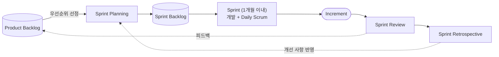

# 애자일 (Agile)

---

## I. 계획보다 변화 대응, 애자일의 개요

### 가. 정의

- 짧은 주기로 **동작하는 소프트웨어를 반복·점진적으로 인도하고 고객 피드백으로 변화에 대응**하는 경량 [[소프트웨어 개발 방법론]]의 총칭

### 나. 특징

| 구분 | 내용 |
| --- | --- |
| 등장 배경 | [[워터폴\|폭포수]]의 경직성, 불확실한 비즈니스 환경, Time-to-Market 요구 |
| 가치 | 개인과 상호작용, 작동하는 SW, 고객 협력, 변화 대응 ([[애자일 선언문]]) |
| 반복 · 점진 | 1~4주 주기로 동작하는 증분 인도 |
| 자율 팀 | 다기능 팀의 자기 관리, 경험적 프로세스 제어(투명성·검토·조정) |

---

## II. 스크럼 프로세스 및 구성요소

### 가. 스크럼(Scrum) 프로세스

- 제품 백로그의 상위 항목을 스프린트 백로그로 가져와 타임박스 안에서 증분을 만들고, 리뷰로 제품을, 회고로 프로세스를 개선

### 나. 구성요소 ([[SCRUM|Scrum]] 기준)

| 구분 | 요소 | 설명 |
| --- | --- | --- |
| 역할 | Product Owner | 제품 백로그 관리, 우선순위 결정, 가치 극대화 책임 |
| | Scrum Master | 스크럼 정착을 돕는 서번트 리더, 장애 요소 제거 |
| | Developers | 증분을 만드는 다기능·자기 관리 팀 |
| 산출물 | Product · Sprint Backlog | 전체 요구 목록, 해당 스프린트 구현 대상 |
| | Increment | 완료 정의(DoD)를 충족한 사용 가능한 결과물 |
| 이벤트 | Daily Scrum | 매일 15분, 스프린트 목표 대비 진행 점검 |
| | Review · Retrospective | 결과물 시연·피드백, 팀 [[프로세스]] 개선 |
| 실천 기법 | User Story | "As a ~, I want ~, so that ~" 형식의 사용자 관점 요구 |
| | Planning Poker | 스토리 포인트를 팀 합의로 추정 |

---

## III. 비교 및 동향

### 가. 애자일 vs 폭포수

| 비교 항목 | 애자일 | [[워터폴\|폭포수]] |
| --- | --- | --- |
| 접근 | 적응형 (Adaptive) | 예측형 (Predictive) |
| 개발 방식 | 반복·점진 | 순차·단계별 |
| 요구사항 | 진행 중 변경 허용 | 초기 확정, 변경 엄격 통제 |
| 고객 참여 | 전 과정 지속 참여 | 요구 정의·[[인수 테스트]] 시점 집중 |
| 진척 척도 | 동작하는 SW | 문서·산출물 |
| 통제 | 팀 자기 관리 | PM 중심 하향식 |
| 적합 사업 | 불확실성 높은 신규 서비스 | 요구 명확·안정적인 대형 시스템 |

### 나. 동향

- 대규모 조직 확장 프레임워크 SAFe, LeSS 도입
- 공공·대형 사업에서 폭포수 관리 체계 위에 애자일 개발을 결합한 하이브리드 방식 확산
- [[DevOps]]·CI/CD와 결합해 스프린트 단위를 넘어 상시 배포로 확장

---

### 🔗 연관 토픽

- **소속 도메인**: [[00_소프트웨어공학_MOC|🏗️ 소프트웨어공학]]
- **세부 분류**: `1. 소프트웨어 개발 생명주기(SDLC) & 방법론`
- **핵심 연관 토픽**:
  - [[애자일 선언문]]
  - [[SCRUM]]
  - [[소프트웨어 개발 방법론]]
  - [[워터폴]]
  - [[TDD]]
