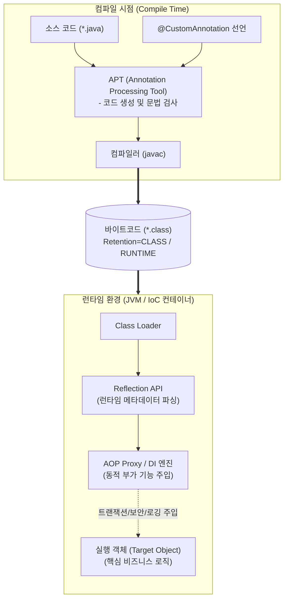

# Annotation

---

## I. 선언적 프로그래밍을 위한 메타데이터, Annotation의 개요

소스 코드에 메타데이터(Metadata)를 선언하여 컴파일러나 런타임 프레임워크가 특정 동작(유효성 검증, 설정 주입, AOP 횡단 처리 등)을 수행하도록 지시하는 마크업 형태의 프로그래밍 태그이다.

| 구분 | 주요 내용 |
| --- | --- |
| **개념** | `@` 기호를 접두사로 사용하여 클래스, 메서드, 필드 등에 부가적인 제어 정보를 부여하고, 리플렉션이나 컴파일러 도구를 통해 해석되는 메타데이터 체계 |
| **등장 배경** | 기존 [[XML]] 기반의 방대하고 파편화된 외부 설정 파일 관리의 복잡성 극복, 설정 정보와 비즈니스 로직의 응집도 향상 요구 |
| **핵심 특징** | 보일러플레이트 코드 감소, 의존성 주입(DI) 및 관점 지향 프로그래밍([[AOP (Aspect Oriented Programming)|AOP]])의 기반 제공, 컴파일 타임 검증 지원 |

---

## II. Annotation의 동작 원리 및 핵심 기술 요소

### 가. Annotation의 아키텍처 및 런타임 처리 흐름

작성된 어노테이션은 컴파일 타임에 APT를 통해 유효성 검증 및 코드를 자동 생성하거나, 바이트코드에 보존된 후 런타임에 Reflection API를 통해 해석되어 동적 프록시 기반의 부가 기능을 주입한다.

### 나. Annotation의 핵심 기술 및 구성 요소

| 분류 | 요소기술 (키워드) | 세부 설명 |
| --- | --- | --- |
| **메타 태그** | Meta-Annotation | 커스텀 어노테이션을 정의할 때 사용하는 어노테이션 (`@Target`, `@Retention`, `@Documented` 등) |
| **유지 정책** | Retention Policy | 어노테이션의 생명주기를 규정 (SOURCE: 컴파일 시 제거, CLASS: 바이트코드 유지, RUNTIME: JVM 실행 중 참조) |
| **적용 대상** | Target | 어노테이션을 부착할 수 있는 문법적 위치 지정 (TYPE, METHOD, FIELD, PARAMETER 등) |
| **런타임 해석** | Reflection API | JVM 런타임에 클래스의 메타데이터 및 어노테이션 정보를 동적으로 조회하여 인스턴스를 제어하는 기법 |
| **부가기능 주입** | [[AOP (Aspect Oriented Programming)|AOP]] 포인트컷 | 특정 어노테이션을 포인트컷 기준으로 지정하여 트랜잭션, 로깅 등 횡단 관심사 로직을 대상 메서드에 위빙 |
| **객체 관리** | 의존성 주입 (DI) | `@Autowired`, `@Inject` 등을 통해 IoC 컨테이너가 런타임에 객체 생명주기와 의존성을 동적 결합 |
| **컴파일 도구** | APT (Annotation Processor) | 컴파일 타임에 어노테이션을 스캔하여 소스 코드를 자동 생성하는 전처리기 (Lombok, MapStruct 등) |

---

## III. 설정 방식 비교 및 최신 동향

### 가. Annotation 기반 내부 설정 vs XML 기반 외부 설정 비교

| 비교 항목 | Annotation 기반 설정 (코드 내장형) | XML 기반 설정 (외부 분리형) |
| --- | --- | --- |
| **설정 위치** | 소스 코드 대상 위치에 직접 선언 | 별도의 XML 설정 파일로 분리 관리 |
| **응집도/가독성** | 대상 로직과 설정이 결합되어 직관적 파악 가능 | 설정이 한 파일에 모여 전체 시스템 구조 파악 용이 |
| **변경 유지보수** | 설정 변경 시 소스 코드 재컴파일 및 재배포 필요 | 소스 재컴파일 없이 설정 파일 교체로 런타임 반영 가능 |
| **타입 안정성** | 컴파일 타임에 타입 및 문법적 오류 사전 검증 | 문자열 기반 매핑으로 런타임 실행 시에야 오류 발견 가능 |
| **주요 활용처** | 비즈니스 로직별 의존성 주입, 트랜잭션 선언 | 환경별 인프라 연결 정보, 전역 보안 및 레거시 프레임워크 |

### 나. 최신 기술 동향 및 발전 방향

* **코드 최소화(Zero Configuration) 표준화**: Spring Boot의 메타 어노테이션(예: `@SpringBootApplication`) 체계 확산으로 복잡한 보일러플레이트 설정이 자동 구성(Auto-Configuration)으로 대체됨.
* **컴파일 타임 AOT(Ahead-Of-Time) 최적화**: 클라우드 네이티브 환경의 빠른 기동(Cold Start) 속도를 위해 런타임 리플렉션 대신 컴파일 시점에 어노테이션을 사전 분석하고 코드를 생성하는 GraalVM Native Image 및 Quarkus 기술이 대두됨.

---

### 🔗 연관 토픽

- **소속 도메인**: [[00_소프트웨어공학_MOC|🏗️ 소프트웨어공학]]
- **세부 분류**: `6. 소프트웨어 테스팅 & 품질 보증 (QA/QC)`
- **핵심 연관 토픽**:
  - [[AOP (Aspect Oriented Programming)]]
  - [[XML]]
  - [[JSON]]
  - [[응집도]]
  - [[디자인 패턴]]
