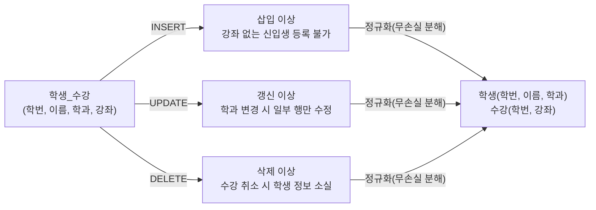

# Anomaly (이상현상)

---

## I. 중복이 낳는 불일치, 이상현상의 개요

### 가. 정의

- 정규화되지 않은 릴레이션에서 **데이터 중복과 부적절한 [[함수적 종속성]] 때문에 삽입·삭제·갱신 시 발생하는 논리적 오류**

### 나. 특징

| 구분 | 내용 |
| --- | --- |
| 원인 | 서로 다른 주제의 속성을 한 릴레이션에 혼재 (부분·이행 종속) |
| 영향 | 데이터 불일치, 정보 손실, 불필요한 NULL |
| 해결 | 무손실 분해를 통한 정규화 |
| 예외 | 성능을 위한 반정규화에서는 동기화 로직으로 관리 |

---

## II. 발생 메커니즘 및 유형

### 가. 발생과 해결

- (학번, 강좌)가 키인 릴레이션에서 이름·학과가 학번에만 부분 종속해 세 가지 이상현상 발생

### 나. 유형 및 관련 요소

| 구분 | 요소 | 설명 |
| --- | --- | --- |
| 이상 유형 | 삽입 이상 | 원하지 않는 값까지 함께 넣어야 하거나 키 일부가 NULL이 되어 삽입 불가 |
| | 갱신 이상 | 중복 행 중 일부만 갱신되어 불일치 발생 |
| | 삭제 이상 | 한 정보 삭제 시 함께 저장된 다른 정보까지 소실 |
| 원인 | 데이터 중복 | 같은 사실이 여러 행에 반복 저장 |
| | 부분·이행 종속 | 기본키 일부 또는 비키 속성에 종속된 속성 혼재 |
| 해결 | [[데이터베이스 정규화\|정규화]] | 1NF~5NF, [[BCNF]] 단계별 분해 |
| 분해 원칙 | 무손실 분해 | 다시 조인하면 원래 릴레이션 복원 |
| | 종속성 보존 | 원래 함수 종속을 분해 후에도 유지 |

---

## III. 비교 및 동향

### 가. RDBMS vs NoSQL의 이상현상 대응

| 비교 항목 | RDBMS (정규화) | [[NoSQL (CAP 이론 BASE 속성)\|NoSQL]] (반정규화) |
| --- | --- | --- |
| 설계 목표 | 무결성, 중복 최소화 | 조회 성능, 확장성 |
| 대응 | 정규화로 구조적 제거 | 중복 허용, 동기화로 관리 |
| 일관성 | ACID | 최종 일관성 (BASE) |
| 통제 주체 | DBMS 제약조건 | 애플리케이션·배치 로직 |

### 나. 동향

- **CQRS·이벤트 기반 동기화**: 읽기 모델 중복 데이터를 이벤트로 갱신해 불일치 최소화 ([[MSA (Micro Service Architecture)|MSA]])
- **데이터 관측성**: 파이프라인 전반의 정합성 이상을 자동 탐지

---

### 🔗 연관 토픽

- **소속 도메인**: [[00_데이터베이스_MOC|🗄️ 데이터베이스]]
- **세부 분류**: `1. 데이터 모델링 & 관계형 DB 설계`
- **핵심 연관 토픽**:
  - [[함수적 종속성|함수적 종속성 (Functional Dependency)]]
  - [[데이터베이스 정규화]]
  - [[BCNF|BCNF (Boyce-Codd Normal Form 3.5NF)]]
  - [[데이터베이스 반정규화]]
  - [[무결성]]
