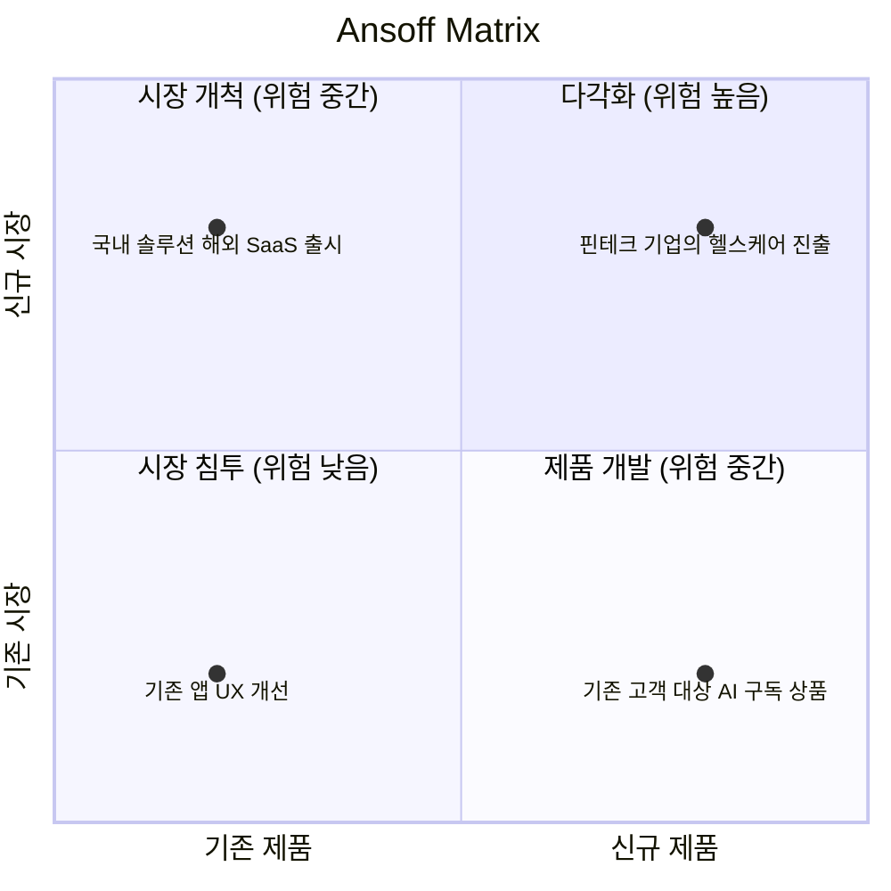

# Ansoff Matrix (앤소프 매트릭스)

---

## I. 제품과 시장으로 성장 경로를 고르는, Ansoff Matrix의 개요

### 가. 정의

- **제품(기존/신규)과 시장(기존/신규)** 두 축을 교차해 시장 침투·시장 개척·제품 개발·다각화의 4가지 성장 전략을 도출하는 [[프레임워크]] (H. I. Ansoff, 1957)

### 나. 특징

| 구분 | 내용 |
| --- | --- |
| 성장 방향 제시 | "어디로 성장할 것인가"를 제품·시장 조합으로 단순화 |
| 위험 비교 | 기존 영역에서 멀어질수록 위험 증가, 다각화가 가장 위험 |
| 갭 분석 연계 | 목표 매출과 현 사업 성장 한계 간 차이를 메울 전략 선택 |
| IT 기획 활용 | [[ISP (Information Strategy Plan)\|ISP]]·DX 기획 시 신규 서비스 방향 정의 |

---

## II. Ansoff Matrix의 구조 및 4대 전략

### 가. 매트릭스

- 위험이 낮은 시장 침투에서 시작해 역량이 쌓이면 제품 개발·시장 개척을 거쳐 다각화로 확장하는 것이 일반적 경로

### 나. 4대 전략

| 구분 | 요소 | 설명 |
| --- | --- | --- |
| 기존 시장 | 시장 침투 (Market Penetration) | 기존 제품으로 점유율 확대 (판촉, 가격, 리텐션 개선) |
| | 제품 개발 (Product Development) | 기존 고객에게 신규 제품 제공 (예: 이커머스의 간편결제 출시) |
| 신규 시장 | 시장 개척 (Market Development) | 기존 제품으로 새 지역·고객층 진출 (예: 해외 진출, B2B → B2C) |
| | 다각화 (Diversification) | 신규 제품으로 신규 시장 진출 (관련·비관련 다각화, M&A) |

---

## III. BCG Matrix 비교 및 동향

### 가. Ansoff vs BCG

| 구분 | Ansoff Matrix | [[BCG Matrix]] |
| --- | --- | --- |
| 목적 | 성장 방향 도출 | 사업 포트폴리오 자원 배분 |
| 축 | 제품 (기존/신규) × 시장 (기존/신규) | 상대적 시장 점유율 × 시장 성장률 |
| 결과 | 침투, 개척, 개발, 다각화 | Star, Cash Cow, Question Mark, Dog |
| 판단 기준 | 위험 수준 | 현금 창출·소요 |
| 활용 시점 | 신사업 기획, M&A 검토 | 기존 사업부 평가 |

### 나. 동향

- **플랫폼 다각화**: 슈퍼앱·빅테크가 고객 데이터와 플랫폼을 기반으로 금융([[핀테크]])·모빌리티 등으로 다각화하며 위험을 낮춤
- **위험 완화 실행**: 다각화를 [[MVP]] 출시와 [[린 방법론|린 스타트업]] 실험으로 단계적으로 검증

---

### 🔗 연관 토픽

- **소속 도메인**: [[00_경영전략_MOC|📈 경영전략]]
- **세부 분류**: `1. 경영 환경 분석 & 전략 수립 프레임워크`
- **핵심 연관 토픽**:
  - [[BCG Matrix]]
  - [[환경분석]]
  - [[SWOT분석]]
  - [[ISP (Information Strategy Plan)]]
  - [[린 방법론|린 (Lean) 방법론]]
