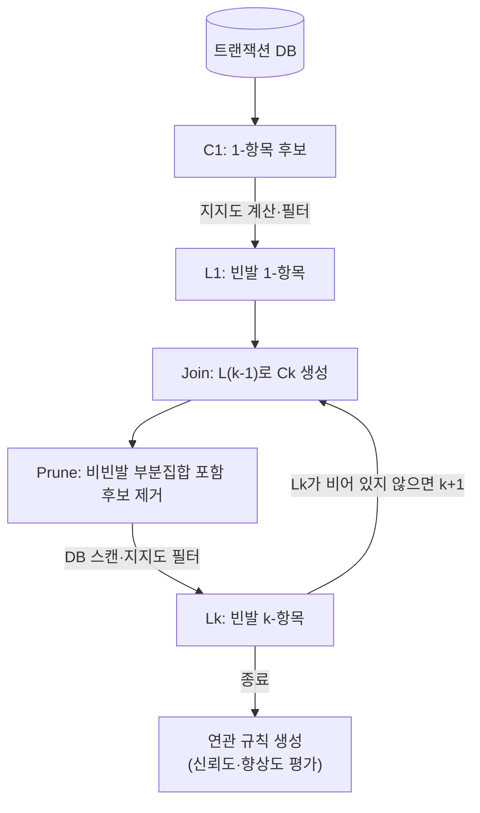

# Apriori 알고리즘

---

## I. 빈발 항목 집합 탐색의 기본, Apriori 알고리즘의 개요

### 가. 정의

- 트랜잭션 데이터에서 **최소 [[지지도]] 이상인 빈발 항목 집합을 크기 1부터 단계적으로 확장·가지치기하며 찾고, 이로부터 연관 규칙을 생성하는 알고리즘** (Agrawal·Srikant, 1994)

### 나. 특징

| 구분 | 내용 |
| --- | --- |
| Apriori 성질 | 빈발 집합의 모든 부분집합은 빈발 (역으로 비빈발 집합의 상위 집합은 비빈발) |
| 탐색 방식 | 상향식(Bottom-up)·너비 우선, k-항목 → (k+1)-항목 |
| 후보 생성·검증 | 후보 생성 후 DB를 스캔해 지지도 계산 |
| 한계 | 후보 집합 폭증, 단계마다 DB 반복 스캔 |

---

## II. 동작 원리 및 구성요소

### 가. 동작 절차

- 각 단계에서 후보를 만들고(Join), Apriori 성질로 줄인 뒤(Prune), DB 스캔으로 지지도를 확인

### 나. 구성요소

| 구분 | 요소 | 설명 |
| --- | --- | --- |
| 평가 지표 | 지지도 | P(A∩B) |
| | 신뢰도 | P(B\|A) |
| | 향상도 | P(B\|A) / P(B) |
| 핵심 원리 | Apriori 성질 | 하향 폐쇄성(Downward Closure)으로 탐색 공간 축소 |
| 단계 | Join | (k-1)-빈발 집합을 결합해 k-후보 생성 |
| | Prune | 비빈발 (k-1)-부분집합을 가진 후보 제거 |
| | Count | DB 스캔으로 후보 지지도 계산 |
| 최적화 | Hash Tree | 후보 지지도 계산 시 빠른 탐색 |
| | [[DHP(Direct Hashing & Pruning) 알고리즘\|DHP]] | 해시 버킷으로 2-항목 후보 축소 |

---

## III. 비교 및 동향

### 가. Apriori vs FP-Growth

| 비교 항목 | Apriori | [[FP(Frequent Pattern) - Growth 알고리즘\|FP-Growth]] |
| --- | --- | --- |
| 방식 | 후보 생성 후 검증 | FP-Tree 기반 패턴 성장 |
| DB 스캔 | 최대 빈발 집합 크기만큼 반복 | 2회 |
| 메모리 | 후보 집합이 큼 | 압축 트리 |
| 성능 | 낮은 지지도·대용량에서 느림 | 대용량에 유리 |
| 장점 | 구현 단순, 이해 쉬움 | 후보 생성 불필요 |

### 나. 동향

- **분산 처리**: Spark MLlib은 Apriori 대신 병렬 FP-Growth(PFP)를 제공
- **교육·기준 알고리즘**: 실무는 FP-Growth·ECLAT 계열을 주로 쓰지만 연관 규칙의 기본 원리로 활용

---

### 🔗 연관 토픽

- **소속 도메인**: [[00_데이터베이스_MOC|🗄️ 데이터베이스]]
- **세부 분류**: `2. 트랜잭션 & 동시성 제어 (Concurrency)`
- **핵심 연관 토픽**:
  - [[연관성 분석]]
  - [[FP(Frequent Pattern) - Growth 알고리즘]]
  - [[DHP(Direct Hashing & Pruning) 알고리즘]]
  - [[지지도]]
  - [[연관화]]
