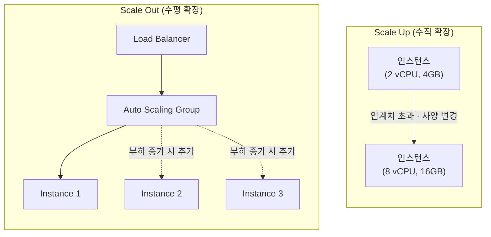

# Auto Scale Up과 Auto Scale Out

---

## I. 부하에 맞춘 자원 자동 조절, Auto Scaling의 개요

### 가. 정의

- 클라우드·[[컨테이너]] 환경에서 부하([[CPU]]·메모리·트래픽)를 감지하여 **단일 서버의 사양을 높이거나(Scale Up) 서버 수를 늘려(Scale Out)** 자원을 자동 조절하는 기술

### 나. 특징

| 구분 | 내용 |
| --- | --- |
| 등장 배경 | 트래픽 급증 시 장애 방지, 유휴 자원 최소화로 종량제 비용 절감 |
| 자동화 | 임계치(Threshold)·목표 추적·예측 정책 기반 자동 확장·축소 |
| 가용성 | 헬스체크로 비정상 인스턴스 교체 |
| 워크로드 적합성 | 무상태(Stateless)는 Scale Out, 상태 유지(Stateful)는 Scale Up 중심 |

---

## II. 구조 및 구성요소

### 가. 개념도

- Scale Up은 단일 노드의 사양을 높이고, Scale Out은 로드밸런서 뒤 인스턴스 수를 늘려 분산 처리

### 나. 구성요소

| 구분 | 요소 | 설명 |
| --- | --- | --- |
| 모니터링 | Metric Collector | CPU·메모리·네트워크·[[세션]] 수 등 지표 수집 (CloudWatch, Prometheus) |
| 제어 | Scaling Policy | Target Tracking, Step Scaling, Scheduled, Predictive |
| | Cooldown | 연속 확장·축소 진동 방지를 위한 대기 시간 |
| 자원 그룹 | ASG (Auto Scaling Group) | 동일 템플릿 인스턴스 그룹, 최소·최대·희망 용량 관리 |
| 분배 | Load Balancer | 추가된 인스턴스로 트래픽 분산 (ALB, NLB) |
| | Health Check | 비정상 인스턴스 제거 후 교체 |
| 쿠버네티스 | [[HPA (Horizontal Pod Autoscaler)\|HPA]] | 메트릭에 따라 Pod 복제 수 증감 (Scale Out) |
| | VPA | Pod의 CPU·메모리 requests/limits 조정 (Scale Up) |
| | Cluster Autoscaler | Pod를 배치할 노드가 부족하면 노드 수 증감 |

---

## III. 비교 및 동향

### 가. Scale Up vs Scale Out

| 비교 항목 | Scale Up (수직) | Scale Out (수평) |
| --- | --- | --- |
| 방식 | 단일 인스턴스의 CPU·RAM 증대 | 동일 사양 [[인스턴스]] 수 증가 |
| 적합 워크로드 | [[데이터베이스]](RDBMS), Stateful 앱 | Web/WAS, Stateless 앱 |
| 장점 | 구조 단순, 데이터 정합성 유지 용이 | 확장 한계가 작음, [[HA(High Availability)\|고가용성]] |
| 단점 | 장비 사양 상한, 변경 시 재시작 필요 | 로드밸런서 필요, 세션·상태 동기화 복잡 |
| 축소 명칭 | Scale Down | Scale In |

### 나. 동향

- **예측 기반 확장**: 과거 트래픽 패턴을 ML로 분석해 부하 이전에 선제 확장 (AWS Predictive Scaling)
- **이벤트 기반 확장**: KEDA로 Kafka 큐 길이 등 외부 이벤트에 따라 Pod 확장, 0개까지 축소
- **무재시작 수직 확장**: 쿠버네티스 In-place Pod Resize로 재생성 없이 Pod 자원 변경, 서버리스(Lambda, Cloud Run)는 요청 수에 따라 자동 확장

---

### 🔗 연관 토픽

- **소속 도메인**: [[00_디지털서비스_MOC|🚀 디지털서비스]]
- **세부 분류**: `1. 클라우드 컴퓨팅 & 가상화 인프라`
- **핵심 연관 토픽**:
  - [[HPA (Horizontal Pod Autoscaler)]]
  - [[쿠버네티스|쿠버네티스(Kubernetes)]]
  - [[클라우드 컴퓨팅|클라우드 컴퓨팅 (Cloud Computing)]]
  - [[컨테이너|컨테이너 (Container)]]
  - [[HA(High Availability)|고가용성]]
