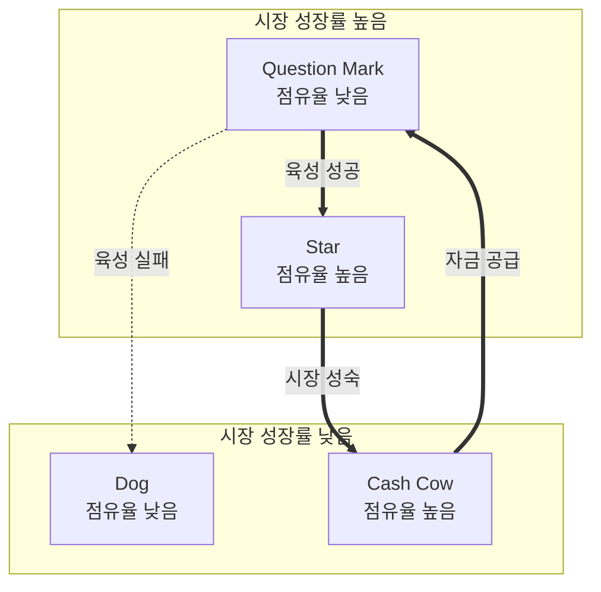

# BCG Matrix

---

## I. 현금 흐름으로 사업을 배분하는, BCG Matrix의 개요

### 가. 정의

- **시장 성장률과 상대적 시장 점유율** 두 축으로 사업 단위(SBU)를 4개 영역에 배치해 투자·회수 전략을 정하는 포트폴리오 관리 기법 (B. Henderson, BCG, 1970)

### 나. 특징

| 구분 | 내용 |
| --- | --- |
| 이론 근거 | 경험 곡선(점유율 ↑ → 원가 ↓ → 현금 창출 ↑), 제품 수명주기(성장률 ↑ → 투자 소요 ↑) |
| 현금 균형 | Cash Cow의 잉여 현금으로 Question Mark·Star를 육성 |
| 단순성 | 정량 지표 2개로 직관적 시각화 (원 크기 = 매출 규모) |
| 한계 | 사업 간 시너지 무시, 점유율과 수익성의 단순 등치 |

---

## II. BCG Matrix의 구조 및 전략

### 가. 4분면과 현금 흐름

- 관례상 가로축(상대 점유율)은 1.0, 세로축(성장률)은 10% 전후를 경계로 구분하며, 점유율 축은 왼쪽이 높음

### 나. 구성요소

| 구분 | 요소 | 설명 |
| --- | --- | --- |
| 평가 축 | 상대적 시장 점유율 | 자사 점유율 ÷ 최대 경쟁사 점유율 (원가 우위·현금 창출력) |
| | 시장 성장률 | 해당 산업의 연간 성장률 (투자 소요량) |
| 4분면 | Star | 고성장·고점유율, 현금 창출도 크지만 지위 방어 투자도 큼 |
| | Cash Cow | 저성장·고점유율, 투자 소요가 적어 주 자금원 |
| | Question Mark | 고성장·저점유율, 현금 소요 큼, 육성 또는 철수 판단 대상 |
| | Dog | 저성장·저점유율, 수확 또는 철수 검토 |
| 전략 | Build (육성) | 점유율 확대 투자 (Question Mark → Star) |
| | Hold (유지) | 현 점유율 유지 (Star, 강한 Cash Cow) |
| | Harvest (수확) | 투자 축소, 단기 현금 극대화 (약한 Cash Cow, Dog) |
| | Divest (철수) | 매각·청산 (Dog, 가망 없는 Question Mark) |

---

## III. GE/McKinsey Matrix 비교 및 동향

### 가. BCG vs GE/McKinsey

| 구분 | BCG Matrix | GE/McKinsey Matrix |
| --- | --- | --- |
| 크기 | 2 × 2 (4개 영역) | 3 × 3 (9개 영역) |
| 축 | 상대적 시장 점유율 / 시장 성장률 | 사업 강점 / 산업 매력도 |
| 지표 | 단일 정량 지표 | 다수 정량·정성 지표의 가중 합 |
| 전략 구분 | Build, Hold, Harvest, Divest | 투자·성장, 선별 유지, 수확·철수 |
| 한계 | 시너지 무시, 지표 단순 | 가중치·점수 부여의 주관성 ([[편향]]) |

### 나. 동향

- **플랫폼 사업의 한계**: 네트워크 효과·데이터 공유로 사업 간 시너지가 커져 사업부를 독립 평가하는 BCG의 전제가 약화
- **보완 기법**: 신사업은 실물 옵션 평가, 포트폴리오는 [[Ansoff Matrix]]·[[IT 투자성과 평가|IT 포트폴리오 관리]]와 병행

---

### 🔗 연관 토픽

- **소속 도메인**: [[00_경영전략_MOC|📈 경영전략]]
- **세부 분류**: `1. 경영 환경 분석 & 전략 수립 프레임워크`
- **핵심 연관 토픽**:
  - [[Ansoff Matrix]]
  - [[환경분석]]
  - [[SWOT분석]]
  - [[IT 투자성과 평가]]
  - [[편향]]
