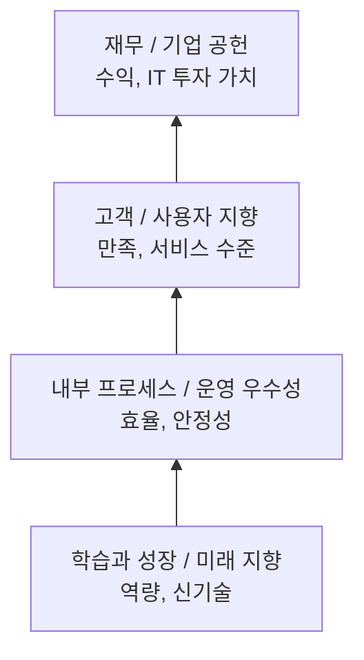

# BSC (Balanced Scorecard), IT-BSC (IT-Balanced Scorecard)

---

## I. 재무와 비재무를 함께 보는, BSC·IT-BSC의 개요

### 가. 정의

- **BSC**: 재무 지표만의 한계를 보완해 **재무·고객·내부 프로세스·학습과 성장 4개 관점**으로 전략 실행 성과를 측정하는 성과관리 기법 (R. Kaplan & D. Norton, 1992)
- **IT-BSC**: BSC를 IT 조직에 적용해 **기업 공헌·사용자 지향·운영 우수성·미래 지향 4개 관점**으로 IT 성과와 전략 정렬을 평가하는 모델 (W. Van Grembergen)

### 나. 특징

| 구분 | 내용 |
| --- | --- |
| 균형 | 재무–비재무, 단기–장기, 결과–선행 지표의 균형 |
| 인과관계 | 전략 지도(Strategy Map)로 관점 간 원인–결과 연결 |
| 하향 전개 | 전사 BSC → 부서·IT-BSC로 목표 캐스케이딩 |
| IT 정렬 | IT 성과를 경영 목표 기여도로 설명 |

---

## II. BSC·IT-BSC 구조 및 구성요소

### 가. 관점 간 인과관계

- 인력 역량과 기술(학습·성장)이 프로세스를 개선하고, 이것이 고객(사용자) 만족을 거쳐 재무 성과(기업 공헌)로 이어지는 인과 구조

### 나. 관점 매핑과 지표

| 구분 | 요소 | 설명 |
| --- | --- | --- |
| 재무 → 기업 공헌 | IT가 경영 가치에 기여하는가 | IT 투자 ROI, 예산 준수율, 사업 기여도 |
| 고객 → 사용자 지향 | 현업이 IT를 어떻게 평가하는가 | 사용자 만족도, [[SLA]] 준수율, 요청 처리 시간 |
| 내부 프로세스 → 운영 우수성 | IT 프로세스가 효율·안정적인가 | 가용성, MTTR, 프로젝트 납기 준수율 |
| 학습과 성장 → 미래 지향 | 미래 변화에 대비하는가 | 교육 시간, 신기술 적용, 아키텍처 개선 |
| 지표 설계 | SMART 원칙 | Specific, Measurable, Achievable, Relevant, Time-bound |

---

## III. 성과관리 기법 비교 및 동향

### 가. BSC vs IT-BSC vs OKR

| 구분 | BSC | IT-BSC | [[OKR]] |
| --- | --- | --- | --- |
| 대상 | 전사 | IT 조직 | 팀·개인 (전사 정렬) |
| 구조 | 4관점 + 전략 지도 | IT 4관점 | 목표 + 핵심 결과 |
| 주기 | 연 단위 | 연 단위 | 분기 단위 |
| 활용 | 전략 실행·보상 연계 | IT 성과·정렬 평가 | 도전적 목표 정렬, 보상과 분리 권장 |

### 나. 동향

- **거버넌스 연계**: COBIT 목표 체계, [[ITSM(Information Technology Service Management)|ITSM]] 지표와 연결해 [[IT 거버넌스]]의 성과 측정 수단으로 활용
- **ESG 관점 추가**: 지속가능성 관점을 추가한 확장 BSC 시도
- **실시간 대시보드**: 지표 데이터를 자동 수집해 주기적 보고서 대신 상시 성과 모니터링

---

### 🔗 연관 토픽

- **소속 도메인**: [[00_경영전략_MOC|📈 경영전략]]
- **세부 분류**: `3. 비즈니스 프로세스 혁신 & 디지털 전환 (DX)`
- **핵심 연관 토픽**:
  - [[IT 투자성과 평가]]
  - [[IT-ROI 투자 성과평가 모델]]
  - [[IT 거버넌스]]
  - [[OKR]]
  - [[SLA|SLA (Service Level Agreement)]]
