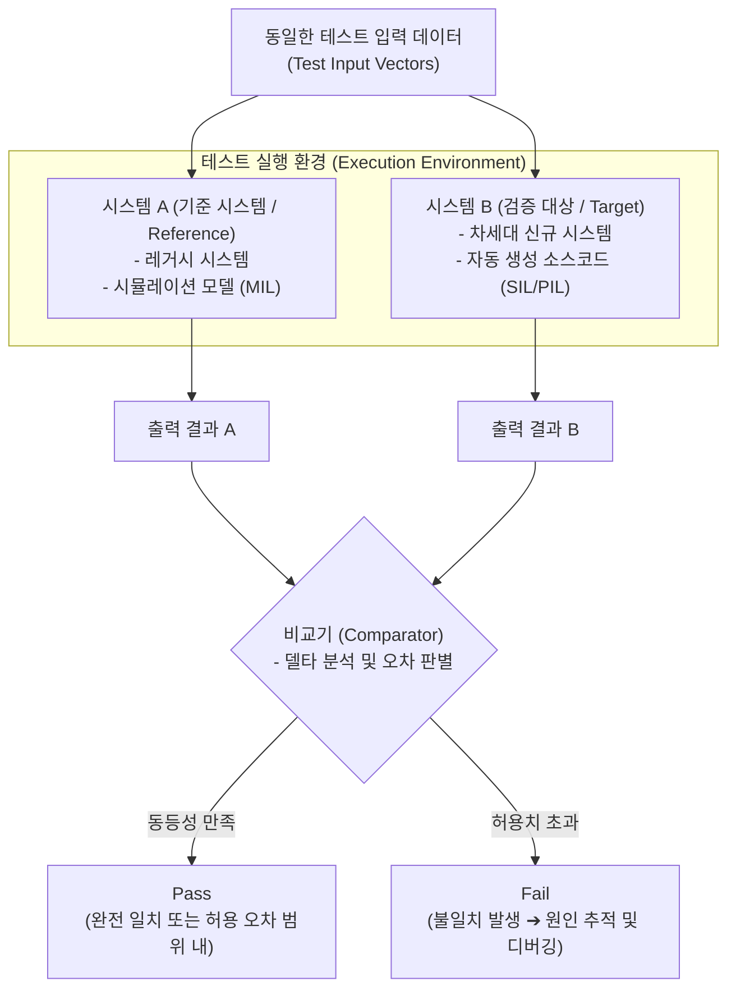

# Back-to-Back 테스트

---

## I. 시스템 동등성 검증의 핵심, Back-to-Back 테스트의 개요

동일한 테스트 입력 데이터(Test Vector)를 두 개 이상의 상이한 시스템, 버전 또는 구현체에 동시에 인가한 후, 생성된 출력 결과를 상호 비교하여 기능적·비기능적 동등성을 검증하는 소프트웨어 테스트 기법이다.

| 구분 | 주요 내용 |
| --- | --- |
| **개념** | 명시적인 참 오라클(True Oracle)이 없더라도 기존 기준 시스템(레거시/모델)을 의사 오라클(Pseudo-Oracle)로 삼아 대상 시스템의 출력 일치 여부를 판별하는 비교 검증 기술 |
| **등장 배경** | 대규모 차세대 시스템 마이그레이션 시 데이터 및 로직 무결성 검증 한계, 모델 기반 설계(MBD) 환경에서 모델과 자동 생성 코드 간 불일치 위험 증가 |
| **핵심 특징** | 의사 오라클 활용, 자동화된 차이(Delta) 분석, 하드웨어·수치 연산 차이에 따른 허용 오차(Tolerance) 적용, 자동차 기능안전([[ISO 26262]]) 핵심 요구사항 |

---

## II. Back-to-Back 테스트의 아키텍처 및 핵심 기술 요소

### 가. Back-to-Back 테스트의 아키텍처 및 동작 원리

신뢰성이 입증된 레거시 시스템이나 시뮬레이션 모델(시스템 A)의 출력을 기준값으로 설정하고, 신규 개발된 대상(시스템 B)의 출력을 비교기(Comparator)를 통해 자동 대조하여 불일치(Delta)를 검출한다.

### 나. Back-to-Back 테스트의 핵심 기술 및 구성 요소

| 분류 | 요소기술 (키워드) | 세부 설명 |
| --- | --- | --- |
| **테스트 자극** | Test Vector | 두 시스템에 동시에 동일한 조건으로 주입되는 입력 데이터 집합 및 실행 시나리오 |
| **비교 분석** | 비교기 (Comparator) | 두 시스템의 출력 로그 및 반환값을 실시간/배치로 대조하여 편차(Delta)를 산출하는 모듈 |
| **검증 기준** | 의사 오라클 (Pseudo-Oracle) | 기대 결과가 사전에 정형화되어 있지 않을 때 기준 시스템의 실제 출력을 정답으로 채택하는 방식 |
| **판정 기준** | 허용 오차 (Tolerance) | 부동소수점 연산, 컴파일러 최적화, CPU 아키텍처 차이로 인한 미세한 수치 차이의 수용 한계치 |
| **MBD 검증** | MIL (Model-in-the-Loop) | 제어 알고리즘을 수학적 시뮬레이션 모델(Simulink 등)로 구현하여 가상 환경에서 수행하는 초기 검증 |
| **MBD 검증** | SIL / PIL / HIL | 모델에서 생성된 C 코드를 소프트웨어(SIL), 타깃 MCU(PIL), 실제 하드웨어(HIL) 상에서 교차 검증 |
| **컴플라이언스** | [[ISO 26262]] (ASIL) | 자동차 기능안전 국제 표준으로 고위험 등급(ASIL C/D)에서 모델-코드 간 동등성 검증 필수 권고 |

---

## III. 회귀 테스트와의 비교 및 최신 동향

### 가. Back-to-Back 테스트 vs 회귀 테스트(Regression Test) 비교

| 비교 항목 | Back-to-Back 테스트 | 회귀 테스트 ([[리그레션 테스트\|Regression Test]]) |
| --- | --- | --- |
| **주요 목적** | 상이한 **두 시스템·구현체 간의 동등성** 검증 | 시스템 변경(수정/추가) 후 **기존 기능 정상 동작** 검증 |
| **비교 대상** | 시스템 A vs 시스템 B (상이한 두 시스템 동시 실행) | 버전 N vs 버전 N+1 (동일 시스템의 변경 전후 순차 실행) |
| **테스트 오라클** | **의사 오라클 (Pseudo-Oracle)** (기준 시스템 출력) | **참 오라클 / 사전 정의된 기댓값** (테스트 케이스 명세) |
| **주요 활용처** | 차세대 마이그레이션, MBD 모델-코드 일치성 검증 | 소프트웨어 [[유지보수]], CI/CD 자동화 배포 파이프라인 |

### 나. 최신 기술 동향 및 발전 방향

* **클라우드 트래픽 미러링(Traffic Shadowing) 연계**: 실시간 운영 트래픽을 신규 클라우드 환경으로 실시간 복제(Shadow)하여 구버전과 신버전의 응답 결과를 실시간 Back-to-Back 비교하는 무중단 검증이 확산됨.
* **SDV(소프트웨어 정의 차량) 및 AI 제어기 검증**: 자율주행 시뮬레이터 가상 환경과 실제 차량 온보드 컴퓨터 간의 센서 데이터 처리 무결성을 보장하기 위한 핵심 품질 검증 체계로 안착됨.

---

### 🔗 연관 토픽

- **소속 도메인**: [[00_소프트웨어공학_MOC|🏗️ 소프트웨어공학]]
- **세부 분류**: `6. 소프트웨어 테스팅 & 품질 보증 (QA/QC)`
- **핵심 연관 토픽**:
  - [[기능안전 표준]]
  - [[리그레션 테스트]]
  - [[테스트 오라클]]
  - [[유지보수]]
  - [[무결성]]
