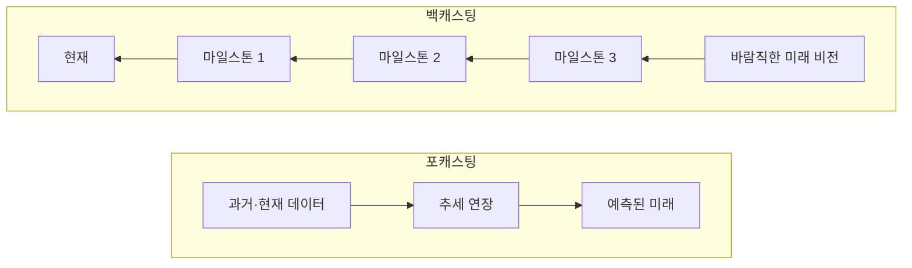

# 백캐스팅 (Backcasting)

---

## I. 미래 목표에서 거꾸로 계획하는, 백캐스팅의 개요

### 가. 정의

- **바람직한 미래 상태(비전)를 먼저 정하고 현재로 거슬러 올라오며** 필요한 중간 목표와 실행 경로를 도출하는 전략 기획 기법 (A. Lovins의 에너지 정책 연구에서 출발, J. Robinson 1982 명명)

### 나. 필요성 및 특징

| 구분 | 내용 |
| --- | --- |
| 필요성 | 과거 추세 연장(포캐스팅)으로는 탄소중립 같은 단절적 목표 달성 경로를 찾기 어려움 |
| 목표 지향 | '무엇이 될까'가 아닌 '무엇이 되어야 하는가'(규범적 시나리오) |
| 현재 제약 배제 | 현 제약에 묶이지 않고 목표 달성에 필요한 조건을 도출 |
| 단계화 | 비전–현재 격차를 마일스톤으로 나누어 점검 |

---

## II. 백캐스팅의 수행 구조 및 구성요소

### 가. 포캐스팅 vs 백캐스팅 흐름

- 포캐스팅은 현재에서 미래를 탐색하고, 백캐스팅은 목표 시점에서 현재로 역추적해 필요한 조치를 도출

### 나. 구성요소

| 구분 | 요소 | 설명 |
| --- | --- | --- |
| 목표 설정 | 비전 (Vision) | 10~30년 후 달성할 미래 상태 (예: 2050 넷제로) |
| | 규범적 시나리오 | 목표 달성을 전제로 한 '되어야 할' 미래 서술 |
| 분석 | 격차 분석 (Gap Analysis) | 비전(To-Be)과 현재(As-Is)의 기술·자원·제도 차이 |
| | 역추적 (Working Backwards) | 목표 시점부터 거꾸로 단계별 필요 조치 도출 |
| 실행 | 마일스톤 | 경로 상 중간 목표와 점검 지점 |
| | 액션 플랜 | 단·중·장기 과제와 자원 배분 |
| 방법론 예 | ABCD 프로세스 (The Natural Step) | Awareness(인식) → Baseline(현황) → Creative solutions(해결안) → Decide on priorities(우선순위) |

---

## III. 포캐스팅 비교 및 동향

### 가. 포캐스팅 vs 백캐스팅

| 구분 | 포캐스팅 (Forecasting) | 백캐스팅 (Backcasting) |
| --- | --- | --- |
| 방향 | 현재 → 미래 | 미래 → 현재 |
| 기반 | 과거 추세, 통계 | 목표 비전, 규범 |
| 시나리오 | 탐색적 (어떤 미래가 가능한가) | 규범적 (원하는 미래를 어떻게 만드는가) |
| 적합 환경 | 점진적 변화, 낮은 불확실성 | 구조적 전환이 필요한 장기 과제 |
| 활용 예 | 수요 예측, 용량 산정 | 탄소중립 로드맵, 장기 R&D 전략 |

### 나. 동향

- **탄소중립 로드맵**: 각국·기업의 2050 넷제로 계획이 목표 연도에서 역산한 감축 경로로 수립되며 [[ESG 경영]]과 연계
- **제품 기획 응용**: 아마존 Working Backwards (출시 보도자료·FAQ를 먼저 쓰고 개발)처럼 고객 가치에서 역산하는 기획 방식
- **포캐스팅과 병행**: 실제 적용에서는 백캐스팅으로 목표 경로를, 포캐스팅으로 현실 제약을 확인해 함께 사용

---

### 🔗 연관 토픽

- **소속 도메인**: [[00_경영전략_MOC|📈 경영전략]]
- **세부 분류**: `1. 경영 환경 분석 & 전략 수립 프레임워크`
- **핵심 연관 토픽**:
  - [[ESG 경영]]
  - [[디지털 전환|디지털 전환(DX)]]
  - [[환경분석]]
  - [[ISP (Information Strategy Plan)]]
  - [[린 방법론|린 (Lean) 방법론]]
