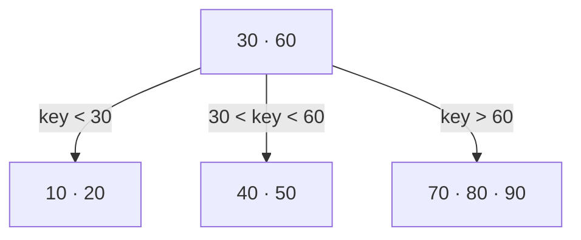

# B-Tree (Balanced Tree)

---

## I. 디스크 접근을 줄이는 다진 균형 트리, B-Tree의 개요

### 가. 정의

- 한 노드에 **여러 키와 자식을 담고 모든 리프를 같은 깊이로 유지하는 m-원(m-way) 균형 탐색 트리** (Bayer·McCreight, 1972)

### 나. 필요성 및 특징

| 구분 | 내용 |
| --- | --- |
| 디스크 I/O 감소 | 노드 크기를 디스크 블록(페이지)에 맞춰 한 번 읽기로 많은 키 비교 |
| 낮은 높이 | 분기 수가 커서 수억 건도 높이 3~4 수준 |
| 완전 균형 | 모든 리프가 같은 레벨, 탐색·삽입·삭제 O(log n) |
| 자가 균형 | 삽입 시 분할(Split), 삭제 시 재분배·병합으로 균형 유지 |
| 배경 | [[이진 탐색 트리]]는 높이가 커 디스크 기반 [[데이터베이스]]에 부적합 |

---

## II. 구조 및 구성요소

### 가. 구조 (차수 4 예)

- 노드 안 키는 정렬되어 있고, 키 k개인 노드는 자식 포인터 k+1개로 탐색 범위를 나눔

### 나. 구성요소

| 구분 | 요소 | 설명 |
| --- | --- | --- |
| 구조 | 차수 m | 노드가 가질 수 있는 최대 자식 수 |
| | 키 개수 제한 | 루트 제외 노드는 ⌈m/2⌉-1 ~ m-1개 키 (루트는 1개 이상) |
| | 자식 수 제한 | 루트·리프 제외 노드는 ⌈m/2⌉ ~ m개 자식 |
| | 리프 레벨 | 모든 리프가 같은 깊이 |
| 삽입 | 분할 (Split) | 키가 m-1개를 넘으면 중앙 키를 부모로 올리고 두 노드로 나눔, 루트 분할 시 높이 1 증가 |
| 삭제 | 재분배 | 키가 최소치 미만이면 형제에게서 부모를 거쳐 키를 빌려옴 |
| | 병합 (Merge) | 빌릴 수 없으면 형제·부모 키와 합쳐 하나의 노드로 |
| 최적화 | 페이지 크기 노드 | 노드 = 디스크 페이지(예: 16KB), 한 번의 I/O로 노드 전체 적재 |

---

## III. 비교 및 동향

### 가. B-Tree vs B+ Tree vs B* Tree

| 비교 항목 | B-Tree | B+ Tree | B* Tree |
| --- | --- | --- | --- |
| 데이터 위치 | 모든 노드 | 리프 노드에만 (내부는 인덱스 키) | 모든 노드 |
| 리프 연결 | 없음 | 연결 리스트로 연결, 범위 검색 유리 | 없음 |
| 최소 채움 | 1/2 | 1/2 | 2/3 (형제와 재분배 후 2→3 분할) |
| 높이 | 상대적으로 높음 | 내부 노드에 더 많은 키, 낮음 | 공간 활용률 높아 낮음 |
| 활용 | 일부 파일시스템·DB | [[RDBMS 인덱스(index)\|RDBMS 인덱스]] (InnoDB, Oracle), NTFS·XFS 디렉터리 | 일부 파일시스템 |

### 나. 동향

- **B+ Tree 표준화**: 범위 검색·순차 접근이 많은 RDBMS 인덱스의 사실상 표준
- **쓰기 최적화 구조**: 쓰기가 많은 [[NoSQL (CAP 이론 BASE 속성)|NoSQL]]·키-값 저장소는 LSM-Tree(RocksDB, Cassandra) 사용
- **인메모리·동시성**: 락 없는 Bw-Tree(Microsoft Hekaton), 캐시 라인 크기에 맞춘 B-Tree 변형 연구

---

### 🔗 연관 토픽

- **소속 도메인**: [[00_컴퓨터구조_MOC|💻 컴퓨터구조]]
- **세부 분류**: `3. 고성능 AI 가속기 & 입출력 시스템`
- **핵심 연관 토픽**:
  - [[RDBMS 인덱스(index)]]
  - [[이진 탐색 트리|이진 탐색 트리(Binary Search Tree)]]
  - [[AVL 트리]]
  - [[트리 순회|트리 순회 (Tree Traversal)]]
  - [[데이터베이스]]
