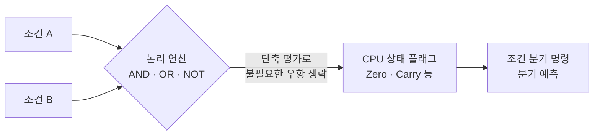

# Boolean Type (논리형)

---

## I. 참과 거짓 두 값만 갖는, 논리형의 개요

### 가. 정의

- 불 대수(G. Boole)에 기반해 **참(True)과 거짓(False) 두 값만 표현하는 원시 자료형**([[Data Type]])

### 나. 특징

| 구분 | 내용 |
| --- | --- |
| 흐름 제어 | if·while 등 조건식의 결과 |
| 논리 연산 | AND·OR·NOT·XOR로 복합 조건 구성 |
| 저장 크기 | 이론상 1비트지만 바이트 단위 주소 지정 때문에 보통 1바이트 이상 차지 |
| 언어별 차이 | 정수와의 호환 여부, 거짓으로 취급되는 값(Falsy)이 언어마다 다름 |

---

## II. 처리 구조 및 구성요소

### 가. 조건 평가에서 분기까지

- 비교 결과는 [[CPU]] 상태 플래그에 반영되고 조건 분기 명령이 그 플래그로 실행 경로를 결정

### 나. 구성요소

| 구분 | 요소 | 설명 |
| --- | --- | --- |
| 이론 | 불 대수 | 드모르간 법칙 등으로 논리식 변환·간소화 ([[카르노 맵]]) |
| [[연산자]] | 논리 연산자 | && (AND), \|\| (OR), ! (NOT), ^ (XOR) |
| 평가 | 단축 평가 | AND는 좌항이 거짓, OR는 좌항이 참이면 우항 생략 (널 검사 후 접근에 활용) |
| 저장 | 바이트 단위 | C·C++ bool, Java 배열의 boolean 원소는 보통 1바이트 |
| 압축 | 비트 필드·비트셋 | 많은 플래그를 정수의 비트로 묶어 저장 (예: Java BitSet, C++ std::vector&lt;bool&gt;) |
| 암묵 변환 | Truthy / Falsy | Python·JavaScript에서 0, "", None/null 등은 조건문에서 거짓 |
| DB | 3값 논리 | [[SQL(Structured Query Language)\|SQL]]은 TRUE·FALSE·UNKNOWN(NULL) 3값으로 평가 |
| 래퍼 | Boxing | Java Boolean 객체는 null 가능, 언박싱 시 NullPointerException 주의 |

---

## III. 비교 및 동향

### 가. 언어별 논리형

| 비교 항목 | C | Java | Python |
| --- | --- | --- | --- |
| 타입 | C99 _Bool·stdbool.h의 bool, C23부터 bool 키워드 | boolean (기본형), Boolean (참조형) | bool (int의 하위 클래스) |
| 크기 | 보통 1바이트 | JVM 구현 의존 (지역 변수는 int 슬롯 사용) | 객체 (약 28바이트) |
| 정수 호환 | 0은 거짓, 0 이외는 참 | 정수와 변환 불가 | True == 1, False == 0 |
| null | 해당 없음 | Boolean만 null 허용 | None은 Falsy |

### 나. 동향

- **분기 없는 코드**: 예측이 어려운 조건 분기 대신 조건부 이동(CMOV)·비트 연산·SIMD 마스크로 파이프라인 플러시 감소
- **Null 안전 설계**: DB의 NULL을 애플리케이션 논리형으로 옮길 때 Optional·nullable 타입으로 3값 논리를 명시적으로 처리

---

### 🔗 연관 토픽

- **소속 도메인**: [[00_컴퓨터구조_MOC|💻 컴퓨터구조]]
- **세부 분류**: `3. 고성능 AI 가속기 & 입출력 시스템`
- **핵심 연관 토픽**:
  - [[연산자]]
  - [[카르노 맵|카르노 맵 (Karnaugh Map)]]
  - [[Data Type]]
  - [[Int Type]]
  - [[Pipeline Hazard]]
