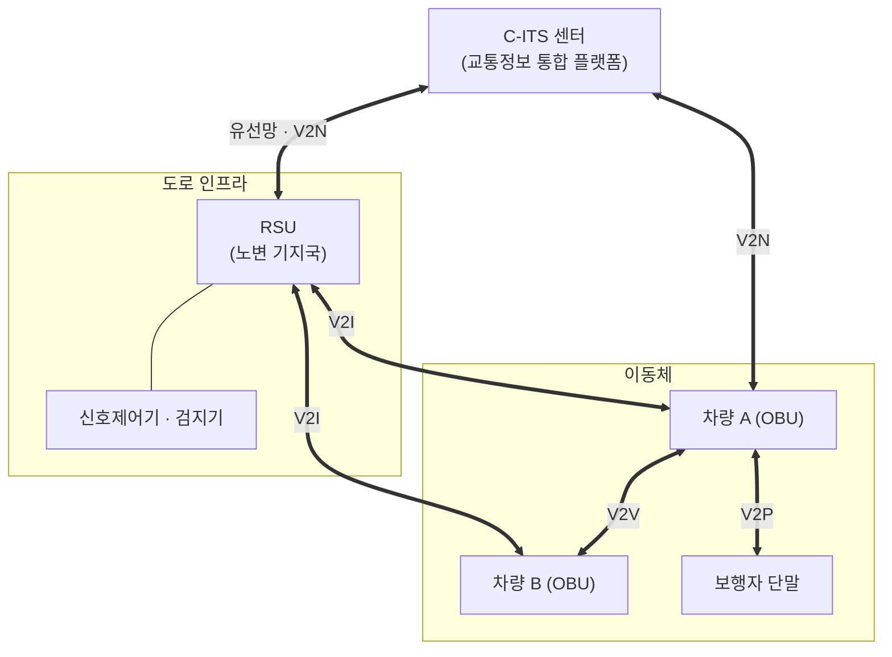

# C-ITS (Cooperative-Intelligent Transport Systems)

---

## I. 차량과 인프라가 협력하는 교통, C-ITS의 개요

### 가. 정의

- 차량이 주행 중 **다른 차량·도로 인프라·보행자와 V2X 통신으로 위험·교통 정보를 실시간 주고받아** 사고를 예방하는 협력형 지능형 교통체계 (국내 명칭: 차세대 ITS)

### 나. 특징

| 구분 | 내용 |
| --- | --- |
| 등장 배경 | 센터 중심 단방향 ITS로는 돌발 상황 즉시 대응 한계 |
| 양방향 통신 | 차량-차량, 차량-인프라 간 직접 정보 교환 |
| 사각지대 인지 | 센서로 볼 수 없는 비가시권(NLoS) 위험 사전 경고 |
| 사고 예방 | 사후 관리에서 사전 예방 중심으로 |
| 자율주행 지원 | 차량 센서를 보완하는 인프라 정보 제공 |

---

## II. 구조 및 기술요소

### 가. 구조

- 차량 단말(OBU)과 노변 기지국(RSU)이 V2V·V2I·V2P로 정보를 직접 교환하고, 센터는 광역 정보를 수집·배포

### 나. 기술요소

| 구분 | 요소 | 설명 |
| --- | --- | --- |
| 통신 | WAVE (IEEE 802.11p) | 5.9GHz 대역 차량 전용 근거리 무선 통신 (DSRC 계열) |
| | C-V2X (LTE-V2X, NR-V2X) | 3GPP 기반 셀룰러 V2X, 단말 간 직접 통신(PC5)과 망 통신(Uu) 지원 |
| 단말 | OBU (On-Board Unit) | 차량 위치·속도·상태 송수신 |
| | RSU (Road-Side Unit) | 도로변 통신 중계·인프라 정보 송신 |
| 데이터 | LDM (Local Dynamic Map) | 정밀 지도 위에 동적 교통 정보를 계층적으로 갱신 |
| | 메시지 표준 | SAE J2735 BSM(기본 안전 메시지), SPaT(신호 정보) 등 |
| 처리 | [[Mobile Edge Computing\|MEC]] | 인프라 근처에서 저지연 처리 |
| 보안 | SCMS | 인증서 발급·폐기로 메시지 송신자 인증, 익명 인증서로 위치 추적 방지 |
| | IEEE 1609.2 | V2X 메시지 서명·[[암호화]] 보안 표준 |

---

## III. 비교 및 동향

### 가. ITS vs C-ITS

| 비교 항목 | ITS | C-ITS |
| --- | --- | --- |
| 통신 | 센터 경유 단방향 정보 제공 | 차량·인프라 간 양방향 |
| 정보 수집 | 센터 집중형 (검지기·CCTV) | 분산형 (차량이 정보 생성·공유) |
| 인지 범위 | 가시권 | 비가시권·원거리 |
| 목적 | 교통 흐름 관리, 사후 대응 | 사고 사전 예방, 자율주행 지원 |
| 통신 기술 | DSRC(하이패스), 이동통신 | WAVE, C-V2X |

### 나. 동향

- **국내 통신 방식 결정**: 정부가 2023년 C-ITS 통신 방식을 LTE-V2X 단일 표준으로 확정, 실증 후 고속도로·도심으로 단계적 구축
- **해외**: 미국 FCC가 5.9GHz 대역을 C-V2X에 재배정, 유럽은 ITS-G5(802.11p 계열)와 C-V2X 병행
- **자율주행 협력**: 정밀 측위·[[디지털 트윈]]과 결합한 협력 주행(CACC, 군집 주행), [[UAM]] 등 미래 모빌리티 관제와 연계

---

### 🔗 연관 토픽

- **소속 도메인**: [[00_디지털서비스_MOC|🚀 디지털서비스]]
- **세부 분류**: `3. 사물인터넷 (IoT) & 스마트 플랫폼 · 메타버스`
- **핵심 연관 토픽**:
  - [[Smart Car(자율주행)]]
  - [[측위기술|측위기술 (LDT Location Determination Technology)]]
  - [[Mobile Edge Computing|Mobile Edge Computing (MEC)]]
  - [[디지털 트윈|디지털 트윈 (Digital Twin)]]
  - [[UAM|UAM (Urban Air Mobility)]]
