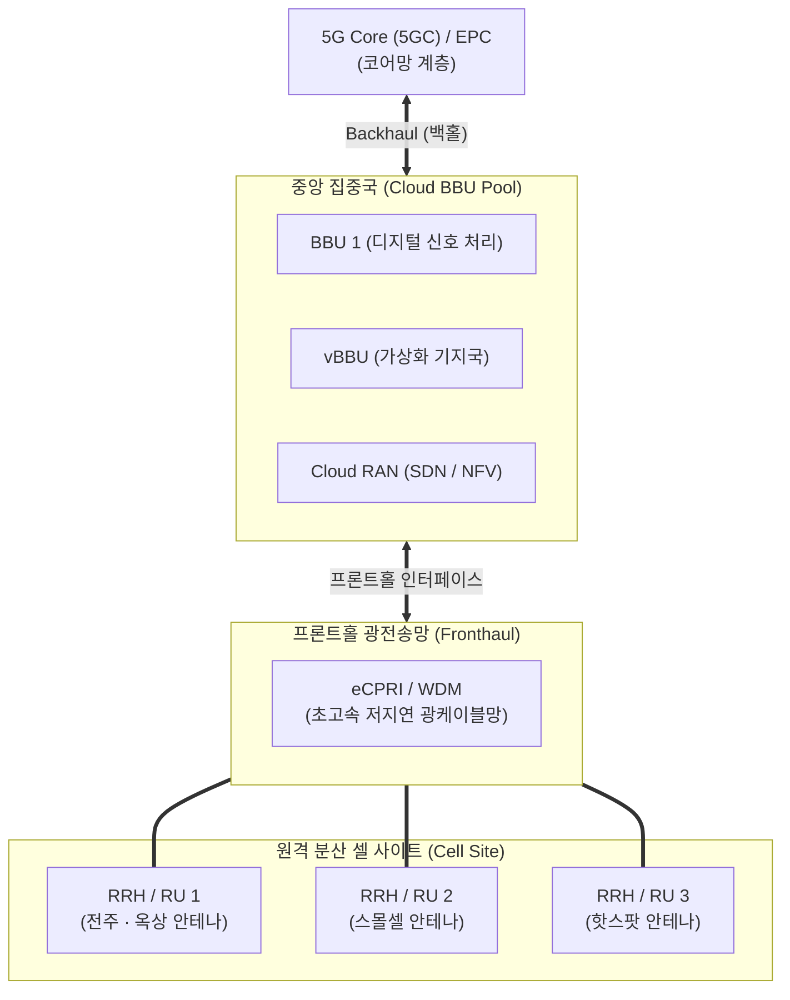

# C-RAN (Centralized / Cloud RAN)

---

## I. 기지국 기능 분리와 자원 풀링, C-RAN의 개요

### 가. 정의

- 기존 기지국 장비를 디지털 기지국(BBU)과 무선 송수신반(RRH)으로 물리 분리하여, **BBU는 중앙 데이터센터에 모아 통합 풀링(Pooling) 처리하고 RRH는 원격 서비스 구역에 분산 배치하는 차세대 무선 접속망(RAN) 아키텍처**

### 나. 특징 및 필요성

| 구분 | 내용 |
| --- | --- |
| CAPEX / OPEX 절감 | 국소별 항온항습실 및 고비용 BBU 장비를 없애고 원격 RRH만 설치하여 구축비 및 전력·상면 임대료 대폭 절감 |
| 자원 가상화(vRAN) | 중앙 BBU 풀을 범용 x86 서버 상에 가상화(vBBU) 및 클라우드 네이티브로 구현하여 동적 자원 스케줄링 |
| 간섭 제어 고도화 | 다중 기지국 협력 통신(CoMP)을 중앙에서 지연 없이 수행하여 셀 경계 지역의 간섭을 최소화하고 커버리지 확대 |
| 개방형 진화 (O-RAN) | BBU와 RRH 간의 프론트홀 인터페이스(eCPRI)를 개방하여 특정 통신 장비 벤더 종속성을 탈피하는 기초 제공 |

---

## II. 개념도 및 핵심 구성요소

### 가. 개념도 (중앙 집중형 BBU 풀과 분산 RRH)

- 코어망과 BBU 풀 간은 고대역폭 백홀로 연결되고, 중앙 BBU 풀과 각 지역의 소형 안테나(RRH) 간은 eCPRI 기반 초저지연 프론트홀 광케이블망으로 연결

### 나. 핵심 기술 요소

| 구분 | 요소 | 설명 |
| --- | --- | --- |
| 핵심 장비 | BBU (Baseband Unit) | 기저대역 디지털 신호 처리, 채널 코딩, 변복조, 스케줄링을 중앙 데이터센터에서 집중 수행 |
| | RRH (Remote Radio Head) | 아날로그 고주파(RF) 신호 증폭 및 안테나 송수신만 담당하는 경량화된 분산 원격 장비 |
| 전송망 | Fronthaul (프론트홀) | BBU Pool과 원격 RRH 간을 고속으로 연결하는 광통신망 (모바일 백홀과 명확히 구분) |
| 인터페이스 | CPRI / eCPRI | BBU와 RRH 간 디지털 I/Q 데이터 전송 규격 (5G에서는 대역폭 절감을 위해 이더넷 기반 eCPRI 적용) |
| 간섭 제어 | CoMP | 여러 RRH가 협력하여 단말에 다중 빔을 형성함으로써 셀 경계 지역 핸드오버 및 처리량 개선 |
| 가상화 | vRAN (Virtual RAN) | 전용 DSP 하드웨어 대신 범용 COTS(Commercial Off-The-Shelf) 서버에 BBU 소프트웨어 가상화 |
| 개방화 | [[O-RAN]] | DU(Distributed Unit)와 RU(Radio Unit) 간 개방형 인터페이스 규격을 적용하여 다중 벤더 상호 운용성 확보 |

---

## III. RAN 아키텍처 비교 및 동향

### 가. D-RAN vs C-RAN

| 비교 항목 | D-RAN (Distributed RAN, 기존 분산형) | C-RAN (Centralized / Cloud RAN) |
| --- | --- | --- |
| 기지국 구조 | 기지국마다 BBU + RRH가 일체형으로 배치 | BBU는 중앙 집중 풀링, RRH만 국소 분산 |
| 공간 및 전력 (상면) | 모든 기지국 사이트마다 전용 상면 및 에어컨 필요 | 현장 사이트는 소형 RRH만 장착, 상면 및 전력비 절감 |
| 자원 활용 효율 | 셀별 고정 자원 할당으로 유휴 자원 낭비 발생 | 중앙 풀에서 트래픽 밀집 지역으로 동적 자원 재분배 |
| 간섭 제어 (CoMP) | 기지국 간 백홀 지연으로 정밀 CoMP 적용 곤란 | 중앙에서 전 기지국 신호를 직접 제어하여 간섭 최소화 |
| 프론트홀 요구량 | 없음 (기지국 내부 연결) | 매우 큼 (초저지연 대용량 광케이블 인프라 필수) |

### 나. 동향

- **Open RAN([[O-RAN]]) 생태계로의 전면 진화**: 기지국 소프트웨어와 하드웨어를 분리하고 개방형 인터페이스 규격을 적용하여 특정 통신 벤더(노키아, 에릭슨 등)의 독점을 타파하는 차세대 vRAN 확산
- **AI 기반 무선망 지능형 컨트롤러(RIC)**: O-RAN 아키텍처에 근실시간(Near-RT) 및 비실시간(Non-RT) RIC를 탑재하여 트래픽 예측, 빔포밍 최적화, 전력 절감 알고리즘 자율 구동
- **프론트홀 전송 최적화(eCPRI 및 RoE)**: 5G 초광대역 트래픽을 프론트홀에서 수용하기 위해 패킷 기반 eCPRI 및 Radio over Ethernet(IEEE 1914.3) 표준 적용 가속화

---

### 🔗 연관 토픽

- **소속 도메인**: [[00_네트워크_MOC|🌐 네트워크]]
- **세부 분류**: `4. 무선 및 차세대 이동통신 (5G/6G/Wi-Fi)`
- **핵심 연관 토픽**:
  - [[O-RAN]]
  - [[NFV]]
  - [[가상화]]
  - [[다중화]]
  - [[클라우드 네이티브]]
