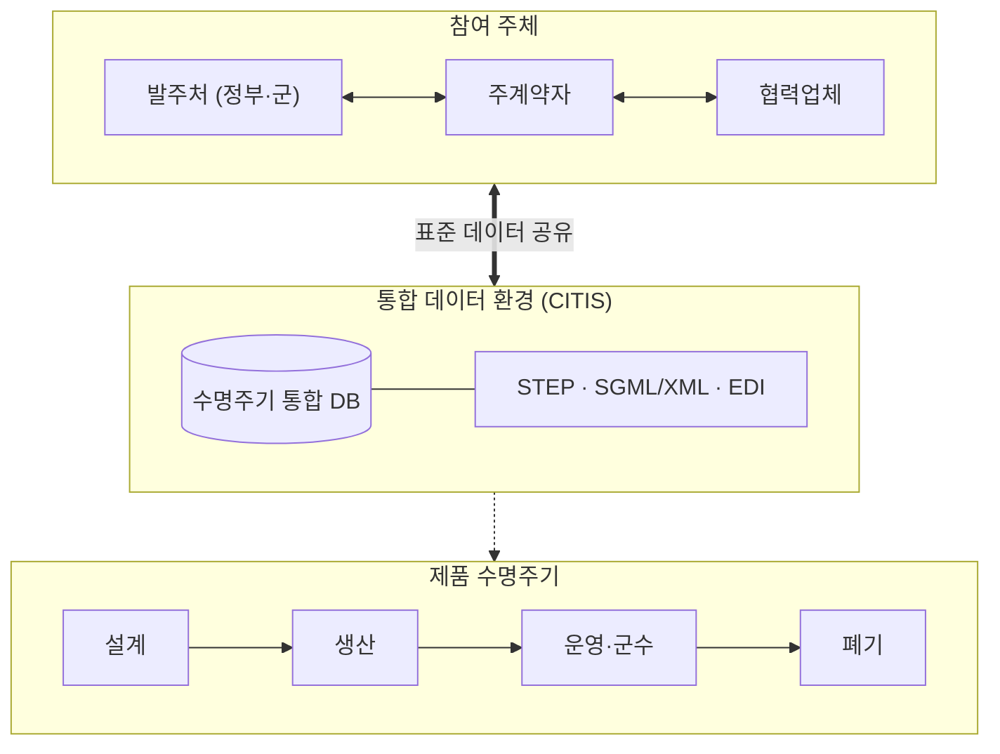

# CALS (Commerce At Light Speed)

---

## I. 제품 수명주기 정보를 표준화·공유하는, CALS의 개요

### 가. 정의

- 제품의 **설계·생산·조달·운영·폐기 등 수명주기 전반의 정보를 표준 디지털 형식으로 통합**해 발주처·계약자·협력업체가 공유하는 정보화 전략·체계

### 나. 등장 배경 및 특징

| 구분 | 내용 |
| --- | --- |
| 배경 | 미 국방부(DoD)가 무기체계 기술 문서·군수 지원의 종이 문서 비용을 줄이려 1985년 시작 |
| 표준 기반 | STEP·SGML·EDI 등 국제 표준으로 이기종 시스템 간 데이터 교환 |
| 종이 없는 업무 | 도면·매뉴얼·거래 문서의 전자화 |
| 동시공학 | 설계 초기부터 생산·유지보수 부서가 함께 참여해 개발 기간 단축 |

---

## II. CALS의 구조 및 구성요소

### 가. 개념도

- 참여 주체가 통합 데이터 환경에 접속해 도면·기술 문서·거래 문서를 공유하고, 설계 변경이 생산·군수 계획에 함께 반영됨

### 나. 구성요소

| 구분 | 요소 | 설명 |
| --- | --- | --- |
| 운영 환경 | CITIS (Contractor Integrated Technical Information Service) | 발주처가 계약자의 기술 데이터에 접근해 조회·승인하는 정보 서비스 |
| | 통합 데이터 환경 (IDE) | 수명주기 데이터를 통합 관리하는 공유 저장소 |
| 표준 | STEP (ISO 10303) | CAD/CAM 간 제품 데이터 교환 표준 |
| | SGML / [[XML]] | 기술 교범·매뉴얼의 구조화 문서 표준 |
| | [[EDI]] | 발주·납품·청구 등 상거래 문서 전자 교환 |
| 경영 혁신 | 동시공학 (CE) | 설계·생산·지원 부서의 병행 협업 |
| | BPR | 종이 기반 순차 업무를 전자 환경에 맞게 재설계 |
| 보안 | 인증·[[암호화]]·접근통제 | PKI 기반 인증, 등급별 접근 통제 |

---

## III. 발전 단계 비교 및 동향

### 가. CALS 의미의 변화

| 시기 | 명칭 | 범위 |
| --- | --- | --- |
| 1985 | Computer Aided Logistics Support | 국방 군수 지원 문서 전산화 |
| 1988 | Computer-aided Acquisition and Logistics Support | 조달까지 확대 |
| 1993 | Continuous Acquisition and Life-cycle Support | 제품 수명주기 전체 데이터 통합 |
| 1994~ | Commerce At Light Speed | 민간 산업 전자상거래·기업 간 협업 |

### 나. 동향

- **현대 시스템으로 흡수**: 수명주기 통합·협업 개념이 PLM, ERP, [[SCM (Supply Chain Management)|SCM]], [[EDI]]로 이어짐
- **국내 적용**: 국방 CALS, 건설 CALS(건설사업정보시스템) 등 공공 분야에서 운영
- **디지털 스레드·트윈**: 수명주기 데이터를 연결하는 디지털 스레드와 [[디지털 트윈]], [[CPS]]로 개념 계승

---

### 🔗 연관 토픽

- **소속 도메인**: [[00_경영전략_MOC|📈 경영전략]]
- **세부 분류**: `2. IT 거버넌스 & 엔터프라이즈 아키텍처 (EA/ISP)`
- **핵심 연관 토픽**:
  - [[EDI]]
  - [[XML]]
  - [[SCM (Supply Chain Management)]]
  - [[디지털 트윈|디지털 트윈 (Digital Twin)]]
  - [[CPS]]
