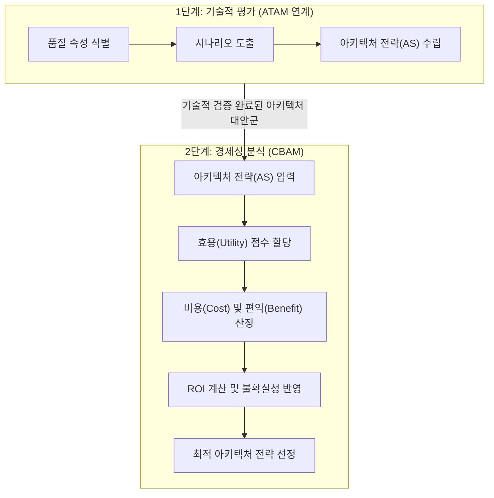

# CBAM (Cost Benefit Analysis Method)

---

## I. 소프트웨어 아키텍처의 경제성 평가 기법, CBAM의 개요

ATAM 등 기술적 평가를 통해 도출된 복수의 소프트웨어 아키텍처 전략(대안)에 대해 구현 비용(Cost), 비즈니스 효용(Benefit), 리스크를 경제적 관점에서 분석하여 최적의 투자 대비 수익률(ROI)을 제공하는 아키텍처를 선정하는 정량적 의사결정 모델이다.

| 구분 | 주요 내용 |
| --- | --- |
| **개념** | 카네기멜론 대학(CMU SEI)에서 개발한 모델로, 비즈니스 목표 달성을 위한 아키텍처 전략별 효용 점수와 소요 비용을 산출하여 우선순위를 결정하는 기법 |
| **등장 배경** | 기존 ATAM 기법이 기술적 관점(품질 속성 상충관계)에 집중되어 있어, 경영진과 사업 관리자가 요구하는 비용 효율성 및 경제적 ROI 근거 제공 한계 극복 |
| **핵심 특징** | 효용(Utility)의 정량화 곡선 적용, 불확실성(Uncertainty) 수용, 비즈니스 전략과 아키텍처 설계의 직접적 연계, ATAM 보완적 성격 |

---

## II. CBAM의 평가 프로세스 및 핵심 기술 요소

### 가. CBAM의 평가 프로세스 및 동작 원리

ATAM을 통해 도출된 아키텍처 대안들을 입력받아, 각 전략이 비즈니스 시나리오 달성에 기여하는 효용(Utility)과 투입 비용(Cost)을 종합하여 최종 ROI(Benefit / Cost)를 산출한다.

### 나. CBAM의 핵심 기술 및 구성 요소

| 분류 | 요소기술 (키워드) | 세부 설명 |
| --- | --- | --- |
| **평가 대상** | 아키텍처 전략 (AS) | 품질 속성 시나리오를 만족시키기 위해 고안된 구체적 아키텍처 설계 대안 및 패턴 |
| **평가 기준** | 시나리오 (Scenario) | 자극(Stimulus)과 반응(Response)으로 기술된 시스템 상황으로, 비즈니스 우선순위 반영 |
| **가치 척도** | 효용 (Utility) | 특정 아키텍처 전략이 비즈니스 목표 달성에 기여하는 정도를 0~100점 척도로 정량화한 값 |
| **경제 지표** | 비용 (Cost) | 해당 아키텍처 전략을 개발, 테스트, 배포 및 유지보수하는 데 필요한 총 소요 비용(인력/기간) |
| **경제 지표** | 편익 (Benefit) | 이전 상태 대비 아키텍처 전략 도입으로 인해 창출되는 성능 향상, 운영비 절감 등 종합적 효익 |
| **의사결정** | ROI (투자 대비 수익률) | 총 편익을 총 비용으로 나눈 값 (Benefit / Cost)으로, 아키텍처 전략 채택의 최종 정량적 기준 |
| **위험 관리** | 불확실성 (Uncertainty) | 비용과 편익 추정 과정에서 발생하는 오차 범위를 수용하기 위한 확률적 가중치 반영 |
| **기반 모델** | [[ATAM]] 연계 | 소프트웨어 품질 속성의 기술적 상충관계를 사전에 검증하여 CBAM의 입력 데이터로 제공 |

---

## III. ATAM과 CBAM 비교 및 최신 동향

### 가. ATAM vs CBAM 비교

| 비교 항목 | ATAM (Architecture Tradeoff Analysis Method) | CBAM (Cost Benefit Analysis Method) |
| --- | --- | --- |
| **평가 관점** | **기술적 관점** (Technical Perspective) | **경제적 관점** (Economic Perspective) |
| **주요 목적** | 품질 속성 간 상충관계(Trade-off) 발견 및 위험 식별 | 최적의 투자 대비 수익률(ROI) 및 대안 우선순위 도출 |
| **핵심 지표** | 민감점(Sensitivity), 상충점(Trade-off), 리스크(Risk) | 비용(Cost), 편익(Benefit), 효용(Utility), ROI |
| **주요 참여자** | 소프트웨어 아키텍트, 기술 리드, 개발자 | 프로젝트 관리자(PM), 비즈니스 분석가, 경영진(C-Level) |
| **수행 시점** | 시스템 아키텍처 설계 완료 전후 | ATAM 수행 완료 직후 (도출된 대안 기반) |

### 나. 최신 기술 동향 및 발전 방향

* **클라우드 현대화(Modernization) TCO 분석 연계**: 레거시 시스템을 클라우드 네이티브로 전환할 때, 컨테이너화/서버리스 전환 대안들의 구축 비용과 클라우드 인프라 운영비(FinOps) 절감 효용을 CBAM 기반으로 정량 비교함.
* **애자일 백로그 우선순위화 결합**: 복잡한 전체 시스템 단위의 정량화 대신, 에픽(Epic) 및 아키텍처 스파이크(Spike) 작업의 ROI를 판단하여 스프린트 백로그 우선순위를 결정하는 경량 CBAM 모델이 활용됨.

---

### 🔗 연관 토픽

- **소속 도메인**: [[00_소프트웨어공학_MOC|🏗️ 소프트웨어공학]]
- **세부 분류**: `4. 아키텍처 스타일 & 객체지향 설계 원리`
- **핵심 연관 토픽**:
  - [[ATAM]]
  - [[ARID]]
  - [[SAAM]]
  - [[SW Architecture 평가]]
  - [[유틸리티 트리]]
