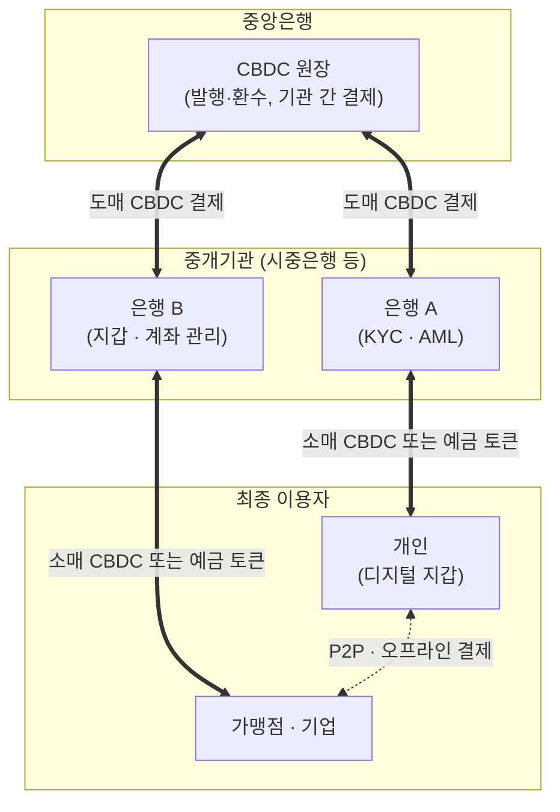

# CBDC (Central Bank Digital Currency)

---

## I. 중앙은행이 발행하는 디지털 법정화폐, CBDC의 개요

### 가. 정의

- **중앙은행이 전자적 형태로 발행하는 법정화폐**로, 현금과 같은 중앙은행 부채이며 기존 지급준비금과 달리 디지털 토큰·계좌 형태로 유통

### 나. 등장 배경 및 특징

| 구분 | 내용 |
| --- | --- |
| 등장 배경 | 현금 이용 감소, 민간 가상자산·스테이블코인 확산에 따른 통화주권 우려, 결제 효율화 |
| 가치 안정 | 법화와 1:1, 가치 변동 없음 |
| 신뢰성 | 중앙은행 직접 발행, 신용위험 없음 |
| 프로그래머블 | 스마트 컨트랙트로 조건부 지급(바우처·보조금) 구현 |
| 유형 | 소매형(일반 국민 대상) / 도매형(금융기관 간 거액결제) |

---

## II. 구조 및 기술요소

### 가. 2계층(Two-Tier) 구조

- 중앙은행은 발행·기관 간 결제를 맡고, 중개기관이 고객 확인(KYC)·자금세탁방지(AML)·지갑 관리를 맡아 중앙은행의 운영 부담과 개인정보 집중을 줄이는 구조

### 나. 기술요소

| 구분 | 요소 | 설명 |
| --- | --- | --- |
| 원장 | 분산원장(DLT) | [[01_IT Tech/블록체인\|블록체인]] 기반으로 기관 간 기록 공유·[[무결성]] 확보 |
| | 중앙집중형 원장 | 대량 소매 결제 처리량 확보를 위한 기존 DB 방식 (설계에 따라 선택) |
| 거래 | 스마트 컨트랙트 | 조건 충족 시 자동 지급하는 프로그래머블 머니 |
| 프라이버시 | [[영지식증명\|ZKP]] · 익명성 한도 | 소액은 익명성 보장, 고액은 추적 가능하도록 차등 설계 |
| 이용자 | 디지털 지갑 | 키 관리, 인증, 송금 인터페이스 |
| | 오프라인 결제 | [[NFC]]·BLE로 통신 단절 시 단말 간 가치 이전 |
| 규제 | KYC / AML | 거래 한도·불법자금 추적을 위한 신원 확인 연계 |
| 상호운용 | 국가 간 결제 플랫폼 | 다국가 CBDC 연계 실험 (mBridge, BIS Project Agorá) |

---

## III. 비교 및 동향

### 가. CBDC vs 암호화폐 vs 스테이블코인

| 비교 항목 | CBDC | 암호화폐 | 스테이블코인 |
| --- | --- | --- | --- |
| 발행 주체 | 중앙은행 | 탈중앙 프로토콜 | 민간 기업 (Tether, Circle 등) |
| 법적 지위 | 법화 | 법화 아님 (가상자산) | 법화 아님 (일부 국가 규제 대상 지급수단) |
| 가치 변동 | 없음 | 매우 큼 | 낮음 (법화·자산 담보로 페깅) |
| 신용위험 | 없음 | 해당 없음 | 발행사 준비금에 의존 |
| 용도 | 지급결제, 통화정책 | 투자, DeFi | 가상자산 거래 결제, 송금 |

### 나. 동향

- **한국**: 한국은행 '프로젝트 한강'으로 도매 CBDC 기반 은행 예금 토큰 실거래 테스트(2025) 진행, 원화 스테이블코인 논의와 병행
- **해외**: 중국 e-CNY 시범 운영 확대, 유럽중앙은행은 디지털 유로 준비 단계 진행, 미국은 행정명령(2025.1)으로 CBDC 추진 금지·스테이블코인 법제화(GENIUS Act, 2025.7)
- **설계 과제**: 은행 예금 이탈(디지털 뱅크런) 방지를 위한 보유 한도·무이자 설계, 프라이버시 보호, 시스템 복원력

---

### 🔗 연관 토픽

- **소속 도메인**: [[00_디지털서비스_MOC|🚀 디지털서비스]]
- **세부 분류**: `2. 블록체인 & 분산원장 · Web3`
- **핵심 연관 토픽**:
  - [[01_IT Tech/블록체인|블록체인 (Block Chain)]]
  - [[01_IT Tech/핀테크|핀테크 (FinTech)]]
  - [[영지식증명|영지식증명(Zero Knowledge Proof)]]
  - [[합의 알고리즘|합의 알고리즘 (Consensus Algorithm)]]
  - [[NFT (Non Fungible Token)]]
