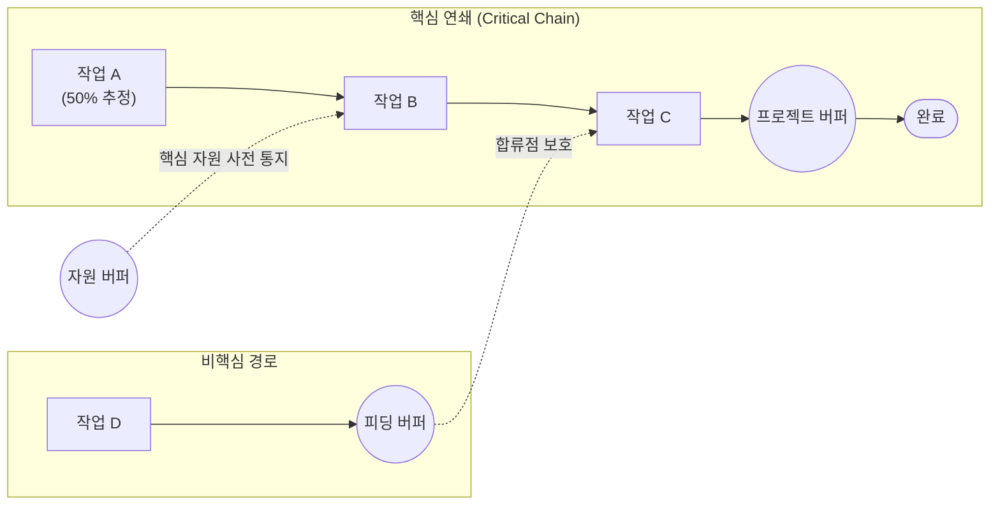

# CCM (Critical Chain Method, 핵심 연쇄 일정관리)

---

## I. 제약이론 기반 버퍼 일정관리, CCM의 개요

### 가. 정의

- 활동 간 의존관계와 **자원 제약을 함께 고려**해 핵심 연쇄(Critical Chain)를 찾고, 활동별 여유를 걷어 **버퍼로 통합 관리**하는 일정 기법 (Goldratt, 1997, 제약이론 TOC 적용, CCPM이라고도 함)

### 나. 필요성 및 특징

| 구분 | 내용 |
| --- | --- |
| CPM 한계 보완 | [[CPM]]은 자원 경합을 고려하지 않아 실제 일정과 괴리 |
| 심리적 지연 차단 | 학생 증후군, 파킨슨 법칙으로 활동별 여유가 낭비되는 문제 해결 |
| 공격적 추정 | 활동 기간을 50% 확률 수준으로 추정, 걷어낸 여유를 버퍼로 집약 |
| 버퍼 관리 | 활동 일정 대신 버퍼 소진율로 프로젝트 상태 판단 |
| 멀티태스킹 억제 | 작업 전환 손실을 줄이기 위해 릴레이 경주식 수행 |

---

## II. 동작 원리와 구성요소

### 가. 개념도

- 활동별 안전 여유를 제거해 기간을 압축하고, 그 일부를 프로젝트 끝(PB)과 합류점(FB)에 모아 전체 납기를 보호

### 나. 구성요소

| 구분 | 요소 | 설명 |
| --- | --- | --- |
| 일정 계획 | 핵심 연쇄 | 의존관계와 자원 제약을 모두 반영한 가장 긴 경로 |
| 버퍼 | 프로젝트 버퍼 (PB) | 핵심 연쇄 끝에 두어 최종 납기 보호 |
| | 피딩 버퍼 (FB) | 비핵심 경로가 핵심 연쇄에 합류하는 지점에 두어 지연 전파 차단 |
| | 자원 버퍼 (RB) | 시간이 아닌 경보 장치, 핵심 자원이 제때 투입되도록 미리 통지 |
| 심리 요인 | 학생 증후군 | 마감 직전에야 착수해 앞쪽 여유를 낭비 |
| | 파킨슨 법칙 | 일이 주어진 시간을 다 채울 때까지 늘어남 |
| 통제 | 피버 차트 | 핵심 연쇄 진척률 대비 버퍼 소진율을 녹·황·적 영역으로 표시 |
| | 멀티태스킹 제한 | 작업 전환에 따른 셋업 시간·지연 방지 |

---

## III. 비교 및 동향

### 가. CPM vs CCM

| 비교 항목 | CPM | CCM |
| --- | --- | --- |
| 기반 이론 | 네트워크 분석 | 제약이론 (TOC) |
| 기간 추정 | 활동별 안전 여유 포함 | 50% 확률 수준, 여유는 버퍼로 집약 |
| 고려 제약 | 활동 간 논리적 의존관계 | 의존관계 + 자원 제약 |
| 여유 관리 | 활동별 여유(Float) | 프로젝트·피딩 버퍼 |
| 통제 지표 | 주공정 활동의 일정 준수 | 버퍼 소진율, 병목 자원 |

### 나. 동향

- **다중 프로젝트 CCPM**: 공유 자원(Drum)을 기준으로 프로젝트 착수를 시차 조정해 전체 처리량 향상
- **PMBOK 반영**: PMBOK 5판까지 일정 개발 프로세스의 도구로 수록, 6판부터는 도구 목록에서 빠지고 자원 최적화·일정 압축 중심으로 정리
- **애자일 접점**: WIP 제한·흐름 관리라는 점에서 [[Kanban (development) 프로세스|칸반]]과 철학 공유

---

### 🔗 연관 토픽

- **소속 도메인**: [[00_프로젝트관리_MOC|📋 프로젝트관리]]
- **세부 분류**: `1. PMBOK 표준 & 프로젝트 거버넌스`
- **핵심 연관 토픽**:
  - [[CPM|CPM (Critical Path Method)]]
  - [[프로젝트 일정관리]]
  - [[일정단축 기법]]
  - [[자원 최적화]]
  - [[3점 산정]]
