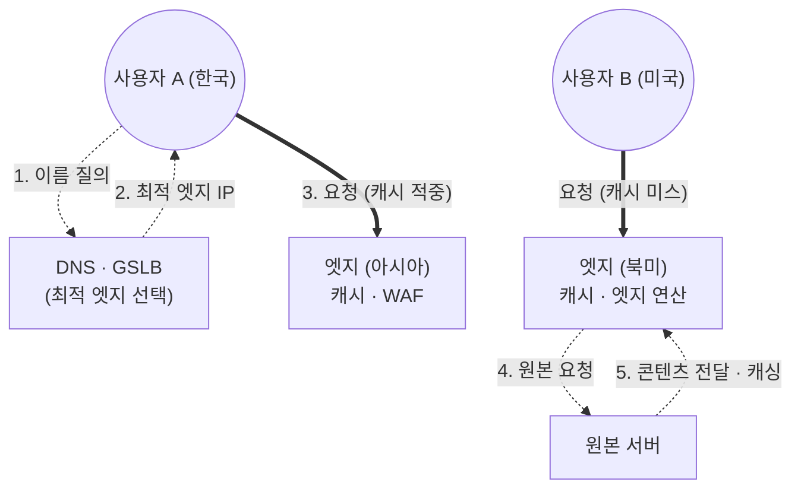

# CDN (Content Delivery Network)

---

## I. 가까운 곳에서 꺼내 주는, CDN의 개요

### 가. 정의

- 원본 서버의 콘텐츠를 **사용자 가까운 여러 엣지 서버(PoP)에 캐싱하고, 요청을 최적의 엣지로 유도해 빠르고 안정적으로 전달**하는 분산 전송 네트워크

### 나. 등장 배경 및 특징

| 구분 | 내용 |
| --- | --- |
| 등장 배경 | 영상·대용량 콘텐츠 증가, 원본 집중에 따른 병목과 장거리 지연 |
| 지연 단축 | 물리적으로 가까운 [[EDGE\|엣지]]에서 응답 |
| 원본 부하 감소 | 캐시 적중만큼 원본 트래픽·대역 비용 절감 |
| 가용성 | 엣지 분산으로 단일 장애점 완화 |
| 보안 | 엣지에서 [[DDOS\|DDoS]] 흡수, WAF 적용 |

---

## II. 구조 및 구성요소

### 가. 요청 처리 흐름

- [[DNS(Domain Name System)|DNS]] 또는 애니캐스트로 사용자를 최적 엣지에 연결하고, 캐시에 없으면 원본에서 가져와 저장 후 응답

### 나. 구성요소

| 구분 | 요소 | 설명 |
| --- | --- | --- |
| 요청 유도 | DNS 기반 GSLB | 위치·부하·지연을 고려해 엣지 IP 응답 |
| | 애니캐스트 | 여러 PoP가 같은 IP를 [[BGP]]로 광고, 가까운 PoP로 라우팅 |
| 캐싱 | TTL · Cache-Control | 유효 기간 동안 캐시 사용, 만료 시 재검증 |
| | 계층 캐시 (Origin Shield) | 중간 캐시로 원본 요청 집약 |
| | Purge · 무효화 | 원본 변경 시 캐시 즉시 삭제 |
| 가속 | 동적 가속 ([[DSA]]) | 캐시 불가 콘텐츠의 경로 최적화, [[TCP]] 연결 재사용 |
| 보안 | Edge WAF · DDoS 완화 | 원본 도달 전 공격 차단, 대규모 분산 흡수 |
| 연산 | 엣지 컴퓨팅 | 엣지에서 서버리스 함수 실행 (Cloudflare Workers, Lambda@Edge) |
| 미디어 | 적응형 스트리밍 | HLS·MPEG-DASH 세그먼트 캐싱 |

---

## III. 비교 및 동향

### 가. 원본 단독 서비스 vs CDN

| 비교 항목 | 원본 단독 | CDN |
| --- | --- | --- |
| 콘텐츠 위치 | 단일 데이터센터 | 전 세계 분산 엣지 |
| 트래픽 처리 | 원본에 집중 | 엣지로 분산 |
| 지연 | 거리에 비례해 증가 | 근거리 응답 |
| 대역 비용 | 전부 원본에서 송출 | 캐시 적중률만큼 절감 |
| 장애 영향 | 원본 장애 시 전면 중단 | 엣지 장애는 다른 PoP로 우회 |

### 나. 동향

- **멀티 CDN**: 특정 CDN 장애 대비와 지역별 성능·비용 최적화를 위해 여러 CDN을 동시 운용
- **프로토콜 고도화**: [[HTTP 3|HTTP/3]]·TLS 1.3 기본 지원으로 연결 지연 감소
- **엣지 AI 추론**: 엣지 PoP에 GPU를 배치해 사용자 가까이에서 추론 서비스 제공

---

### 🔗 연관 토픽

- **소속 도메인**: [[00_네트워크_MOC|🌐 네트워크]]
- **세부 분류**: `3. 전송 계층 & 트래픽 / 혼잡 제어 (L4)`
- **핵심 연관 토픽**:
  - [[DNS(Domain Name System)]]
  - [[BGP|BGP(Border Gateway Protocol)]]
  - [[HTTP 3|HTTP/3]]
  - [[DDOS]]
  - [[Mobile Edge Computing|Mobile Edge Computing (MEC)]]
