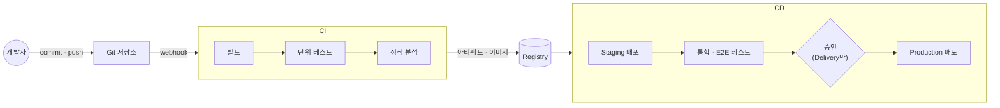

# CI/CD (Continuous Integration, Continuous Delivery/Deployment)

---

## I. 통합부터 배포까지 자동화, CI/CD의 개요

### 가. 정의

- 코드 **병합(Integration)부터 빌드·테스트·배포(Delivery/Deployment)까지를 파이프라인으로 자동화**하여 작은 변경을 자주, 안정적으로 출시하는 [[DevOps]] 핵심 프랙티스

### 나. 특징

| 구분 | 내용 |
| --- | --- |
| 등장 배경 | [[Agile]]·[[MSA (Micro Service Architecture)\|MSA]] 확산에 따른 잦은 릴리스, 수동 배포 오류 |
| 파이프라인 자동화 | 빌드-테스트-배포 단계를 연결해 사람 개입 최소화 |
| 빠른 피드백 | 커밋 직후 결함을 개발자에게 통보 (Shift-Left) |
| 품질 게이트 | 테스트·정적 분석 기준 미달 시 다음 단계 차단 |

---

## II. 파이프라인 구조 및 구성요소

### 가. CI/CD 파이프라인

- 푸시 이벤트로 CI가 빌드·테스트·분석을 수행해 아티팩트를 저장하고, CD가 스테이징 검증 후 운영에 배포

### 나. 구성요소

| 구분 | 요소 | 설명 |
| --- | --- | --- |
| [[형상 관리]] | VCS | 소스 버전 관리·협업 (Git, GitLab) |
| CI | 파이프라인 엔진 | 워크플로를 코드로 정의·실행 (Jenkins, GitHub Actions) |
| | 빌드 · 테스트 | 의존성 관리·패키징, [[단위 테스트]] (Maven, Gradle, JUnit) |
| | 정적 분석 | 버그·취약점·코드 스멜 검사, 품질 게이트 (SonarQube) |
| 저장 | 아티팩트 · 컨테이너 레지스트리 | 빌드 결과물·[[도커\|Docker]] 이미지 버전 보관 (Nexus, Harbor) |
| CD | IaC | 배포 인프라를 코드로 [[프로비저닝]] (Terraform, Ansible) |
| | 배포 · 오케스트레이션 | [[쿠버네티스]]·Argo CD 기반 [[무중단 배포]] (Blue-Green, Canary) |
| 운영 | 모니터링 | 배포 후 지표 수집·알림 (Prometheus, Grafana) |

---

## III. 비교 및 동향

### 가. Continuous Delivery vs Continuous Deployment

| 비교 항목 | Continuous Delivery (지속적 제공) | Continuous Deployment (지속적 배포) |
| --- | --- | --- |
| 개념 | 언제든 운영 배포 가능한 상태 유지 | 테스트 통과 시 운영까지 자동 배포 |
| 운영 반영 | 수동 승인 후 배포 | 사람 개입 없이 즉시 배포 |
| 테스트 의존도 | 높음 | 매우 높음 (자동 테스트가 유일한 관문) |
| 적용 예 | 금융·공공 등 승인 절차가 필요한 시스템 | 빠른 피드백이 중요한 B2C 웹 서비스 |

### 나. 동향

- Git 저장소 상태를 클러스터에 Pull 방식으로 동기화하는 GitOps(Argo CD, Flux) 확산
- [[SAST]]·SCA·[[DAST]]를 파이프라인에 내장하는 [[DevSecOps]]
- DORA 지표(배포 빈도, 리드 타임, 변경 실패율, 복구 시간)로 파이프라인 성과 측정

---

### 🔗 연관 토픽

- **소속 도메인**: [[00_소프트웨어공학_MOC|🏗️ 소프트웨어공학]]
- **세부 분류**: `1. 소프트웨어 개발 생명주기(SDLC) & 방법론`
- **핵심 연관 토픽**:
  - [[DevOps|데브옵스 (DevOps)]]
  - [[형상 관리]]
  - [[무중단 배포]]
  - [[릴리즈 엔지니어링]]
  - [[DevSecOps]]
