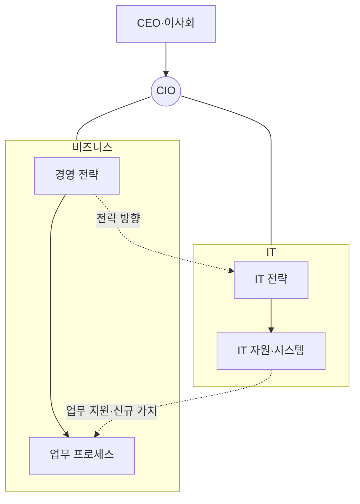

# CIO (Chief Information Officer)

---

## I. 경영과 IT를 잇는 책임자, CIO의 개요

### 가. 정의

- 경영 목표에 맞춰 **IT·디지털 전략을 수립하고 전사 IT 자원(투자·인력·시스템)을 총괄**하는 최고정보책임자

### 나. 필요성 및 특징

| 구분 | 내용 |
| --- | --- |
| 필요성 | IT가 비용 부서에서 사업 혁신 수단으로 바뀌며 IT 투자 타당성·통제 책임자 필요 |
| 전략 정렬 | 경영 전략과 IT 전략의 정렬(Business-IT Alignment) |
| 거버넌스 | [[IT 거버넌스]] 체계 수립, IT 투자·위험 관리 |
| 혁신 주도 | 클라우드·데이터·AI 도입 등 [[디지털 전환]] 추진 |

---

## II. CIO의 역할 구조 및 직무

### 가. 비즈니스–IT 정렬 구조

- CIO가 경영 전략을 IT 전략으로 번역하고, IT 자원이 업무 프로세스에 가치를 주도록 양방향 정렬을 관리

### 나. 핵심 직무

| 구분 | 요소 | 설명 |
| --- | --- | --- |
| 전략 | 정보화 전략 수립 | [[ISP (Information Strategy Plan)\|ISP]]로 중장기 정보화 계획 수립 |
| | 전사 아키텍처 (EA) | 비즈니스·데이터·애플리케이션·기술 아키텍처 청사진 관리 ([[EAO]] 협업) |
| 통제 | IT 거버넌스 | 의사결정 체계, COBIT·[[ISO 38500 2024\|ISO/IEC 38500]] 적용 |
| | IT 포트폴리오·투자 관리 | 가치 높은 과제 선별, [[IT 투자성과 평가]] |
| 운영 | IT 서비스 관리 | ITIL 기반 [[ITSM(Information Technology Service Management)\|ITSM]], [[SLA]] 관리 |
| | IT 위험·연속성 | 보안 위협·장애 대응, [[BCP]]·DR 체계 |
| 협력 | 소싱·벤더 관리 | 외주, 클라우드 사업자([[CSP]]) 계약·성과 관리 |

---

## III. 유사 임원 비교 및 동향

### 가. CIO vs CTO vs CDO

| 구분 | CIO | CTO | CDO (Chief Data/Digital Officer) |
| --- | --- | --- | --- |
| 핵심 역할 | 사내 IT 운영과 비즈니스–IT 정렬 | 제품 기술·연구개발 | 데이터 자산화, 디지털 사업 혁신 |
| 주요 대상 | 임직원, 내부 시스템·프로세스 | 외부 고객용 제품·서비스 | 데이터 조직, 신사업 |
| 성과 지표 | IT 비용 효율, 가용성, 사용자 만족 | 출시 속도, 기술 경쟁력 | 데이터 기반 매출·서비스 창출 |

### 나. 동향

- **역할 확대**: IT 운영자에서 사업 혁신·디지털 수익 모델을 주도하는 전략 임원으로 확대
- **AI 거버넌스 주도**: 생성형 AI 도입 시 사용 정책·데이터 보호·위험 관리 체계([[AI 거버넌스]]) 수립이 핵심 과제
- **CAIO 신설**: AI 전담 임원(CAIO)을 두는 조직이 늘며 CIO·CDO와의 역할 분담 필요 (미국 연방기관은 2024년 OMB 지침으로 CAIO 지정 의무화)

---

### 🔗 연관 토픽

- **소속 도메인**: [[00_경영전략_MOC|📈 경영전략]]
- **세부 분류**: `1. 경영 환경 분석 & 전략 수립 프레임워크`
- **핵심 연관 토픽**:
  - [[IT 거버넌스]]
  - [[ITSM(Information Technology Service Management)]]
  - [[ISP (Information Strategy Plan)]]
  - [[EAO]]
  - [[BCP|비즈니스 연속성 계획]]
