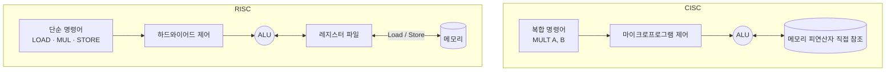

# CISC와 RISC

---

## I. 명령어 집합 설계의 두 철학, CISC와 RISC의 개요

### 가. 정의

- [[CPU]] 명령어 집합 구조(ISA)의 설계 방식으로, **복잡·다양한 명령어를 하드웨어로 처리하는 CISC**와 **단순·고정 길이 명령어로 파이프라이닝을 극대화하는 RISC**

### 나. 등장 배경 및 특징

| 구분 | 내용 |
| --- | --- |
| 등장 배경 | 메모리가 비싸던 시기 코드 크기를 줄이는 CISC 발전, 이후 메모리 가격 하락·컴파일러 발전으로 RISC 등장 (1980년대 Berkeley RISC, Stanford MIPS) |
| CISC | 가변 길이 명령어, 메모리 직접 연산, 마이크로프로그램 제어 |
| RISC | 고정 길이 명령어, Load/Store 구조, 하드와이어드 제어, 다수 범용 레지스터 |
| 현재 | 내부 구현은 수렴, ISA 호환성·전력 효율로 구분 |

---

## II. 구조 및 요소 비교

### 가. 실행 구조

- CISC는 한 명령어가 메모리 피연산자를 직접 다루고, RISC는 메모리 접근을 Load/Store로 한정해 레지스터 간 연산만 수행

### 나. 요소별 비교

| 구분 | 요소 | 설명 |
| --- | --- | --- |
| 명령어 | 길이 | CISC 가변 (x86 1~15바이트), RISC 고정 (보통 32비트) |
| | 수 · 주소 지정 | CISC 명령어·주소 지정 방식 다수, RISC 소수 |
| 메모리 접근 | 연산 방식 | CISC 메모리 직접 연산, RISC Load/Store 전용 |
| 제어 | 제어 유닛 | CISC 마이크로프로그램, RISC 하드와이어드 |
| 레지스터 | 개수 | CISC 적음, RISC 많음 (예: 32개 범용 레지스터) |
| 성능 | CPI | CISC 명령어당 여러 사이클, RISC 1 사이클 지향 |
| 부담 주체 | 복잡도 | CISC 하드웨어, RISC 컴파일러 최적화 |
| 코드 | 크기 | CISC 작음, RISC 상대적으로 큼 |

---

## III. 비교 및 동향

### 가. 종합 비교

| 비교 항목 | CISC | RISC |
| --- | --- | --- |
| 설계 철학 | 하드웨어로 고수준 연산 지원 | 단순 명령어 + 컴파일러 최적화 |
| 파이프라이닝 | 가변 길이·복잡 명령어로 어려움 | 고정 길이·단순 명령어로 용이 |
| 전력 효율 | 상대적으로 낮음 | 높음 |
| 대표 ISA | x86, x86-64 (Intel, AMD) | ARM, RISC-V, MIPS, Power |
| 주요 활용 | PC·서버 | 모바일·임베디드, Apple M 시리즈 PC, 클라우드 서버 |

### 나. 동향

- 현대 x86은 CISC 명령어를 내부에서 RISC형 마이크로 연산(μop)으로 분해해 실행 (CISC-RISC 혼합 구조)
- AWS Graviton 등 ARM 서버, Apple M 시리즈로 RISC가 PC·데이터센터까지 확대
- 개방형 ISA인 RISC-V가 임베디드·AI 가속기·차량용 반도체로 확산

---

### 🔗 연관 토픽

- **소속 도메인**: [[00_소프트웨어공학_MOC|🏗️ 소프트웨어공학]]
- **세부 분류**: `2. 애자일(Agile) & 지속적 통합/배포(CI/CD)`
- **핵심 연관 토픽**:
  - [[CPU]]
  - [[Smart Car(자율주행)]]
