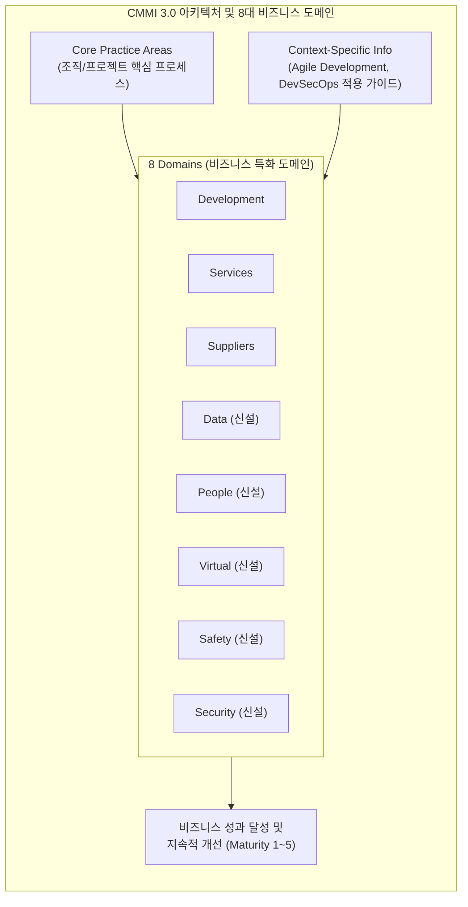

# CMMI 3.0

---

## I. 비즈니스 성과 중심의 융합 프로세스 프레임워크, CMMI 3.0의 개요

기존 소프트웨어 개발 및 서비스 중심의 CMMI V2.0을 확장하여, 데이터, 인력, 가상화(Virtual), 안전(Safety), 보안(Security) 등 총 8개 비즈니스 도메인으로 통합하고 조직의 비즈니스 성과 향상을 지원하는 ISACA의 프로세스 성숙도 평가 모델이다.

| 구분 | 주요 내용 |
| --- | --- |
| **개념** | 급변하는 디지털 환경과 최신 비즈니스 위험에 대응하기 위해 8대 특화 도메인을 모듈형으로 제공하는 프로세스 개선 및 성숙도 평가 체계 |
| **등장 배경** | 팬데믹 이후 원격 근무(Virtual) 일상화, AI 및 데이터 자산 거버넌스 중요성 증대, 글로벌 사이버 보안 및 제품 안전 컴플라이언스 강화 |
| **핵심 특징** | 8대 비즈니스 도메인 체계 확립, ML2 전 프로세스 병렬 개선 구조 개편, 애자일([[Agile]]) 및 [[DevSecOps]] 컨텍스트의 전면 수용 |

---

## II. CMMI 3.0의 아키텍처 및 핵심 구성 요소

### 가. CMMI 3.0의 아키텍처 및 도메인 확장 구조

공통 핵심 프로세스(Core PA)에 최신 IT 환경(Agile, DevSecOps) 가이드를 결합하고, 조직의 전략적 우선순위에 따라 8개 비즈니스 도메인을 유연하게 선택·적용하여 성숙도를 평가한다.

### 나. CMMI 3.0의 핵심 기술 및 구성 요소

| 분류 | 요소기술 (키워드) | 세부 설명 |
| --- | --- | --- |
| **도메인 확장** | 8대 도메인 체계 | 기존(개발, 서비스, 공급자) 영역에 Data, People, Virtual, Safety, Security 5개 영역을 신규 편입 |
| **평가 구조** | ML2 아키텍처 개편 | Maturity Level 2에서 특정 영역에 편중되지 않고 모든 영역이 CL2를 충족하도록 전방위적 개선 철학 적용 |
| **개발 방법론** | Agile Development | 기존 Scrum 중심에서 벗어나 SAFe, Kanban 등 다양한 애자일 방법론 환경에서의 실무 프로세스 지침 강화 |
| **자동화 파이프라인** | DevSecOps 통합 | 보안이 내재화된 CI/CD 파이프라인 및 인프라 코드화(IaC) 환경에서의 정량적 프로세스 통제 기준 신설 |
| **자산 거버넌스** | Data & People | 엔터프라이즈 데이터 파이프라인 품질 관리 체계 및 인적 역량 개발(Workforce Empowerment) 기준 제시 |
| **보안/위험** | Virtual & Security | 지리적으로 분산된 원격 인력 관리(Virtual)와 사이버 보안(Security), 시스템 기능안전(Safety) 관리 규정화 |
| **성과 평가** | Benchmark Appraisal | 프로세스 규정 준수 여부를 넘어 실질적 비즈니스 KPI 및 가치 창출 지표와 연계한 벤치마크 평가 고도화 |
| **도입 유연성** | 모듈형 [[테일러링]] | 조직의 비즈니스 과제(예: 보안 인증)에 맞춰 필요한 특정 도메인만 선별적으로 평가받는 테일러링 지원 |

---

## III. CMMI 2.0과 CMMI 3.0 비교 및 최신 동향

### 가. CMMI 2.0 vs CMMI 3.0 비교

| 비교 항목 | CMMI 2.0 | CMMI 3.0 |
| --- | --- | --- |
| **제정 연도/기관** | 2018년 (CMMI Institute) | **2023년 (ISACA)** |
| **적용 도메인** | 3개 영역 (Development, Services, Supplier) | **8개 영역** (기존 3개 + Data, People, Virtual, Safety, Security) |
| **ML2 평가 사상** | 프로젝트 관리(PM) 중심의 순차적 선행 평가 | **모든 PA에 대한 병렬적 성숙도(Capability Level 2) 확보 요구** |
| **특화 적용 지침** | Agile with Scrum 가이드 중심 | **Agile Development, DevSecOps 등 최신 딜리버리 환경 전면 수용** |
| **주요 목적** | 프로세스 간소화 및 성과 측정 체계 도입 | 원격 근무, 데이터/보안 리스크 대응 등 **총체적 비즈니스 거버넌스 확립** |

### 나. 최신 기술 동향 및 발전 방향

* **글로벌 규제 준수 프레임워크로 격상**: 미국 국방부 사이버보안 성숙도 인증(CMMC) 및 글로벌 의료기기 규정(FDA 등) 대응을 위해 Security 및 Safety 도메인을 결합한 CMMI 3.0 인증 채택이 확대됨.
* **AI 및 데이터 거버넌스의 전사적 기반**: Data 도메인을 활용하여 엔터프라이즈 데이터 품질을 통제하고, 생성형 AI 도입에 따른 모델 안전성과 신뢰성을 검증하는 AI 거버넌스 체계의 핵심 지표로 진화 중임.

---

### 🔗 연관 토픽

- **소속 도메인**: [[00_소프트웨어공학_MOC|🏗️ 소프트웨어공학]]
- **세부 분류**: `4. 아키텍처 스타일 & 객체지향 설계 원리`
- **핵심 연관 토픽**:
  - [[CMMI]]
  - [[테일러링]]
  - [[Agile]]
  - [[AI 거버넌스]]
  - [[프로세스]]
