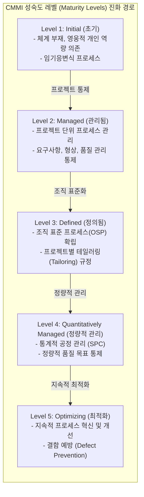

# CMMI (Capability Maturity Model Integration)

---

## I. 조직의 프로세스 성숙도 평가 모델, CMMI의 개요

소프트웨어 개발, 시스템 엔지니어링 등 조직 전반의 프로세스 개선과 성숙도 향상을 지원하기 위해 미국 카네기멜론 대학교 소프트웨어공학연구소(SEI)에서 개발하고 현재 ISACA가 관리하는 통합 프로세스 개선 및 평가 모델이다.

| 구분 | 주요 내용 |
| --- | --- |
| **개념** | 파편화되어 있던 기존 CMM 모델들을 하나로 통합하여, 조직의 비즈니스 목표 달성을 위한 최적의 엔지니어링 및 관리 프로세스 기준을 제공하는 성숙도 프레임워크 |
| **등장 배경** | SW-CMM, SE-CMM 등 개별 평가 모델 간의 중복과 충돌 해소, 다학제 융합 환경에서의 전사적 품질 개선 가이드라인 요구 |
| **핵심 특징** | 단계적 표현(Staged, 조직 전체 성숙도 5단계)과 연속적 표현(Continuous, 프로세스 역량 4단계)의 이원화된 평가 접근법 제공 |

---

## II. CMMI의 핵심 구조 및 성숙도 레벨

### 가. CMMI의 성숙도 5단계 아키텍처 (단계적 표현 방식)

개인의 역량에 의존하던 1단계에서 출발하여, 프로젝트 관리(2단계) $\rightarrow$ 전사 표준화(3단계) $\rightarrow$ 통계적 정량 관리(4단계) $\rightarrow$ 지속적 혁신(5단계)으로 프로세스 역량이 고도화된다.

### 나. CMMI의 핵심 구성 요소 및 레벨별 특징

| 분류 | 요소기술 (키워드) | 세부 설명 |
| --- | --- | --- |
| **표현 방식** | 단계적 표현 (Staged) | 조직 전체의 성숙도(Maturity Level)를 1~5단계로 평가하여 표준적인 개선 로드맵 제시 |
| **표현 방식** | 연속적 표현 (Continuous) | 특정 개별 프로세스 영역(PA)별로 역량 수준(Capability Level 0~3)을 유연하게 진단 |
| **성숙도** | Level 1 (Initial) | 프로세스가 예측 불가능하고 혼란스러움 (일정 지연 및 예산 초과 빈번, 개인 능력 의존) |
| **성숙도** | Level 2 (Managed) | 프로젝트 단위로 기본 프로세스가 계획·실행·측정·통제됨 (요구사항, 협력업체, 형상 관리) |
| **성숙도** | Level 3 (Defined) | 조직 표준 프로세스(OSP) 자산이 구축되고 프로젝트 환경에 맞춰 합리적인 [[테일러링]] 수행 |
| **성숙도** | Level 4 (Quantitatively) | 통계적 공정 관리(SPC) 기법을 활용하여 프로세스 성과와 품질을 수치 기반으로 정량 통제 |
| **성숙도** | Level 5 (Optimizing) | 정량적 피드백 분석과 신기술 도입을 바탕으로 결함을 사전에 예방하고 프로세스를 지속 혁신 |
| **프로세스 단위** | Process Area (PA) | 프로세스 개선 목표(Goal)를 달성하기 위해 조직이 수행해야 할 연관된 실무 활동(Practice)의 집합 |

---

## III. CMMI와 SPICE 비교 및 최신 동향

### 가. CMMI vs SPICE (ISO/IEC 33000) 비교

| 비교 항목 | CMMI | [[SPICE]] (ISO/IEC 15504 $\rightarrow$ 33000) |
| --- | --- | --- |
| **주관 기관** | **ISACA** (미국 국방부 / CMU SEI 기원) | **ISO / IEC JTC1 SC7** (국제표준화기구) |
| **주요 목적** | 조직의 비즈니스 가치 창출 및 종합적 프로세스 성숙도 개선 | 소프트웨어 프로세스 역량의 객관적 심사 및 평가 기준 제공 |
| **평가 차원** | 1차원 구조 (성숙도 단계 또는 프로세스 역량) | 2차원 매트릭스 (프로세스 차원 $\times$ 역량 수준 차원) |
| **레벨 체계** | Maturity Level 1 ~ 5단계 | Capability Level 0 ~ 5단계 (불완전 ~ 최적화) |
| **주요 적용처** | 미국 국방·공공 사업, 글로벌 IT 및 금융 엔터프라이즈 | 유럽 중심 다국적 기업, 자동차 산업군(A-SPICE) 필수 인증 |

### 나. 최신 기술 동향 및 발전 방향

* **CMMI V2.0 및 3.0으로의 진화**: 단순 인증 규정 준수(Compliance)에서 벗어나 실질적인 비즈니스 성과(ROI) 창출 중심으로 개편되었으며, 애자일(Scrum, SAFe) 및 DevSecOps 딜리버리 환경과의 결합이 표준화됨.
* **산업 도메인 융합 거버넌스 확장**: 최신 CMMI 3.0에서는 소프트웨어 엔지니어링을 넘어 사이버 보안(Security), 안전(Safety), 데이터(Data) 영역까지 통합 평가하는 엔터프라이즈 융합 거버넌스 체계로 안착됨.

---

### 🔗 연관 토픽

- **소속 도메인**: [[00_소프트웨어공학_MOC|🏗️ 소프트웨어공학]]
- **세부 분류**: `6. 소프트웨어 테스팅 & 품질 보증 (QA/QC)`
- **핵심 연관 토픽**:
  - [[CMMI 3.0]]
  - [[SPICE]]
  - [[테일러링]]
  - [[Agile]]
  - [[프로세스]]
