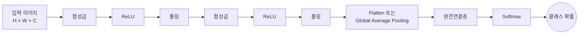

# CNN (Convolutional Neural Network)

---

## I. 공간 구조를 보는 신경망, CNN의 개요

### 가. 정의

- 합성곱 필터로 **이미지 같은 격자형 데이터의 지역 패턴을 계층적으로 추출**해 분류·탐지·분할을 수행하는 [[딥러닝]] 신경망

### 나. 등장 배경 및 특징

| 구분 | 내용 |
| --- | --- |
| 배경 | 완전연결망은 이미지를 1차원으로 펴 공간 정보 손실, 파라미터 폭증 |
| 지역 연결 | 각 뉴런이 입력의 작은 영역(수용 영역)만 봄 |
| 가중치 공유 | 같은 필터를 전체 위치에 적용해 파라미터 대폭 감소 |
| 이동 등변성 | 합성곱은 입력이 이동하면 특징 맵도 이동(등변), 풀링이 작은 이동에 대한 불변성 부여 |
| 계층적 특징 | 앞단은 경계·질감, 뒷단은 부분·객체 수준 특징 |

---

## II. 구조 및 구성요소

### 가. 아키텍처

- 합성곱·활성화·풀링을 반복해 특징 맵을 추상화하고, 분류부에서 클래스 확률 산출

### 나. 구성요소

| 구분 | 요소 | 설명 |
| --- | --- | --- |
| 특징 추출 | 합성곱 | 필터를 슬라이딩하며 곱·합 연산, 경계·질감 등 특징 맵 생성 |
| | 스트라이드 | 필터 이동 간격, 클수록 출력 크기 감소 |
| | 패딩 | 가장자리를 0 등으로 채워 크기·경계 정보 유지 |
| | 출력 크기 | $\lfloor (W - F + 2P)/S \rfloor + 1$ |
| 비선형 | ReLU | $\max(0, x)$, 시그모이드 대비 기울기 소실 완화 ([[활성화함수]]) |
| 축소 | 풀링 | Max·Average 풀링으로 해상도 축소, 작은 위치 변화에 강건 |
| 분류 | 완전연결·Softmax | 특징을 결합해 클래스 확률 출력 ([[소프트맥스 정규화]]) |
| 안정화 | [[배치 정규화]]·[[Dropout]] | 학습 안정화와 과적합 방지 |
| 대표 구조 | LeNet → AlexNet → VGG → ResNet | ResNet의 잔차 연결로 100층 이상 학습 가능 |

---

## III. 비교 및 동향

### 가. CNN vs ViT

| 비교 항목 | CNN | ViT (Vision Transformer) |
| --- | --- | --- |
| 핵심 연산 | 합성곱, 지역 특징 | 패치 간 Self-Attention, 전역 관계 |
| 유도 편향 | 강함 (지역성, 이동 등변성) | 약함 |
| 데이터 요구 | 중소 규모에서도 학습 잘 됨 | 대규모 사전학습 필요 (또는 강한 증강) |
| 연산 | 해상도에 선형, 엣지에 적합 | 패치 수의 제곱 $O(N^2)$ |
| 대표 | ResNet, EfficientNet, ConvNeXt | ViT, Swin Transformer, DeiT |

### 나. 동향

- **ConvNeXt**: 패치화 스템, 큰 커널, Inverted Bottleneck, GELU·LayerNorm 등 Transformer 설계를 도입한 순수 CNN이 ViT급 성능 달성
- **하이브리드·경량화**: CNN 초기층 + Transformer 결합, MobileNet·EfficientNet 계열로 엣지·모바일 실시간 추론 ([[온디바이스 AI]])
- **효율적 확장**: 깊이·너비·해상도를 함께 키우는 [[Compound Scaling]]

---

### 🔗 연관 토픽

- **소속 도메인**: [[00_인공지능_MOC|🤖 인공지능]]
- **세부 분류**: `1. 수학 · 통계학 & 데이터 전처리`
- **핵심 연관 토픽**:
  - [[딥러닝]]
  - [[Atros Convolution]]
  - [[Compound Scaling]]
  - [[이미지넷]]
  - [[트랜스포머|트랜스포머(Transformer)]]
