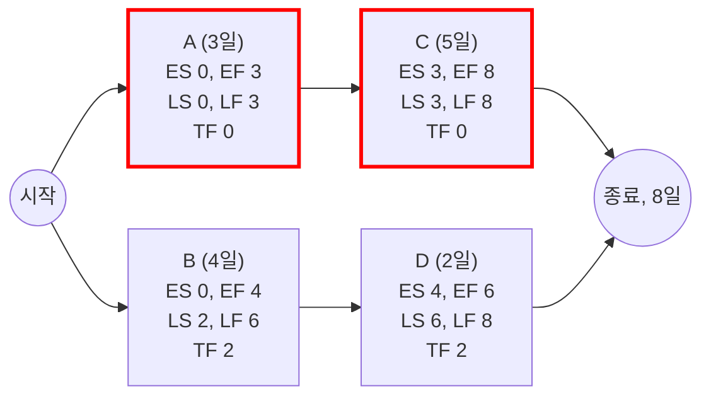

# CPM (Critical Path Method, 주공정법)

---

## I. 가장 긴 경로가 일정을 결정한다, CPM의 개요

### 가. 정의

- 활동 간 의존관계와 기간으로 네트워크를 구성해 **여유가 없는 최장 경로(주공정)** 와 프로젝트 **최단 완료 기간**을 산출하는 결정론적 일정 분석 기법 (1957년 DuPont·Remington Rand 개발)

### 나. 필요성 및 특징

| 구분 | 내용 |
| --- | --- |
| 집중 관리 대상 식별 | 지연되면 프로젝트 전체가 지연되는 주공정 활동 파악 |
| 단일 추정 | 활동 기간을 하나의 값으로 추정 (결정론적) |
| 여유 관리 | 총 여유·자유 여유로 비주공정 활동의 지연 허용폭 파악 |
| 단축 기준 | 크래싱·패스트 트래킹은 주공정에 적용 |
| 한계 | 자원 제약 미반영 → [[자원 최적화]], [[CCM]]으로 보완 |

---

## II. 계산 원리와 구성요소

### 가. 개념도

- 전진 계산(Forward Pass)으로 ES·EF, 후진 계산(Backward Pass)으로 LS·LF를 구하고, 총 여유가 0인 A→C(8일)가 주공정. B의 자유 여유는 0, D의 자유 여유는 2

### 나. 구성요소

| 구분 | 요소 | 설명 |
| --- | --- | --- |
| 일정 계산 | 전진 계산 | 시작에서 ES·EF 산출, EF = ES + 기간, 합류점은 선행 EF 최댓값 |
| | 후진 계산 | 종료에서 LF·LS 역산, LS = LF − 기간, 분기점은 후행 LS 최솟값 |
| 일정 지표 | ES / EF | 가장 빠른 시작·종료 |
| | LS / LF | 가장 늦은 시작·종료 |
| 여유 | 총 여유 (Total Float) | 프로젝트 완료일을 늦추지 않는 지연 허용 시간, LS − ES |
| | 자유 여유 (Free Float) | 후속 활동의 ES를 늦추지 않는 지연 허용 시간 |
| 경로 | 주공정 (Critical Path) | 총 여유가 0인 최장 경로, 복수 존재 가능 |
| 표기 | PDM (AON) | 노드에 활동, FS·SS·FF·SF 관계 표현 |
| 단축 | 크래싱, 패스트 트래킹 | 주공정 활동에 적용 ([[일정단축 기법]]) |

---

## III. 비교 및 동향

### 가. CPM vs PERT

| 비교 항목 | CPM | PERT |
| --- | --- | --- |
| 기원 | DuPont 등 (1957), 공장 정비 | 미 해군 폴라리스 계획 (1958) |
| 기간 추정 | 1점, 결정론적 | 3점 (낙관·최빈·비관), 확률적 ([[3점 산정]]) |
| 관리 초점 | 시간-비용 교환, 최소 비용 단축 | 완료 확률, 불확실성 |
| 적용 대상 | 경험·데이터가 충분한 건설·제조 | 선례가 적은 R&D |
| 표기 | 주로 AON (PDM) | 전통적으로 AOA |

### 나. 동향

- **CCPM 결합**: 자원 제약과 버퍼를 반영한 [[CCM]]으로 보완
- **확률적 CPM**: 몬테카를로 시뮬레이션으로 경로별 지연 확률·준주공정 식별
- **하이브리드**: 마스터 일정은 CPM, 세부 개발은 [[SCRUM|스크럼]] 타임박스

---

### 🔗 연관 토픽

- **소속 도메인**: [[00_프로젝트관리_MOC|📋 프로젝트관리]]
- **세부 분류**: `2. 프로젝트 범위 & 일정 관리 (Scope & Schedule)`
- **핵심 연관 토픽**:
  - [[프로젝트 일정관리|프로젝트 일정관리(Project Schedule Management)에 대하여 설명하시오]]
  - [[CCM|CCM (Critical Chain Management)]]
  - [[3점 산정]]
  - [[일정단축 기법]]
  - [[자원 최적화]]
